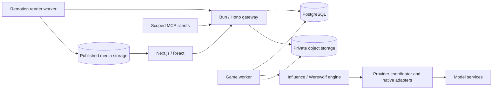

# The House architecture

The House hosts Influence and Werewolf on shared identity, model routing, persistence, playback and production infrastructure. Each game owns its rules, accepted decisions and outcomes. Models author character choices and House narration; the runtime validates exact structured responses before committing facts. Transcript prose is presentation, never a source from which to reconstruct game authority.

## Runtime and storage

The gateway serves HTTP commands, reads, WebSockets and scoped MCP tools. It does not advance durable games. Game workers run the same API image with a different service role and claim renewable ownership leases. Influence commits an XState frontier and logical turns; Werewolf commits its versioned event cursor and frozen action/observation plans. Accepted provider calls replay from the journal during ordinary process recovery. This is not a promise of recovery from corrupt durable records. See [runtime continuity](statefulness-plan.md) and [worker operations](deployment/game-worker-operations.md).

PostgreSQL owns canonical events, relational records, permissions, ownership, indexed metadata and small transactional state. S3-compatible buckets own binaries and large immutable documents, including frozen context, provider evidence, recovery snapshots and render inputs. Database references carry hashes, lengths and versions; readers verify integrity. Private evidence and public media use separate access boundaries. Local private storage uses MinIO. Existing-data migration requires the coordinated [whole-storage cutover](deployment/private-payload-storage-cutover.md), not a new-writes-only rollout.

## Decisions, context and evidence

- **Exact model contracts.** State-affecting turns use provider-native strict JSON schemas and semantic validation within the provider attempt. Invalid output follows typed retry, legal fallback or explicit failure paths.
- **Frozen model routing.** Characters, contestants and the House use catalog-backed routes. Each game seals provider choices and bounded fallback allowances. Native OpenAI, xAI, Anthropic and Meta adapters coexist with Katana and best-effort local compatible routes. See [routing](model-routing.md), [xAI](native-xai.md) and [Anthropic](native-anthropic.md).
- **Actor-scoped context.** Recall plans combine protected current state, private strategy, attended huddles and authorized history. House narration can use private producer context, but that context and its narrative notebook never enter contestant prompts. See [observability](reasoning-transcript-observability.md) and [context evaluation](prompt-thread-context-evaluation.md).
- **Durable evidence.** Preserve sanitized requests/responses, accepted thinking, available native reasoning, retries, failures and usage. API games retain game IDs and private journal evidence; offline simulations produce local JSONL artifacts without creating API games. Paid evaluation uses the [localhost API](local-model-evaluation.md).
- **Canonical presentation.** Replay, ballot reveals, standings and postgame read models derive from accepted events. Elimination commits before an exit speech. Viewer reveal timing does not expand contestant knowledge. Derived analysis is distinct from accepted game facts.

## Identity and access

Durable House accounts resolve Privy and managed Clerk credentials through provider-neutral identity. MCP separates `agents:read`, `agents:write`, `games:read` and producer permissions; privileged reads also require current roles. Public/unlisted spectator access does not grant owner learning, private provider evidence or production access. See [authentication](authentication/layered-identity-rollout.md), [MCP/OAuth](game-mcp-production-oauth.md) and [game visibility](game-guide.md#visibility-and-sharing).

## Production

Live replay, Studio and frozen exports share canonical source coordinates and game-owned presentation. Visual Mode generates scenes for API games; Audio Mode binds recordings to frozen delivery inputs. House Highlights rendering runs separately from game execution. See [Visual Mode](visual-mode.md), [Audio Mode](audio-mode.md), [Studio](production-studio.md) and the [render-worker contract](deployment/house-highlights-render-worker.md).

## Repository map

| Location | Responsibility |
| --- | --- |
| `packages/engine` | Influence orchestration, Werewolf rules/reducer, model adapters, canonical projections, simulation CLIs and local game MCP |
| `packages/api` | Hono gateway and game-worker roles, auth, PostgreSQL schema/migrations, storage, durable lifecycle, public and producer endpoints |
| `packages/web` | Next.js UI, shared watch player, Studio, Remotion compositions and render-worker entrypoints |
| `packages/prompt-lab-protocol` | Shared prompt-lab contracts |
| `packages/made-for-video` | Experimental private video-study tooling; see its [README](../packages/made-for-video/README.md) |
| `docs/` | Product/runtime guides, deployment runbooks, evaluation evidence, plans and solution learnings |
| `Dockerfile.api`, `Dockerfile.web`, `Dockerfile.render-worker` | Service images; gateway and game workers share the API image |
| `.github/workflows/` | CI, build/deploy hooks and environment verification |

For installation and classified test commands, use [development and operations](development-and-operations.md). Staging and production acceptance are separate from local validation; production requires the deployment approval gate.
