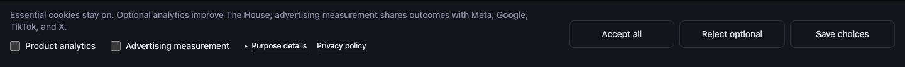
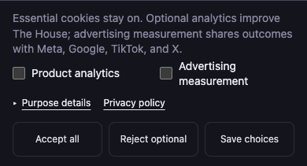

# Tracking preferences: rendered design evidence

These screenshots render the actual preference component with repository CSS in
an isolated browser preview. They are not deployed-site screenshots.

Desktop (1440 × 900 viewport; 108 px collapsed banner):

Mobile (390 × 844 viewport; 211 px collapsed banner):

Browser checks covered eleven viewport/state combinations: desktop US/non-US,
1024 px laptop, 390/320 px mobile, 667 × 375 landscape, 320 × 284 reduced viewport,
2560 px desktop, desktop/mobile inline Privacy controls, and GPC-disabled controls.
Collapsed and expanded layouts had no horizontal overflow, and banner actions
remained accessible. Keyboard selection, disclosure, focus entry/return, and
unsaved-preference error feedback were also verified.

The Privacy page uses stacked controls within its prose column. The banner's
wide action column does not apply to that surface. All three actions have equal
visual weight. The settings UI is outside the player picture; no game, Studio,
or export content changed.
