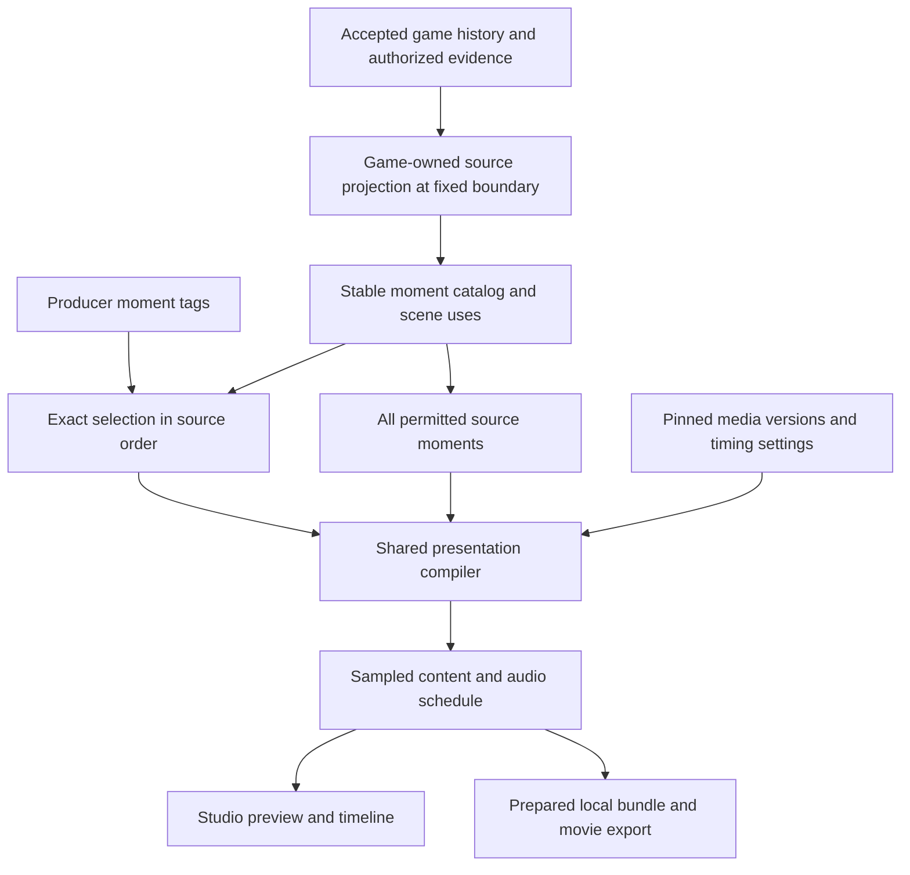

# Production Studio A2.1/A2.2 — moment editor

Build a working video-production workspace for Influence and Werewolf: timeline, playhead, playable preview, scene repair, independent moment tags and a selected local video export. The producer decides which moments tell the story by watching the edit. Narrative continuity analysis, automatic context insertion and mandatory retention of game outcomes are outside this work.

This is the technical planning pass for the [studio scope](../ideation/2026-09-30-production-studio-brainstorm.md) and [House pillar](../ideation/2026-09-30-house-admin-and-production.md#a2--production-studio). Research inspected `codex/exporter-production` at `8a1f4975`. Findings describe that checkout, not deployed behavior. No implementation, provider calls or operator UX approval have occurred as part of this plan.

## Delivery boundary

A2.1/A2.2 is accepted only when the operator can open either game, repeatedly seek through its source, repair a scene, independently tag thinking and speech, watch the exact shortened cut and export it through the existing local exporter. A static inspector plus a CLI command is insufficient. Internal increments leave existing production and full exports working until their replacement is ready.

Include completed games and the existing supported suspended visual-repair entry points. A suspended game's preview uses a fixed accepted history prefix; refresh explicitly advances that prefix. Full-video export remains completed-game only. General live editing, hosted full-game render jobs, arbitrary clip reordering, a persistent multi-cut project model, speech generation, soundtrack authoring and crowdsourcing are outside A2.1/A2.2.

This delivery explicitly includes both A2.1 and A2.2. A2.1 owns shared production contracts, discovery, repair and recovery; A2.2 owns the timeline, playable source/cut preview, moment editing and selected export. The ST-01–15 tasks implement them together, with shared early design gates and end-to-end acceptance. Unpublished-candidate playback and richer scene-use navigation remain deferred refinements. A2.3 remains the separate cross-game job overview.

## Research findings that change the task order

| Finding | Evidence in this checkout | Required early work |
| --- | --- | --- |
| Export cues combine thinking and speech; timing nests thinking inside speech | Web `lib/replay-export/cues.ts`, `timing.ts` | Introduce independently selectable moments before adding tag UI. Filtering today's cue array cannot meet the requirement. |
| Werewolf cursors depend on audience; multiple accepted thoughts can share cursor and actor | Engine `werewolf/watch.ts`, `thinking.ts`; API `services/werewolf-thinking.ts` | Preserve canonical provenance in a producer-only projection. Stop joining separate thoughts for editorial identity. |
| Influence has both transcript-backed and event-backed presentation | Web `influence-replay-cues.ts`, `format-presentation-model.ts` | Support both typed source identities. Keep the existing classic parser frozen. |
| A stored scene may serve several canonical uses; some required work has no scene row | API `werewolf-production.ts`, `visual-replay-production.ts` | Distinguish scene use, stored scene, version and form-only work. |
| Existing boundary numbers mean different things across games | Same inventory services | Use game-owned typed coordinates; don't make `boundarySequence`, `roomId` or replay cursor a universal identity. |
| Influence's suspended recovery differs from Werewolf's published-repair validation | API `visual-repair.ts`, `visual-policy.ts`, `werewolf-visual-policy.ts` | Inventory operations and preserve Influence asset repair/finals rebuild before removing old UI. |
| Library omits suspended Influence; large inventories read whole histories and sometimes binary references | API `visual-replay-production.ts`, `visual-media-repair.ts`, `werewolf-production.ts` | Add bounded summary/detail reads and metadata-only inventory before connecting polling. |
| Source loader accepts completed games only | Web `lib/replay-export/source.ts` | Separate completed export validation from fixed-prefix studio preview. |
| The deterministic renderer already samples pictures, focus, layouts and audio | Web `remotion/house-replay/frame.tsx`, `components/watch/sampled-stage.tsx`, export `audio.ts` | Reuse the compiler and composition; do not mount the public timer-based director as the export-equivalent preview. |
| Admin, producer and media-management permissions differ | API routes `visual-replay-production.ts`, `visual.ts`, `episodes.ts` | Preserve action-specific authority; discovery must not accidentally grant private evidence or paid generation. |

Paths in the table are relative to `packages/engine/src`, `packages/api/src` or `packages/web/src` as labeled. The tasks below assign concrete owners and proof to these findings.

## Architecture and ownership



Full authorized source reduction happens **before** editorial filtering. Selected moments retain the actual roster, tally, eligibility and state at their source positions even if earlier visible moments are excluded. Technical context can load without becoming extra movie content. Private evidence must still be excluded by audience at projection and serialization boundaries.

Use concrete functions and discriminated unions for the two existing games. Do not add a plugin registry, a second reducer, a universal production state machine or a new scheduler. A future game supplies source projection, moment/scene-use mapping, presentation payloads and recovery actions; it reuses tag storage, selection, timing, media lifecycle and studio controls.

| Owner | Responsibility | Must not own |
| --- | --- | --- |
| Game projection in engine/API | Accepted facts, source identity, audience filtering, game-specific scene uses and recovery validation | Producer selection, browser time, editable gameplay facts |
| Small shared contract modules | Typed provenance, stable key construction, semantic part validation and production DTOs | Database access, React, provider calls |
| API production services | Authorized snapshots, tags, bounded reads, command validation and existing job/publication lifecycle | Frame animation, transcript parsing for facts |
| Web presentation modules | Catalog presentation expansion, exact selection, contiguous timing, sampled pictures and audio schedule | Database authority, a second interpretation of game outcomes |
| Studio host | Transport input, selection/inspector state, drafts, preview and local-export handoff | Independent timing rules or optimistic publication |
| Local export preparation | Resolve authorized inputs, freeze layouts/media/selection, validate and render a bundle | Re-evaluate tags while rendering or silently fetch newer publications |

Place pure source-reference/key contracts and the catalog assembler in a small explicit engine subpath, following existing `werewolf/watch-contract` and `visual-scene-plan` exports. Extract source/semantic-part eligibility from current web cue builders so the API and browser use one assembler, not just a common string encoder. Keep visual payload construction in web. The grandfathered classic parser stays frozen at its existing path: it may supply existing display interpretation inside a transcript-backed moment, but the API must not import it to infer authority. Where a classic subpart cannot be identified from structured provenance, keep it internal to its stable transcript moment rather than inventing an independently taggable fact. ST-02 must prove this extraction before storage validates submitted moments.

Keep production storage and permissions in API. Keep the browser-safe compiler near the existing web presentation/export modules, separating it from filesystem, network and Remotion-host code. Do not create a new workspace package for these types or move everything into `made-for-video`, which is a separate producer-script workflow.

### Scene use and media contracts

A **scene use** is a game's requirement for visual staging at an accepted source point. A **scene** is the persisted media object with versions and publication. Multiple uses may reference one scene. A **moment** references its source and zero or more scene uses. A required wolf form with no scene is a repair work item, not a fabricated scene or moment.

The shared read model needs: stable use key, typed game coordinate, display purpose/location, participant IDs, optional scene ID, selected/published version IDs, coverage summary and supported actions with current blockers. Do not expose Werewolf's internal reuse of an Influence room ID as a product location. Keep existing persisted generation plans intact; the DTO boundary can clarify semantics without migrating every plan.

Game-owned plan preparation feeds the existing House media worker. Initial generation and regeneration must use the same staging decisions and references. Extract actual duplicated command decoding/review handling; don't force distinct Influence recovery into Werewolf's lifecycle.

### Stable editorial moments

Identity is scoped to a game and derived from a validated source reference plus a semantic part. It is independent of audience-local cursor, array position, text, timing, pagination, image URL and media revision. Response identity is provenance, never the sole selection unit.

| Source | Example semantic parts | Contract |
| --- | --- | --- |
| Influence transcript row ID | `speech`, `thinking` | Use durable row identity even where historical entry sequence is absent. Source ordering remains separate. |
| Influence canonical event sequence | Existing format stage plus participant discriminator | Ballots use voter identity, not sorted display position. Do not infer facts from prose. |
| Werewolf accepted-action event sequence | `thinking`, supported action presentation | Preserve each accepted action separately, including actions released at the same viewer cursor. |
| Werewolf canonical visible/resolution event | `speech`, `ballot:<voter>`, `tally`, `outcome`, supported night-action parts | Each emitted part has explicit ownership; no duplicated thought under action and resolution identities. |
| Authored game opening | `opening` | One selectable opening containing its linked House/title/cast shots and score. |

The table specifies source namespaces, not arbitrary client-authored part strings. ST-01 inventories the finite currently supported parts and ST-02 validates them. Keys may be opaque encoded strings; the API resolves them against the supported catalog rather than treating a decoded client key as permission or authority. Existing `WerewolfWatchMoment` is a projected source row, not this editorial unit; use a distinct `ProductionMoment` name rather than silently changing its meaning.

Preserve source provenance on a **producer-only** path. Raw private event sequence gaps must not leak into public/Mystery watch DTOs merely to support tags. A permitted public speech keeps one tag identity across audience views. Mystery catalog/selection contains no thinking or private nighttime decisions; hand-crafted private IDs are rejected. Permission to inspect production does not override the selected export audience.

Each thought is one editorial moment, including its camera entrance, reading pages, fade and return. Speech from the same response is separate. Each individual ballot and its completed tally must remain separate navigable/selectable moments. Transformation and hunt/action/outcome ownership must be explicit in the catalog. Already-authored House bridges are selectable presentation, not newly generated bridges automatically inserted into a cut. Missing thought evidence does not create an empty moment.

Ordering is deterministic and game-owned: a canonical presentation anchor plus semantic order within that anchor. Preserve existing delivery/reveal ordering, especially withheld ballot/night thoughts; the earlier accepted-action sequence supplies identity, not permission to reveal it earlier. Duplicate or ambiguous identities fail with source diagnostics before tags can be written.

### Tags and concurrency

Add one table for annotated moments only:

```text
production_moment_annotations
  game_id              FK games
  moment_key           stable validated key
  tags                 JSONB flat string -> string map
  revision             positive integer
  updated_by           actor identity using existing user FK conventions
  updated_at           timestamp
  PRIMARY KEY (game_id, moment_key)
```

No rows for the complete catalog, no response-wide inherited tags, no canonical snapshots in this table and no revision-history subsystem. Retain an empty tag row with an incremented revision after removing all tags, preventing stale edits from recreating an earlier revision.

Replace one map using `{expectedRevision, tags}`. An absent row expects revision zero; compare-and-swap update/insert prevents lost updates. A conflict returns 409 and the current authorized map/revision; keep the operator's draft for comparison and explicit retry. Lost-response handling reads current state before resubmission. The small full-map operation does not need another job/receipt system.

Proposed initial limits: 32 pairs per moment, keys of 1–64 ASCII letters/digits/underscore/hyphen/dot, values up to 256 UTF-8 bytes and total encoded map up to 8 KiB. Reject empty values, reserved prototype keys, nested values, arrays and unknown request fields; values and exact matching are case-sensitive and are not silently trimmed or coerced. Render tags as escaped text, never instructions. Validate limits consistently in UI, API and bundle selection decoder.

Load tags and resolve a requested selection from a single consistent database snapshot. A single query can read the bounded annotations for one game; if paging is needed, do not assemble a frozen export across independent changing snapshots. Snapshot ordered IDs, tag values/revisions and source/media revisions into the export descriptor. No game-wide mutable cut document or global annotation counter is required initially.

### Selection and source/cut time

Two explicit selection modes:

- **Full:** preserve the current full-export content-selection policy and thinking preference. Existing speech, game outcomes, authored material and eligible thoughts retain their source order. Adding a catalog entry does not automatically add it to a default movie: newly exposed decision thoughts are selectable in producer-tagged cuts, while the full-selection function retains its existing scope. There is one catalog/compiler, with full and tagged selection functions, not an old/new renderer. Thinking-off timing/pictures must remain stable; any duration change from separating previously joined thoughts must be recorded explicitly in thinking-on fixtures and exporter docs. Public replay behavior is unchanged.
- **Tagged:** a nonempty flat exact predicate such as `cut=youtube`; all supplied pairs must match. Keep matching moments in source order. Thinking is allowed only when its existing visibility option and audience permit it. If thinking is off, the UI shows that matched thoughts are excluded by that option.

Whole opening and ending/result inclusion are explicit controls in tagged mode. Do not append either automatically. The opening is atomic for A2.1/A2.2; ending is the game's supported result presentation with its existing score behavior, not an arbitrary invented outro. These controls select catalog items explicitly and deduplicate them if already matched. The design gate establishes their presentation. Zero selected moments means an empty cut with no render action.

A `CompiledPresentation` includes ordered moment IDs, their internal render segments, start/end frames, source positions, selected predecessor context and one audio schedule. The source view and cut view use the same compiler with different selected sets. No separate cut-specific rules about reading speed or camera duration.

Canonical state follows source history; camera handoffs follow selected presentation neighbors. A thought-only cut must never flash its omitted sibling speech. Give actor/scene context its own fields instead of relying on a retained speech payload. Omitted moments contribute no duration, captions, voice, ducking or automatic transition beat. Technical entrance/return within a selected moment remains part of that moment.

The playhead is a frame in the current compiled view. Store navigation anchors as moment ID plus local offset, not array index. After an edit, pause, retain a surviving moment and clamp its offset; otherwise select the next surviving moment in source order, then the previous if there is no next. Empty selection clears the cut preview. Switching source/cut uses the same rule and makes a moved anchor visible. Changing audience clears unauthorized selections, drafts, cached text/media and pending preview work.

Timing overrides target stable moment IDs or documented internal presentation segments. Reject unresolved overrides explicitly; never silently apply them to the next index. Keep existing reading rates, gaps, ballot/tally holds and motion/reduced-motion contracts. These are presentation settings, not gameplay timing changes.

### Preview and export use the same presentation

Use the existing sampled frame/content and pure `sampleTiming`, `audioGain` and clip placement. The public watch directors intentionally use timers and ambient audio behavior; importing them as the studio preview would preserve two incompatible clocks. Public transport migration remains separately tracked.

Use `@remotion/player` as the default studio host, at the exact same version as Remotion/renderer. Version `4.0.486` is already installed transitively in this checkout, but web does not declare it directly; add that direct dependency during implementation. Local types expose `seekTo`, frame events, play/pause, mute, volume and buffering. Local `OffthreadVideo` uses browser preview video outside rendering, so the opening does not require a second video renderer.

ST-04 proves that choice before building transport. The timeline calls Player's `seekTo`; Player's frame events update the playhead, with no second running timer. Use custom studio controls. Keep filesystem URL localization, preparation artifacts and render-only readiness in the export host; common content receives explicit resolved assets and frozen layout inputs. Use Player buffering for browser image/font/layout readiness rather than treating `delayRender` as a browser playback barrier. Keep the existing `Audio`/`Sequence` schedule in the shared composition.

If that proof fails a specific requirement, document it and choose a thin browser host over the same sampled content and audio schedule; do not build both production hosts or an extensible host registry. Decide once before ST-10. Avoid hand-building an audio/video scheduler unless the existing library cannot satisfy the proof. This is a bounded dependency decision, not a new renderer project.

Preview at an explicit target aspect ratio/resolution, scaled to the editor viewport. Resizing the editor must not change export text pagination. Freeze measured typography/pages against target geometry using the existing measurement contract. Until measurement and required media are ready, show an explicit loading/error state rather than calling a different wrapping or camera pose an exact preview. A selected still comparison is clearly separate from playable source/cut preview.

For an edited cut, rebuild audio from selected chronology. Retain score envelopes, opening effects and voice alignment; seek into the correct clip offsets and stop replaced audio on seek, pause, audience change, cut replacement and unmount. Browser autoplay refusal leaves a usable paused preview with an explicit play action. Mute and volume remain top-level controls. Actual recorded speech is supported through existing attachments; thinking is not automatically voiced.

Validate a speech attachment against the complete permitted speech catalog first. Known omitted recordings are ignored and not cached in the selected bundle; unknown or mismatched message/speaker/text references still fail. Do not weaken integrity checks merely because the edit dropped a cue.

For recorded-speech parity, use a minimal local import of the existing speech manifest plus its audio files into studio memory; object URLs are session-local and revoked on replacement/unmount. The descriptor records validated IDs, hashes, measured duration and alignment, not object URLs or host paths. The CLI requires the corresponding local attachments and verifies their hashes. No server upload, voice library, recording editor or speech generation is introduced. Without that import, preview/descriptor explicitly contain no recorded speech; the CLI cannot silently add recordings to a frozen selection.

### Source snapshot and bounded reads

Pin game identity/kind, audience, accepted event/transcript prefix, projection-contract version and current publication/version selections. The boundary is a typed record, not one integer reused across games. Validate every page against that boundary; a browser generation token discards stale responses after game/audience/snapshot changes. Completed export loading retains existing completeness checks. Suspended preview validates its accepted prefix and never includes pending model work; publishing a repaired scene does not advance game history or resume gameplay.

After publication offer **Refresh published visuals**: pause, fetch a new authorized publication map, preserve the canonical source prefix and selected moments, remeasure/recompile affected content and mark the selection descriptor changed. Do not silently swap images in a pinned preview. The action updates every use of a shared scene consistently; already prepared bundles remain unchanged. Refreshing accepted gameplay history is a separate explicit operation.

Bound network reads separately from compilation. Build one complete authorized source snapshot for the chosen prefix, index it once, then select/sample in memory. Initial loading is explicit and can show progress. Do not re-fetch a thought per frame, reduce the entire source on every pointer move, or fetch the cast's binary files with library polling. Batch/index existing evidence and remove repeated prefix scans exposed by this extraction. A full transport rewrite and persistent checkpoint system are not prerequisites; profile before adding either.

Proposed contracts, under the existing admin production route family:

| Read/command | Shape and boundary |
| --- | --- |
| Library | Cursor page of 25 game summaries; max 100. Kind/status/search/attention filters, status and actual action availability; no transcript, cast binaries or full jobs. |
| Selected-game inventory | Scene-use/repair-work summaries, published/version IDs and source snapshot descriptor. Include both validated pause types. |
| Source/catalog pages | Snapshot-bound, bounded pages of permitted provenance and presentation inputs. Detail/thinking only for an authorized requested snapshot; no raw provider request/reasoning. |
| Selected scene/version | Exact version/panels, coverage and scoped recent job/version history; paginate additional history. No implicit latest-version substitution. |
| Selected evidence/artifact | Authorized on-demand receipt or bytes; no embedded binary assets in inventory refreshes. |
| Moment annotations | Bounded reads; conditional single-moment PUT under `/games/:id/moments/:key/annotations`. |
| Resolve selection | Read-only POST under `/games/:id/selection`: validate fixed boundary/audience, exact predicate and explicit opening/ending choices; return resolved IDs, annotation revisions and descriptor hash. No render job or paid work. |

The identity/catalog rules used by API validation and web compilation must be shared pure code, not a second independently maintained enumeration. Browser-only presentation expansion can add internal segments, not invent taggable identities unknown to the API. Public watch DTOs remain separate audience projections. An unresolved or unsupported source fails clearly rather than losing tags silently.

### Permissions, ownership and recovery

| Capability | Initial policy |
| --- | --- |
| Game/library discovery | Minimal metadata under the caller's existing admin/production grants; neither a private-evidence grant nor permission to edit |
| New moment catalog, annotations, selected-export descriptor | Existing Producer/Sysop production policy plus game access and selected audience; tagging does not grant paid operations |
| Replay image inspection and mutation | Existing Producer/Sysop policy and domain state validation |
| Existing Influence visual inspection/media/recovery | Preserve `view_admin` reads and `start_game` actions, including its existing review/regenerate/verify/harmonize/continue/publish commands and asset/finals recovery, in the game-scoped service |
| Werewolf policy/resume | Existing production policy plus `start_game` and canonical pause validation |
| Episode read/edit | Preserve current `view_admin`/`manage_roles` reads and `manage_postgame_media`/`manage_roles` edits |

Capabilities in DTOs drive available tools; the server enforces them again at the operation boundary. Domain blockers are actionable state, not feature flags. Do not widen role grants to fix missing library links. New role policy requires an explicit product decision.

The existing `/api/admin/production/*` middleware is Producer/Sysop-only. New minimal discovery reads therefore need endpoint-specific authorization; do not simply widen that wildcard guard and expose private detail routes. Preserve the distinct existing Influence media authority when routing shared inspector commands, without extending it to Werewolf or new editorial reads. Test producer-only, admin with `start_game`, admin read-only and denied users independently.

Reuse `AdminSession` and its query ownership, auth generation fences and exact-body unknown-request retry. Selection/inspector components do not own mutations that die when their panel unmounts. Keep tag drafts keyed by game/moment with revision; keep paid media operations keyed by their existing request IDs. Late receipts must match the current operation, game and auth generation. Revocation clears inaccessible data and stops preview/audio.

Reuse immutable media plans/jobs/versions, publication guards and receipts. Regenerate a bad image directly; uncertain paid outcomes require the existing exact-attempt acknowledgement for a fresh request. Rejection is not a refund or a successful reconciliation. Publish and explicit resume are separate. Influence `repair_assets`/finals `rebuild` remain game-owned actions; replace their UI only when tested equivalents exist in the studio. Existing episode/trailer/poster/batch naming tools receive a home without changing automatic publication policy.

### Local-export handoff and frozen output

Studio resolves a selection and downloads a small versioned descriptor, suitable for a new `replay:export --selection <file>` input. It contains game/audience, fixed source boundary, exact ordered IDs, predicate/annotation revisions and pinned published media versions. Freeze the complete presentation configuration: width/height/FPS, motion mode, thinking visibility, timing/overrides, music enablement/volume, opening/episode copy and authored-asset revision, plus imported speech identities/content hashes/alignment. Hash this content/configuration with the selection. Reject conflicting CLI presentation overrides for this input; changing them requires a newly prepared selection.

The descriptor contains no credentials, signed URLs, raw reasoning or arbitrary filesystem/network instructions. The CLI reauthorizes access, validates the descriptor against that exact source/catalog, and resolves those pinned versions. It does not re-run current tags, require their revisions or predicate membership to remain unchanged, or silently substitute newer media/copy. Invalid or unavailable pinned inputs fail with a re-prepare instruction.

The existing local preparation stage then freezes the actual selected content, required state, measured layouts, audio and cached asset hashes. Only after preparation is the artifact a self-contained replay bundle. Later tags or publications do not change it. Show a descriptor/selection hash in the studio and distinguish a changed edit from a previously prepared selection; don't claim to monitor local rendering from the website.

Bump the manifest schema for the new moment/segment relationship. Reject obsolete bundles with an actionable re-prepare message; no compatibility interpretation of new semantics under version 1. Keep normal full exports, overwrite safety, atomic movie promotion and validation working. Range selection applies to the compiled selected timeline and cannot resurrect omitted content. The final serialized cut contains no omitted speech/thinking text, captions, raw private source history or unrelated tag data, even though source reduction used that history internally.

## Dependency-ordered work

The task IDs below are implementation units, not claims of completion. ST-01–07 are deliberate early work. Each unit has a proof boundary before dependent UI work; fixture and compiler changes can land without removing the old workspace.

```text
ST-01 contract / simplification inventory
  ├─ ST-02 provenance + catalog + pure selection
  │    ├─ ST-03 independent moments ─ ST-07 shared compilation
  │    └─ ST-05 tag storage + selection snapshot
  ├─ ST-04 preview host proof
  └─ ST-06 bounded reads + capabilities
ST-08 operator prototype gate (uses ST-01–04 contracts/fixtures; parallel with ST-05–07)
ST-09 workspace shell (after ST-06 + gate)
  ├─ ST-10 timeline/preview (after ST-04 + ST-07)
  ├─ ST-11 moment tools (after ST-05 + ST-07)
  └─ ST-12 scene/recovery tools
ST-13 export handoff (after ST-05 + ST-07; integrated with ST-10/11)
ST-14 regression proof + operator acceptance
ST-15 cutover / deletion + final consistency review
```

### ST-01 — Contract inventory and simplification dispositions

**Owns:** a focused architecture review record and canonical fixture inventory; relevant current guidance in `CONCEPTS.md`, production docs and solutions.

Enumerate supported editorial moments, source namespaces/ordering, scene uses, form-only work, all recovery operations and per-action permissions. Map current public/export/producer presentation ownership. Record each duplicated path as share, retain game-owned, replace or defer; include concrete deletion sites. Correct stale current technical guidance about Doctor-protected hunts without erasing the historical decision record.

**Exit:** finite catalog/operation tables cover completed and suspended fixtures for both games; no unsupported operation disappears behind “shared tools.” Explicitly retain the deferred harmonize schema constraint alignment and broad transport audit as separate work. If either actually blocks this slice, report a bounded prerequisite rather than silently absorbing it.

### ST-02 — Source provenance and stable catalog

**Owns:** engine Werewolf watch/thinking projection, API producer source DTOs, pure moment-key contract, Influence source-reference plumbing.

Retain accepted-action identity and visible-event provenance on producer reads; identify Influence transcripts by durable row ID and canonical decisions by event sequence. Extract one pure catalog assembler with finite semantic part enumeration, source order, audience validation and exact selection resolution, usable by API and browser. It must validate actual supported moments rather than only key syntax. Map classic and generated House-bridge provenance explicitly; leave prose-only classic subparts inside their existing transcript-backed presentation. Remove cursor/actor thought aggregation from the editorial path. Batch validated thought evidence for the fixed prefix; do not return native reasoning or pending calls.

**Exit:** independent thoughts at one cursor, speech/thought siblings, per-voter ballots and non-message moments have stable distinct IDs. Tags would survive timing/page/image changes. Mystery/private-ID injection and cross-game references fail. Classic historical rows work within existing presentation support, without adding prose-parser rules or fabricated canonical links.

### ST-03 — Independent thought and speech presentation

**Owns:** web export cue expansion/timing, sampled stage and affected shared presentation components.

Split combined editorial cues, retain actor/context independently, group technical segments under one moment and make thought-only rendering complete. Define internal transformation/outcome ownership and atomic opening. Separate content needed for picture context from text allowed in output. Preserve full-export order and duration through the compiler refactor.

**Exit:** thought-only, speech-only, separate decision thinking, ballots/tally and nonadjacent same-scene speakers render from fresh mounts with no omitted bubble or blank interval. Thinking-off full-export frames/timing remain stable except documented bug fixes. Full selection retains existing content coverage; thinking-on fixtures document any timing changes from separating formerly joined thoughts. New decision thoughts are proved through explicit producer selection, with no silent expansion of default movies.

### ST-04 — Preview host and layout proof

**Owns:** small local proof using the existing composition and installed Remotion version; no workspace redesign yet.

Evaluate one browser player host against the requirements above; resolve dependency choice once. Use a prepared fixture containing opening video/SFX, paginated thought focus, speech with recording, scene transition and result score. Exercise frame seeking, buffering/failure, target geometry and auth asset access. Record host choice, necessary wrapper extraction and rejected complexity.

**Exit:** browser can sample the same composition and schedule at arbitrary frames, with controlled pause/seek and no Node-only imports. Match selected reference frames and audio offsets to the exporter. This proof does not certify the later editor UX or implement exporter concurrency optimization.

### ST-05 — Annotation persistence and exact selection resolution

**Owns:** DB table/migration, API annotation/selection services and routes, validation contracts and PostgreSQL tests.

Implement bounded flat maps, optimistic replacement, empty-map revision retention, permissioned catalog validation and consistent selection reads. Resolve full/tagged selection plus explicit authored-material controls into ordered IDs; return snapshot/hash without persisting another cut entity. Test concurrent edits and lost-response reconciliation.

**Exit:** two-tab conflicts cannot lose updates; stale insertion/deletion cannot reuse revision zero; selection never combines unauthorized moments or changing tag pages. Tags affect only presentation. Empty/malformed/unknown selection has explicit behavior.

### ST-06 — Bounded production discovery and details

**Owns:** API `visual-replay-production`, `werewolf-production`, selected media reads/routes; shared client DTOs.

Add keyset-paged library summaries with both validated suspended-game kinds and permission-aware discovery. Split inventory, exact-version detail, artifact and receipt reads; use reference metadata instead of binary loading. Preserve separate game coordinates and expose scene-use mappings. Extract strict media command/review/reconciliation decoding where currently duplicated. Scope selected-job refresh to the selected game/scene; do not poll all history.

**Exit:** query/response tests prove page bounds and absence of cast bytes/private evidence in summaries, not merely a client display limit. Exact panel/version is respected. Existing Influence media actions remain available to their authorized operators; admin discovery does not expose producer-only editorial data. All permitted recovery operations are discoverable; forbidden actions still reject when called directly.

### ST-07 — Shared source/cut compiler and fixed-prefix preview

**Owns:** browser-safe source/catalog compilation near `lib/replay-export`, source loader adapters, timing/audio/speech modules.

Separate I/O preparation from pure compilation. Project full accepted state first, select second, compile contiguous frames and source↔cut mapping third. Prove selection with in-memory annotation fixtures and the ST-02 resolver; this task does not wait for database persistence. Support a fixed accepted paused prefix for studio without weakening completed export validation. Pin media selections, eliminate repeated per-cue prefix scans with indexes, and recompile audio/attachments from the chosen sequence.

**Exit:** outcome state remains correct when earlier votes/eliminations are omitted from the movie. Omitted text/audio is absent, no gaps, no forced context. Source and cut use one compiler. Opening selected/omitted, result tail, speech attachments and all frame boundaries have focused tests.

### ST-08 — Operator UX design gate

**Owns:** interactive desktop/narrow-screen prototype with representative source/catalog fixtures and a written operator decision record.

Show source browser, playhead, playable preview, timeline zoom/scroll, moment inspector, tags, source/cut switch, scene comparison and repair. Keep top-level play/pause, mute and volume. Demonstrate selecting a thought while omitting its speech, empty cut, saving conflict, slow media, uncertain render, exact version publication and explicit resume. Selecting an inspection asset does not unexpectedly move the playhead. Identify whether preview is source, selected cut or comparison still.

**Exit:** operator approves actual editing loop and hierarchy before workspace layout/component implementation. Backend and compiler proofs can proceed meanwhile. This is not per-game publication approval; no narrative evaluator is included.

### ST-09 — Workspace, navigation and request ownership

**Owns:** `/admin/production`, new `/admin/production/games/[id]`, admin shell/session query integration.

Implement the approved shell and bounded library. Proposed query state: `audience`, `view=source|cut`, `moment`, `scene`, `version`; preserve library return filters. Keep rapidly changing frame position local rather than writing URL history on every drag. Validate URL references against loaded scope; never put tag drafts/private text or signed URLs in links. Selection and playable head position are separate state.

**Exit:** keyboard/mobile navigation, game/audience switch, cold/slow/denied reads and panel navigation preserve only authorized state. Mutations remain session-owned; stale completions cannot update a new inspector. Existing tools still work while cutover is incomplete.

### ST-10 — Playable timeline and deterministic seeking

**Owns:** studio transport/preview over the chosen host and shared compiler; bounded shared-renderer fixes it exposes.

Implement click and continuous pointer-capture drag, frame/moment stepping, play/pause, timeline scale/scroll, source/cut switching and exact target geometry. Pause on drag, sample during movement and restore pre-drag playback state only on successful completion; cancellation leaves a deterministic paused position. Input updates desired frame immediately; delayed assets cannot restore an older request. Scrubbing is silent; playback resumes audio from the final sampled offset. Buffer at the intended frame until required media is ready.

**Exit:** real browser drag works in portrait/visual modes, window/fullscreen and narrow layouts. Forward, backward, random and fresh-mount samples agree. Camera, text pages, ledger, forms and audio follow the same chosen time. Fix encountered shared reducer/render defects with regressions rather than creating studio-only workarounds.

### ST-11 — Moment tagging and cut inspection

**Owns:** moment inspector, revision-aware drafts, predicate controls and source/cut indicators.

Expose independent moments, ordinary escaped tag editing and explicit save/conflict state. After successful tag/filter edits, pause and recompile using the deterministic anchor rule; drafts do not silently alter the saved cut. Show selected count/duration and why a visibility option excludes a matched thought. No judgments about story gaps. Reload restores server tags; selection descriptor is downloadable for reuse without introducing a project store.

**Exit:** producer makes a short thought/dialogue edit from both games, watches it and can return to its source positions. A no-image game is equally taggable. Audience changes clear private data; failed saves preserve only authorized drafts.

### ST-12 — Scene tools and paused recovery

**Owns:** shared inspector using current scene-repair/review components and existing production services.

Move all-panel comparison, exact-version framing, regeneration, supported harmonization, publication and job/evidence controls into the inspector. Include missing scenes, form-only work and Influence asset/finals repair. Show shared scene uses before publishing. Keep published version stable during preview; offer the explicit published-visuals refresh after repair, updating shared uses without changing source history or tags. Candidate-in-playback remains an explicitly deferred refinement beyond this combined delivery. Put episode/release tools at game level and batch naming in the library. Do not broaden paid-call permissions.

**Exit:** all current completed/suspended journeys have a tested home. Bad pixels need no false head review to regenerate. Unknown paid requests follow existing acknowledgement/receipt semantics; wrong versions fail; publication does not auto-resume. Navigation away mid-request and auth revocation remain fenced.

### ST-13 — Selected export preparation and CLI handoff

**Owns:** selection descriptor decoder, `export-house-replay.ts`, preparation/manifest validators, studio download action and usage docs.

Add the versioned selection input and manifest change. Reauthorize exact source and media references, freeze selected content/assets/layout/audio, and retain local bundle replay without network. Avoid importing Node preparation into the browser. Keep full export and overwrite semantics. Report actual prepared selection hash and enough source/version information to reproduce it.

**Exit:** the saved cut renders locally with the same geometry, sampled frames, duration and audio as its studio preview. Changed tags/publications leave a prepared bundle unchanged; missing pinned inputs fail clearly. Omitted spoken/thought payloads and unused recordings are not serialized. No paid call or hosted job is needed.

### ST-14 — Seek, repair and export proof

**Owns:** provider-free fixtures, PostgreSQL/API-browser coverage, extended local export verifier and operator evidence record.

Run the matrix below using deterministic saved fixtures. Compare actual studio samples with exporter samples, not only exporter output with itself. Make one short cut from each game and exercise at least one paused repair path per game. Fix reproducible shared presentation bugs in place. Obtain operator acceptance of the delivered editing loop before declaring A2.1/A2.2 complete.

### ST-15 — Cutover, deletion and final consistency review

**Owns:** old callers/routes/UI removal, current technical documentation, final simplification/disposition record.

Replace duplicated embedded editors with studio links and remove obsolete route-specific UI once ST-12/14 prove parity. Keep game-owned services whose semantics remain necessary. Review early dispositions against actual code: one identity/selection/compiler path, no duplicated mutation owner, no forgotten release tooling, no generic registry or alternate clocks. Update `CONCEPTS.md`, production/export docs and focused solution learnings as behavior lands. Preserve historical game-rule decisions as history.

**Exit:** one active editor for each production operation, current links/tests/docs, required checks passed, explicit deferred refinements and remaining A2.3 work. No permanently maintained old/new studio or feature flag.

## Simplification and cutover checklist

| Existing piece | Disposition |
| --- | --- |
| House media worker, plans, request journal, jobs, publication | Reuse; no replacement queue or job taxonomy |
| Game-owned scene planners, audience projections and pause validators | Retain behind typed production contracts |
| Ad hoc duplicated media-control/review/reconciliation decoders | Consolidate strict decoding and scoped handlers; preserve permissions |
| Embedded `ReplayVisualProductionPanel`, old visual-page and Werewolf production editor wrappers | Replace after supported operations pass; remove duplicate active editors/callers |
| Existing `scene-repair-panel.tsx`, `image-review-editor.tsx`, episode/release tools | Extract/reuse useful bodies in new inspector; remove duplicated orchestration |
| `AdminSession` request/draft ownership | Reuse and test; do not recreate per-panel mutation state |
| Export cue/timing combination and cursor-only editorial keys | Replace for editor/export with stable moments and internal segments |
| Public watch director and ambient music transport | Retain current product behavior; broader presentation-time migration separately tracked |
| Influence live `prepareVisualRepair` and asset/finals rebuild | Retain semantics and route authority until explicit equivalent coverage; do not delete for visual symmetry |
| Harmonize repair-job schema drift, broad websocket/transport audit | Retain existing deferral; explicit escalation if it becomes a concrete prerequisite |
| Export readiness/concurrency optimization | Separate [performance plan](2026-10-08-001-perf-replay-export-readiness-and-concurrency.md); coordinate shared files, do not claim benchmark gains here |

## Verification matrix and release evidence

| Layer | Required cases |
| --- | --- |
| Identity/projection | Same response yields distinct thought/speech; multiple thoughts at one cursor; ballot ordering; stable across image/timing changes; classic transcript without sequence; source-prefix refresh; no prose-derived facts |
| Audience/security | Producer versus admin-only versus denied; Mystery lacks private moments/text/IDs; handcrafted private/cross-game keys rejected; revocation clears preview/caches; selection descriptor is data, not URL/path authority |
| Tags/snapshot | Exact AND match; absent key; empty cut; map limits; concurrent insert/update; remove-all/stale-readd; lost response; repeatable preparation under concurrent edits |
| State/timing | Skip votes/elimination visually but preserve canonical state; thought-only/no sibling flash; speech-only; opening all/none; result present/absent; boundaries and timing overrides; no hidden extra context |
| Scene/recovery | Both games completed and paused; missing scene; form-only; all panels; exact selected version; shared scene uses; asset/finals repair; uncertainty acknowledgement; stale publication; explicit resume |
| Input/async | Continuous drag with pointer leaving track; cancellation; rapid reverse/random seek; keyboard; fullscreen; slow/replaced/failed assets; navigation and audience change during reads/mutations |
| Frame/audio parity | Source/cut samples in forward, reverse, random and fresh mounts; both orientations; long text; scene/PFP/fullbody thoughts; transformation/tally/results; voice mid-clip seek; mute/pause; removed ducking; opening SFX/score; no stale audio |
| Frozen output | Same selected IDs/timing/layout/version map and duration in preview/export; later tags/publications do not mutate bundle; omitted text/audio absent; full export/overwrite retained; invalid old bundle rejected clearly |

Use current unit-test discovery and `setupTestDB()` for ordinary API tests. Extend `packages/api/src/e2e/replay-visual-production.e2e.test.ts` or a focused neighboring `*.e2e.test.ts` with isolated database/child cleanup. Provider calls are stubbed; no live credentials. Extend `packages/web/src/scripts/verify-house-replay-export.ts` for local Chromium/ffmpeg frame/audio proof, keeping external-tool proof distinct from unit CI.

Record seek latency and memory on a representative approximately 30-minute saved game after initial load. Desired-frame state must update on the next UI frame without a network dependency; measure rendered-preview readiness separately from input response, including cold assets. Do not promise an unmeasured fixed render-latency target. Timeline sampling should search compiled boundaries and render the selected moment, not walk the complete log on each drag event. Only measured problems justify checkpointing/virtualization beyond ordinary list rendering and bounded reads.

For implementation PRs run `bun run test`, `bun run test:postgres`, `bun run check`, and the changed deterministic API browser suite via `bun run test:browser:api`. Report browser/encoded-media/operator evidence separately. Local tests do not establish staging, deployment or real provider behavior. This planning pass needs document/link/consistency validation only.

## Remaining decisions and next work

The product decisions are sufficient for foundational work; there is no new continuity-policy question. Two explicit gates remain: ST-04's concrete preview-host proof and ST-08's operator interaction approval. They are early bounded tasks, not excuses to postpone the playable editor.

Start with ST-01/02 and the ST-04 proof, then storage/read-model/compiler work. Use their concrete fixtures for the operator prototype. Do not begin by relocating existing panels and discover identity, permissions and clock conflicts afterward.

## Implementation record — 2026-10-09

The historical planning text above remains intact. Implementation inspected the clean `codex/production-studio` checkout before editing and continued on that branch. This record describes local behavior and evidence, without claiming deployment or paid-provider execution.

| Task | Current disposition |
| --- | --- |
| ST-01 | Implemented: finite contract inventory, operation grants and explicit simplification dispositions in the companion inventory. |
| ST-02 | Implemented: one stable provenance/catalog/selection contract; audience-local cursor ambiguity removed from saved identity. |
| ST-03 | Implemented: thinking/speech are separate moments; atomic opening and thought presentation segments; canonical context reduced before filtering. |
| ST-04 | Proved locally: exact Remotion Player 4.0.486, shared sampled composition/audio, real pointer drag and recorded-audio controls. |
| ST-05 | Implemented: sparse annotations, optimistic revision replacement, empty revision retention, consistent selection snapshot and exact reviewed-ID check. |
| ST-06 | Implemented bounded library/source reads and scene-scoped SQL metadata/evidence pages. Exact Influence legacy visual workspace retains active-game grants without editorial access. Current publication heads and complete bounded uncertainty membership remain available independently of the history page. |
| ST-07 | Implemented: browser-safe shared binder/compiler and audio schedule; bounded source adapter shared by browser/CLI; fixed accepted paused prefix. |
| ST-08 | Initial desktop/narrow prototype direction approved on 2026-10-09. After concrete delivered UI feedback, the operator explicitly approved the revised production UX on 2026-10-09. Approved hierarchy is integrated into the real workspace; desktop/narrow/short-window/fullscreen browser proof passed. This is separate from ST-14 delivered acceptance. |
| ST-09 | Implemented: library and per-game workspace; persistent administration drafts/requests; audience/auth fences; pinned private media. Batch naming and Episode/trailer uncertainty checks retain drafts and use GET proof before explicit retry. Current-role revocation unmounts private content and fences late reads. |
| ST-10 | Implemented: Player transport, visible timeline/playhead, pointer capture drag, stepping, frame seek, geometry and top-level mute/volume. Canonical Studio seek/drag/conflict/audio/privacy browser proof, synthetic long-source profile and final required full browser suite passed. |
| ST-11 | Implemented: independent moment tags, saved-cut predicate, conflict-preserved drafts, deterministic edit anchor and explicit tag refresh. |
| ST-12 | Implemented scene/version repair, exact-version static framing and game-owned recovery homes. Focused Influence and Werewolf cutover browser proofs passed. Publication/resume stay separate; lost resume responses can be confirmed after the worker completes the game. |
| ST-13 | Implemented: strict frozen descriptor/manifest v2, selected preparation, local recordings, reauthorization and local CLI handoff. Export and both API simulators now share checked-cache reuse and normal browser sign-in. Actual encoded cuts from both games passed. |
| ST-14 | All four required checks passed after approved-interface integration; desktop/narrow/fullscreen proof, direct Studio/encoded parity and cuts from both games passed separately. Canonical recovery and prior operation grants have tested Studio homes. Delivered operator acceptance remains pending. |
| ST-15 | Cutover/review complete: obsolete ProductionPanel, embedded Werewolf production subsection, old Influence visual page and temporary prototype removed; retained tools have tested Studio homes. Final consistency review preserves one identity/selection/compiler/audio path and the existing mutation owners. Overall completion awaits ST-14 delivered acceptance. |

The operator explicitly approved requiring Producer/Sysop authorization for **all API-backed local exports**, including full exports. Public replay permissions and content remain unchanged. Frozen bundle replay still needs no API token.

The operator's implementation contract supersedes the historical delivery-boundary sentence about refresh advancing a suspended prefix: **Refresh published visuals** keeps the accepted source boundary fixed. It only pins refreshed published media. Publication, source reopening and explicit gameplay resume remain distinct operations.

Core implementation evidence before the login follow-up below:

- Final provider-free run: 2,454 passed, five existing skips, zero failures, 17,813 assertions across 255 files. Temporary loopback servers required running outside the restricted sandbox.
- Final isolated PostgreSQL run: 1,982 passed, zero failures, 22,559 assertions across 171 files. Subsequent to the original baseline, stale-prefix/annotation regressions passed 10 tests/84 assertions and cutover recovery/discovery regressions passed 15 tests/114 assertions. The task-owned database was dropped after the final run.
- Final types/lint: `bun run check` passed for all packages after normal route-type generation and the final test-harness changes. No type or lint failures remain.
- Final required API-browser run: 52 passed, three optional proof/review-mode skips, zero failures, 553 assertions across 13 files. The isolated browser harnesses cleaned their owned API/Next/Chrome children and databases. The three optional modes have separate encoded, long-source and operator evidence below; a skip is not an acceptance claim.
- Player prototype and fixture proof: continuous native pointer movement, arbitrary/fresh sampling, thought-only content, narrow layout, audio offset, pause/mute/zero-volume recovery. Prototype approval is separate from delivered acceptance.
- Delivered review was initially presented in authenticated desktop/narrow Chrome on an isolated canonical database fixture. Its 15-minute window expired and cleaned its browser/API/Next/database before the operator tried the link; the operator reported that the site could not be reached. After the final required checks, a new authenticated desktop/narrow review was opened for up to two hours. Its fresh URL returned HTTP 200 and both committed previews/screenshots were verified before requesting acceptance. Tagging and frozen downloads work; provider-affecting writes are blocked. The retained harness also restores only generated route-path additions after cleanup. Delivered operator acceptance remains pending; these optional review runs are distinct from the passed required browser suite.
- Delivered operator feedback asked what opening/result inclusion and the selected count mean. The controls now say **Add episode opening**, **Add game result**, and **moments in this cut**, with visible help explaining that optional additions need no matching tag and are included in the count. Selection behavior is unchanged. Web typecheck, focused lint and whitespace checks passed after this copy update; the review host still returned HTTP 200. This feedback is not delivered-loop acceptance.
- Actual canonical Studio browser proof: one test/22 assertions passed for forward/reverse/fresh pixel hashes, continuous pointer drag, annotation conflict, frozen-tag race, local WAV import and Mystery/narrow layout. The earlier pixel failure was the incomplete test user's profile-onboarding modal; the owning fixture now supplies a complete identity. No renderer workaround was needed.
- Focused cutover browser proof: three tests passed for canonical Studio, Sysop library and Producer-only repair; exact character framing used the selected immutable version. Werewolf canonical repair/publication/separate resume passed one test/nine assertions after updating the obsolete missing-scene selector to the existing failed-scene regeneration control.
- The migrated Werewolf admin journey passed one test/49 assertions, entering the Studio through its visible narrow-screen header link and preserving three-panel review/publication, public replay, visibility and current-role checks. A subsequent full suite exposed an isolated public reduced-motion opening timeout. The focused CLI → Studio admin → failed-portrait/reduced-motion chain passed three tests/83 assertions without changing renderer behavior or relaxing assertions; failure diagnostics now capture opening/cursor/watch context. This case also passed in the final required full run.
- A later public Decisions-inspector timeout exposed an invalid fixture prerequisite: legal nighttime death can leave the doctor with no public ballot, and Mystery correctly returns an empty list. A deterministic counterexample reproduced the same wait failure; the earlier full run lacked response diagnostics, so its exact cause is not retrospectively proven. The test now guarantees legal self-protection and split living-player ballots, asserts accepted public/private API history, and retains all UI/privacy/seek assertions. Three independent role seeds passed three tests/36 assertions. No product rule, renderer or transport change was made for this counterexample.
- Subsequent diagnostics caught a separate readiness race: the transport shell exposed Pause while the Omniscient page still had zero cast members. The test now waits for the exact visible actor before inspection. A local Next replay-document compilation later stalled while homepage/canonical API reads stayed responsive; logs and the old ignored E2E cache were preserved. A fresh process after rebuilding that cache passed one test/12 assertions. The final full run passed the Decisions journey with its canonical prerequisites, exact-actor readiness and all original privacy/seek assertions.
- Final retention long-source profile: 192 uniquely identified saved responses produced 271 moments and 34 min 36 s at 30 fps. Cold navigation to readiness was 1.70 s. Twenty forward/reverse/random seeks measured p95 requested/committed response of 12 ms and decoded/rendered readiness of 44 ms. Heap increased 5.35 MB and DOM nodes 849 without forced garbage collection; this is a local synthetic measurement, not a production latency or leak claim. The retained anchor uses a scoped ref so dragging does not rerender the complete source browser. Evidence: the system temporary directory's `production-studio-long-source-proof.json`.
- Actual Studio → frozen download → CLI → encoded movie passed at 640×360/24 fps. Frames 22, 75 and 113 had mean RGB error 1.39, 1.70 and 1.34 against the live Studio samples (bound 12). The thought-only bundle contained no omitted speech or audio; verifier order/fresh/contiguous checks passed. Evidence: the system temporary directory's `production-studio-ui-encoded-proof/studio-parity.json` and `studio.mp4`.
- Actual isolated API → frozen descriptor → root export CLI → encoded verifier: Werewolf thought (5.625 s/135 frames), Werewolf speech (5.208333 s/125 frames), Influence portrait/scene plus frozen local chirp (12.916667 s/310 frames); 640×360/24 fps. Seven representative samples matched forward/reverse/random/contiguous/fresh and encoded output; encoded RGB mean error 0.98–1.70. Silent cuts contained no AAC stream. Chirp PCM correlation 0.995333, relative error 0.096591; measured +42.6875 ms within one frame plus the explicitly measured libfdk AAC budget. Artifacts: `/private/tmp/production-studio-export-FzwCka/proof.json`.
- Required API-browser first final attempt: 48 passed, three failed. The failures exposed requested-vs-committed frame sampling, an obsolete repair selector, and stale pause controls after accepted resume. Focused corrections and the final full run passed; the earlier failed attempt itself is not a passed browser gate.
- Final ownership review aligned scene reads and regeneration acknowledgement with one game-scoped scene/uncertainty predicate. Historical null-scene receipts remain acknowledgeable through their exact job binding; explicit foreign-scene/game references fail. Focused isolated PostgreSQL proof passed 51 tests/401 assertions. No provider calls were made.
- Actual delayed-refresh regression reproduced a stale anchor: refresh captured frame 75, a subsequent explicit seek reached 105, and the returned media revision restored both heads to 75. The owning preview seek now retains the latest semantic target. A separate cached-cut replacement reproduced **Pause** on a newly stopped host; playback/buffering indicators now belong to the current Player key. Final canonical proof passed two tests/27 assertions, including native WAV play/pause/reverse seek/mute/zero-volume recovery. Ref-retention long-source measurement, final required browser run and bounded correctness/simplification review passed with no remaining finding.

### Delivered export-login feedback

The operator requested the same browser-login expectation as API simulation, with automatic checked-cache reuse and renewed login when needed. Owner inspection found the existing simulation OAuth exchange is local and Producer-only, while Studio also authorizes Sysop. Reusing that OAuth grant for all exporters would narrow current permissions. A contained browser-to-CLI handoff therefore reuses the ordinary web app session and existing authentication/role owners, with an origin-bound private cache shared by both API simulators and local replay export. No issuer, OAuth grant or API permission is changed. `HOUSE_REPLAY_TOKEN` is removed; `INFLUENCE_API_SESSION_TOKEN` remains the shared unattended override.

Cache reuse requires a fresh `/api/auth/me` check at the exact configured API. Missing/expired/401 sessions open the browser; current permission denial and transport/server failures fail clearly. The web page uses the existing sign-in and requires **Authorize local CLI**. Credentials are handed to the exact owned loopback callback in a bounded POST, never a URL. Auth-generation changes fence late results. Review reproduced an unfinished callback-body leak after cancellation; the owner now cancels body reads and force-closes failure/abort/timeout connections while preserving successful acknowledgement delivery. Offline bundle rendering bypasses authentication and network preparation. See [shared CLI session ownership](../solutions/architecture-patterns/2026-10-09-shared-local-cli-session-login.md).

Completed follow-up validation:

- `bun run test`: 2,474 passed, five existing skips, zero failures; 17,987 assertions across 259 files (139.40 s).
- `bun run test:postgres`: 1,982 passed, zero failures; 22,551 assertions across 171 files (533.04 s). The disposable task database was dropped; a subsequent exact-name read confirmed it and the prior browser/review databases were absent.
- `bun run check`: all package types/lint passed. Normal web route generation and typecheck also passed after restoring only generated E2E type paths.
- `bun run test:browser:api`: 53 passed, three optional proof/review-mode skips, zero failures; 564 assertions across 13 files (480.04 s). This includes actual Producer and Sysop browser handoff, visible success acknowledgement and checked cache reuse against the local API. Owned browser/API/Next children and databases were cleaned.
- Focused session lifecycle regressions: 16 tests/168 assertions passed, including incomplete streamed bodies cancelled by abort and bounded timeout, no cache write, released callback port, rejected origins/state/API, stale sessions and permission changes. The bounded final login review found no remaining issue. CLI help was checked for export and both simulators; no separate MCP login or manual export-token copy remains in their normal path.
- The previous operator host was explicitly stopped before the full browser run and its database was dropped. A fresh two-hour review at `http://localhost:28544/admin/production/games/e2e-dark-coral-horn?view=cut` returned HTTP 200; both authenticated desktop/narrow committed previews and screenshots were verified. Editing and frozen downloads work; provider-affecting writes remain blocked. The operator selected **Needs changes**; the specific control/layout/export/login feedback has been requested. This review is intentionally retained for that feedback with its owned cleanup. Delivered operator acceptance remains pending.

These are local fixture/browser proofs; no real Clerk login or live provider call was performed. Earlier encoded-media and long-source evidence remains separate and was not rerun for this authentication-only follow-up.

No paid generation, staging mutation, external write, publication to a real game, deployment or real-game resume was performed. A2.3, exporter performance/concurrency, broad public transport migration, unpublished-candidate playback, richer scene-use navigation and harmonize schema alignment remain explicitly separate.

### Delivered interface revision — renewed design gate

The operator's four screenshots and feedback identify cramped timing fields, displaced native select menus, fixed/resizing behavior, excess top/bottom space, an oversized monitor, disconnected moment inspection and transport, and vertically expanding tools. They requested a House-consistent production editor before using real games. This reopens ST-08; earlier direction approval is not acceptance of the revised interface.

The temporary interactive `/admin/production/prototype` now sits directly below the admin tabs. The source/cut browser is left, the bounded monitor upper right, properties below it, and transport/timeline across the bottom. Moment clicks seek; scrubbing reveals the current row/properties. Draft focus pins the current inspected moment. Save remains in a fixed properties footer and scene tools remain reachable from its header. Narrow screens share Source / Selected cut / Properties tabs, use touch targets, and keep enough scrolling space for the source list and focused tag fields. Aspect/timing belong to Presentation; output pixel size/fps belong to Export. Long recordings and scene workflows open in native modal panels, with DOM-positioned selects that stay beside their triggers.

Fixture preparation uses the existing game-owned catalog/binders and shared compiler under Bun, producing a small static JSON fixture for Next. This avoids pulling engine-only imports through Next's fixture-generation route. The actual Player samples the same composition; ephemeral tags use the shared exact selection. Repair/publication/resume, recording import and export handoff are explicitly simulated here. Existing production routes/services remain active until approved integration. This temporary route and its review-only helper must be removed after the revised Studio has tested homes for all operations.

Completed local evidence:

- Provider-free baseline rerun: **2,475 passed, five existing skips, zero failures; 17,991 assertions / 259 files**. The initial sandbox attempt could not bind local fixture servers; the authorized network-enabled rerun passed without code changes.
- `bun run check` passed all package types/lint; later focused web/API checks passed after the final narrow focus and native-window adjustments. `git diff --check` passed.
- Focused headless interface proof passed: **one test / 32 assertions**, covering held pointer movement, row-click seeking, source/cut/property agreement, thought-only selection, playback, modal menu positioning/ESC, readable timing input width, invariant monitor size at full HD, invalid cut drafts, conflicts, loading/failure recovery, exact simulated-attempt acknowledgement, separate simulated publication/refresh/resume, access loss/restoration, both games, and desktop/narrow/short viewports. Final retained headful review additionally verified focused inputs remain within their scroll pane and native window resizing changes the actual viewport.
- Actual screenshot inspection caught mobile title overlap and an effectively empty list despite no page overflow. The revision now checks list height and title/command separation. It also corrected a real Next JSX compilation warning by placing each dropdown option's key before its props spread, retaining static-child compilation. No browser page error or key warning remains. Background fake-Privy configuration and the isolated harness's absent free-queue read remain reported separately from Studio behavior.
- Each completed focused harness dropped its owned database and stopped browser/API/Next children. The previous retained review was explicitly stopped before opening the replacement. The final prototype review at `http://localhost:34920/admin/production/prototype` returned HTTP 200 and used two signed-in, natively resizable Chrome windows. After approval, that runner was explicitly stopped; its browser/API/Next children ended, owned database was dropped, and generated Next E2E type paths were restored.

Export-environment clarification is documented in `docs/local-replay-export.md`: a downloaded selection has no environment origin/credentials/media; API and browser-login origins are supplied at preparation time. The resulting media bundle renders offline. Staging/production require this implementation deployed and access to the same pinned inputs; no deployed readiness or real remote sign-in was tested. A bounded prerequisite fixed trusted Docker backend-origin comparison without allowing externally requested internal HTTP origins; focused browser-session target/client tests passed five tests / 26 assertions.

The prior full PostgreSQL/API-browser and encoded-media proofs remain the last completed evidence for the core implementation; they were not rerun for this temporary interface prototype. The operator explicitly approved the revised production UX on 2026-10-09. Integration into the real workspace is authorized; full required checks, cleanup/simplification and ST-14 delivered acceptance remain pending.

### Approved interface integration — 2026-10-09

The operator explicitly approved the revised production UX. The real workspace now uses its House layout: no redundant section navigation above the editor, a filling source/cut browser, a bounded upper-right monitor, scrolling properties with fixed tag actions, and one shared bottom timeline. Native dialog panels host presentation, recordings, cut rule, export and scene tools. Existing episode/release dialogs remain independently owned. The existing Floating UI dependency provides positioned, keyboard-accessible selects inside dialog top layers.

Moment clicks seek; the active moment drives row highlighting and following properties. Draft focus, Add/Remove, Save and conflict actions pause/pin inspection. Saves lock editing until the exact response is reconciled. The source-duration display reuses compiled recording timing. Thinking visibility changes preserve movie setup; audience changes retain their private-data boundary. A delayed tag refresh keeps newer accepted annotation revisions. Export subscribes to its session-owned operation and exposes an explicit exact-body retry after an unknown response.

Local integration checks completed so far:

- Isolated PostgreSQL baseline: **1,982 passed, zero failures; 22,553 assertions / 171 files**. The owned database was dropped. No shared checkout/deployed mutation or provider calls occurred.
- Focused web types/lint passed after the interaction fixes. Existing Influence permission and candidate-version tests pass with real dialogs/selects; a missing HappyDOM `Element` global was fixed in the test owner.
- Actual interface and source-pin proof: **two passed, zero failures; 340 assertions**. Desktop 1440 × 920, narrow 390 × 844 and short 1000 × 600 workspaces stayed within their viewports. The monitor remained 608 × 230 on desktop when switching portrait/full-HD output; native pointer dragging sampled continuously. Fullscreen seeking, a positioned audience menu inside the fullscreen container, draft pinning, independent tags and FPS anchor retention passed. Thinking off/on/off performed no new source reads and froze selected speech against the same accepted snapshot. Artifact: `/private/tmp/production-studio-approved-final-interface.log`; screenshots are retained under the system temporary directory.
- Existing Werewolf admin/review journey passed **one test / 50 assertions**, and canonical pause → repair → publication → explicit resume passed **one test / nine assertions**, using the real Studio dialogs and canonical services with deterministic pixels. The caller waits for the intended audience mount and selects repair scenes from the exact canonical pause descriptor.
- A browser close stall reproduced after passing source-pin assertions. The shared test-browser helper now bounds shutdown and terminates only its owned browser process before continuing ordered cleanup. The infrastructure regression passed **12 tests / 30 assertions**, including deliberately stalled close. The final interface run exercised this fallback, then stopped Next/API and dropped its exact database. This is a test-harness prerequisite, separate from public transport work.
- Renewed API → frozen selection → CLI → encoded proof passed for Werewolf thought/speech and Influence portrait/generated-scene cuts at 640 × 360 / 24 fps, including forward/reverse/random/fresh sampling and contiguous ranges. RGB means were 0.98–1.70 against the existing limit of 12; silent cuts contained no AAC stream. The local 1,500 ms recording correlation was 0.9953 with 0.0966 relative error and a 42.6875 ms offset inside the explicit AAC-plus-frame allowance. Evidence: `/private/tmp/production-studio-export-8Lmpd7/proof.json`. Direct Studio → frozen descriptor → encoded movie parity also passed at frames 22/75/113 (RGB means 1.387/1.704/1.337), with no omitted sibling speech/audio: `production-studio-ui-encoded-proof-5qZvBe/studio-parity.json` in the system temporary directory.
- Final `bun run test`: **2,475 passed, five existing skips, zero failures; 17,989 assertions / 259 files (120.69 s)**. Log: `/private/tmp/production-studio-approved-green-provider-free.log`.
- Final `bun run test:browser:api`: **56 passed, three optional-mode skips, zero failures; 858 assertions / 13 files (381.97 s)**. This includes shared browser login/cache reuse, independent moment tags, real pointer drag, stale response fences, source-pin visibility, annotation conflicts, uncertain exact-request recovery, local recording controls, prior Influence permissions and canonical Werewolf repair/publication/explicit resume. Interface, encoded and synthetic-long-source optional skips remain separately scoped evidence rather than acceptance claims. Log: `/private/tmp/production-studio-approved-green-api-browser.log`.
- Final `bun run check` passed all packages' types/lint. Log: `/private/tmp/production-studio-approved-green-check.log`. `git diff --check` passed. The final browser run completed ordered child cleanup; a read-only exact-owner PostgreSQL check found no database left by that run, the focused interface run or the isolated PostgreSQL baseline. Only Next-generated E2E route-path additions were restored after its child stopped.
- The temporary prototype and duplicate fixture/select were removed. Final review found no duplicate compilation, audio, identity, selection or mutation owner, and no stranded release/recovery operation. Earlier failed readiness/caller assertions are not counted as passing proof. ST-14 delivered operator acceptance remains pending; approved prototype direction alone does not close that gate.
- A retained headful/emulated review timed out on native fullscreen despite a trusted click; a focused diagnostic with matched physical bounds reproduced the pending request. Both attempts cleaned their exact databases and children; failed diagnostic excerpts are retained in `/private/tmp/production-studio-headful-fullscreen-diagnostics.md`. The retained-review owner now runs the unchanged full interface proof headlessly, closes that browser, and opens fresh headful Chrome with `defaultViewport:null`. Native desktop/narrow resize and committed previews were verified. No fullscreen assertion or product behavior was weakened. Temporary diagnostic listeners/window reads were removed; scoped API types/lint and diff checks passed. Direct native-input verification was blocked because the Mac was locked; native macOS fullscreen remains a manual trial, and no causal claim about the OS lock is inferred from the earlier timeouts.
- The delivered review at `http://localhost:33923/admin/production/games/e2e-dark-coral-horn?view=cut` returned HTTP 200 and is retained for up to two hours in two authenticated Chrome windows. The operator acceptance question is pending. Tags and frozen downloads work; provider-affecting writes remain blocked. This live local review owns database `influence_e2e_31760_1354768eb2d547148449a5659c24d9ea` and its browser/API/Next children until Chrome closes, its local finish endpoint is called, or the timeout runs cleanup. Its screenshots are `production-studio-revised-native-desktop.png` and `production-studio-revised-native-narrow.png` in the system temporary directory, and its proof/review log is `/private/tmp/production-studio-approved-delivered-review.log`. This retained test fixture is not a deployed environment.

### Normal local game testing — 2026-10-10

The operator's real-use feedback now has an authorized implementation follow-up: [timeline, editorial labels and sizing refinements](2026-10-10-002-feat-production-studio-editing-refinements.md). Its compact interactive prototype was approved on 2026-10-10. That follow-up tracks current local proofs and remaining delivered acceptance separately; it does not replace the original ST-01–ST-15 history below.

- The retained fixture reached its two-hour timeout and cleaned up its owned services/database. That timeout is the retained-review lifecycle; it does not count as another passing automated test or delivered operator acceptance.
- The normal local web process held a stale Tailwind file reference to the removed `replay-visual-production-panel.tsx`. Restarting only the House web process with `bun run dev:web` restored HTTP 200 at `http://localhost:3001/admin/production`; the existing API and game data were left running. The regular House sign-in flow is open for a Producer/Sysop account, without fixture authentication.
- Read-only metadata inspection of `influence_dev` found 47 completed Influence games and six completed Werewolf games, with migration 0113's annotation table present. Read-only Studio source calls passed for `young-olive-oak` and `bare-jade-shard`, returning 256 and 151 moments respectively in their first bounded pages. This establishes existing-game source availability, not a signed-in editing/export test on those games. No provider calls, game mutations, deployment or real external writes were performed. Production-site testing and ST-14 delivered acceptance remain pending.

References: [local export contract](../local-replay-export.md), [original exporter plan](2026-10-07-001-feat-local-house-replay-export.md), [admin session foundation](2026-09-30-002-refactor-admin-continuity-and-production-studio.md), [canonical Werewolf visual recovery](../solutions/architecture-patterns/werewolf-visual-recovery-at-canonical-boundaries.md), [delivery-boundary learnings](../solutions/architecture-patterns/house-delivery-boundary-failures.md), and [refactor queue](../refactor-queue.md).
