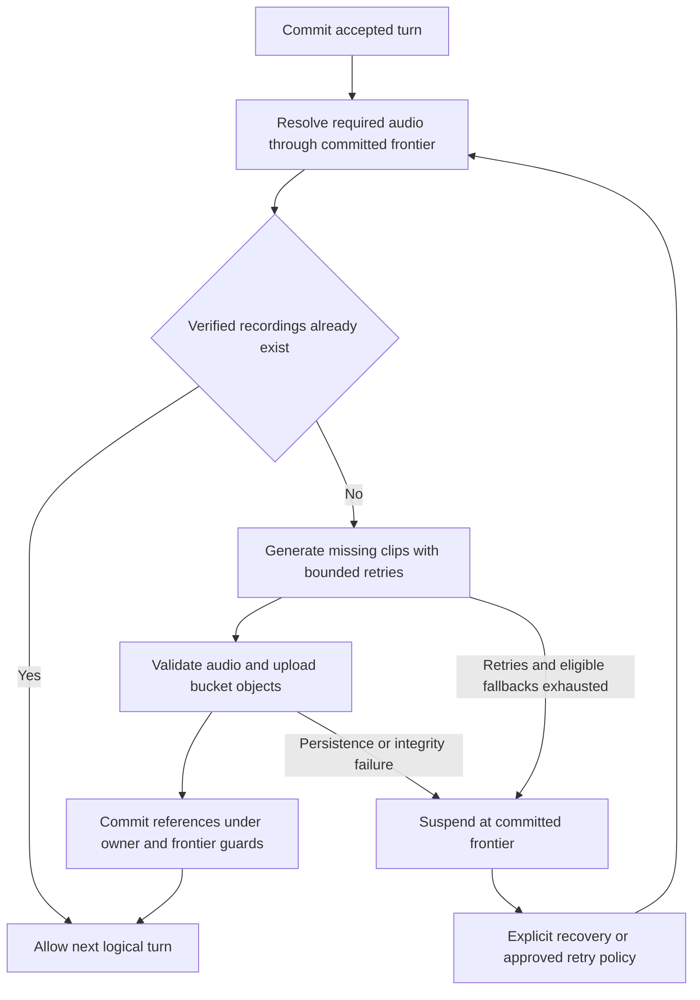

# Agent voices and Audio Mode

Give Influence and Werewolf a consistent spoken cast using xAI TTS, with one recognizable House voice across all games. The first iteration offers a sample-based stock-voice picker for existing saved agents, with deterministic defaults. Custom voice creation/update, delivery customization and character-generation integration remain deferred. Helios is initially approved for the House and reserved from player selection. Audio Mode produces recordings as accepted text becomes available and holds live presentation until they are ready. Public playback, Production Studio and export share speech, thinking treatment, timing and mix.

This is research and planning only: no application code, game backfills, profile mutations or infrastructure changes are authorized here. The operator separately authorized up to **$10 of xAI audition generation**, with receipts and cost visibility. Repository findings initially describe checkout `e5026925`; implementation must build on **`codex/peragent-model-selection`**, inspected at `3830edace6308184a2dfc01568544cf0dfecf30b`, including its migrations and engine changes. Approvals restore a preset-only user picker, replace earlier stacked nighttime/thinking proposals with the explicit treatment matrix below, and include default agent-authored speech tags even when Audio Mode is off. Historical audition notes describe experiments, not current requirements.

## Confirmed requirements

| Area | Requirement |
| --- | --- |
| Provider | Start with xAI for price and capabilities. Research does not establish production voice quality; audition before implementation acceptance. |
| Agent identity | Stock voices only for the initial release, including the House. Owners can preview and select a preset for their saved agents; Helios is reserved for the House and excluded from all player choices and automatic assignment. Missing assignments resolve deterministically, following declared gender where suitable voices are available. No promise of a unique underlying speaker per agent. Creation/update of voices and character-generation integration are deferred. |
| Game mode | Anyone who can create a game may enable Audio Mode, independently of Visual Mode. Audio works with portraits and generated visuals. Preserve creation/scheduler defaults until explicitly chosen. |
| Agent-authored tags | Default speech-generation guidance includes bounded inline delivery tags in every new game, including games without Audio Mode, like production cues. Preserve supported speech and thinking tags for later audio; strip them from presentation and all future agent context. Tags are optional per line, not forced decoration. |
| Voice freeze | When an Audio Mode game starts, freeze the resolved voice configuration for every character. Resolve missing voice assignments from the stable seed. Later profile edits do not change that game. |
| Failure policy | After retries and any eligible configured fallbacks are exhausted, preserve the accepted turn and suspend before the next logical turn. Do not silently continue an Audio Mode game without its required audio. |
| Thinking | Generate saved spectator-visible thinking when accepted text becomes available in Audio Mode. Prompt to prefer higher-pitch ordinarily and lower-pitch at night; add the matching wrapper if absent, retain other supported tags and deduplicate identical nesting. Show thinking controls playback, never paid generation. No automatic historical backfill. |
| House | Initial approval: `helios`, reserved exclusively for the House across all games, independent of the LLM producing House text. Speak existing announcements and add explicit Werewolf summaries/round announcements. |
| Werewolf nighttime speech | Prompt agents to prefer `<soft>` while permitting other supported tags and mixtures. Do not enforce soft or suppress emphasis in newly generated speech. Nighttime thinking prefers lower-pitch with a missing-tag fallback. No local DSP. |
| Backfill | Plan explicit first-track production for originally non-audio games; Studio may freeze current voices at job start. Do not run it until House and cast voices are approved. |
| Existing audio | Ordinary playback, missing-audio backfill and profile edits reuse existing audio. Do not automatically regenerate it. Explicit producer regeneration may be useful later; do not hardcode a permanent prohibition. |
| Surfaces | Integrate public playback, Studio and export, including seeking, speech timing and music mixing. |
| Agent boundary | Generated speech is presentation-only. Game agents never receive recordings, audio URLs, audio-derived transcripts or delivery metadata as observations or model context. |
| Storage | Audio bytes belong in bucket storage. PostgreSQL owns identity, references, integrity metadata, permissions and production state. |

## Repository findings

Required base-branch dependencies: `docs/model-routing.md`, the frozen roster/House routes in `game-model-routing.ts`, and migrations `0128_game_model_routing.sql`, `0129_provider_journal_house_authority.sql` and `0130_provider_route_cooldowns.sql`. Preserve that branch's accepted structured decision speech, including voting/action speech, when mapping production moments. Rebase research findings against the branch at implementation time; do not recreate its migrations or assume the older checkout's speech coverage is complete.

| Existing capability | Evidence and implication |
| --- | --- |
| Character gender and identity revisions | `packages/api/src/db/schema.ts` defines agent gender, current revisions and game-player references. `services/agent-profile-management.ts` owns edits; `routes/agent-profiles.ts` owns character generation. Voice belongs to shared character identity, independently of each game's strategy notes. |
| Canonical production moments | `packages/engine/src/production-moments/index.ts` gives speech and thinking separate identities with game-owned provenance. Use those coordinates, not sentence parsing, actor plus event sequence alone, or replay cursor alone. |
| Existing recording contracts | `packages/engine/src/production-moments/recordings.ts` and web `lib/replay-export/speech-contract.ts` validate exact speaker, text hash, moment and duration. Current local imports attach to speech; thinking audio needs an intentional extension. |
| Shared Studio and export timing | Web `lib/replay-export/timing.ts`, `audio.ts`, `speech.ts` and `prepare.ts` already attach recordings and compile their placement. Thinking-only timing currently rejects a recording. Extend this model instead of adding an independent thought timer. |
| Existing ducking | `audio.ts` already lowers music to 35% of its configured gain around recorded speech, with a 150 ms attack and 350 ms release. This is a starting point to audition, not proof the final mix is right. |
| Public time seeking | `components/watch/replay-scrubber.tsx`, `watch-transport.tsx`, `use-watch-timeline.ts` and `watch-director.ts` already support frame-based seeking and intra-cue time. Extend them with measured audio timing and exact audio offsets. Older notes describing only cue-index scrubbing are stale. |
| Different music behavior | Public replay can preserve gameplay music section position through seeks; Studio/export compile a deterministic schedule. Audio Mode needs movie-like music seeking as well as speech seeking. |
| Durable execution | Influence uses `services/durable-game-runner-store.ts` and `game-lifecycle.ts`; Werewolf uses `werewolf-runtime.ts` and its own store/cursor. Both need an audio gate that works during normal execution and adoption after restart. |
| Unsafe hook for required work | Influence's `onCommitted` callback catches errors as projection-refresh warnings. Required TTS must not be placed solely in that callback. |
| Existing storage boundaries | API `services/payload-storage.ts`, `lib/storage.ts`, `lib/public-media-storage.ts` and the storage inventory provide existing clients and integrity conventions. New audio references and large manifests must join those conventions. |

Keep the ownership and privacy lessons in [Studio recordings](../solutions/ui-bugs/2026-10-09-production-studio-player-and-frozen-recordings.md), [Production Studio](../production-studio.md) and [local replay export](../local-replay-export.md). Existing completed histories remain readable; audio adds presentation artifacts without rewriting accepted events.

## Provider research

Checked October 24, 2026. xAI documents `$15 / 1M input characters`, a TTS endpoint with stock voices, speed `0.7–1.5`, language, output format, speech tags, pronunciation replacements and optional character timestamps. Timestamp mode returns audio in a JSON/base64 envelope; decode it to bucket bytes rather than storing the envelope in the database. The request limit is 60,000 characters. The documented request has no synthesis seed or general temperature parameter. Sources: [TTS guide](https://docs.x.ai/developers/model-capabilities/audio/text-to-speech), [pricing](https://docs.x.ai/developers/models/text-to-speech).

Application determinism therefore means stable selection and settings plus reuse of accepted recordings. It does not promise byte-identical regeneration. Audition gender presentation and voice variety before curating the catalog; do not infer either from a provider voice name. Validate timestamp mapping, Unicode, tags and pronunciation substitutions against exact source text before claiming caption alignment. These are provider qualification tasks, not settled guarantees.

### Voice identity and customization limits

The current decision is to use the stock catalog for both agents and the House. The live audition catalog contained 28 stock voice IDs. xAI documents two ways to obtain a speaker identity: select an existing voice ID or create a custom voice from reference audio. No prompt-only voice designer, seed-to-new-speaker API or synthesis seed is documented. A stable application seed chooses a saved voice recipe from a finite catalog; it does not create a unique vocal identity. Repeated base voices across agents are expected.

Delivery controls include speed and supported pitch, intensity, whisper, emphasis and expression tags. These vary an existing speaker's performance. They are not independent controls for designing arbitrary timbre, age, accent or a new speaker. Local DSP can add a treatment but does not remove that identity limitation. Only auditioned compatible combinations belong in the assignment policy; do not equate many parameter combinations with many perceptually distinct voices.

xAI documents up to **30 custom voices per team**, created free through the console. This is a shared catalog limit, not 30 per agent or end user. Higher limits require contacting xAI; no public per-additional-voice price or automatic overage arrangement was found. API creation requires Enterprise access. Do not model this as known pay-as-you-go capacity. Reference-based creation, uploaded samples, external-model reference generation and user custom-voice entitlements are outside this release. Sources: [Custom Voices](https://docs.x.ai/developers/model-capabilities/audio/custom-voices), [TTS controls](https://docs.x.ai/developers/model-capabilities/audio/text-to-speech).

## Agent voice experience

### Voice and delivery

First delivery includes a focused preset-only voice picker for existing saved agents: display the current or automatic voice, play reusable samples, select a stock voice, and explicitly save. Offer return to the deterministic default. Owners choose voice identity only, with no speed, pitch, effects, custom prompts, uploads or cloning controls. The House controls the approved context treatments.

Use the 27 current player-eligible stock voices; reserve `helios` exclusively for the House. Exclude it from the picker, deterministic assignment and new player assignment requests, with server-side validation rather than UI filtering alone. Do not rewrite frozen historical game recipes. This reservation leaves 18 provider-labeled male voices and nine provider-labeled female voices in the saved catalog. Use these supplied labels for optional filters and default matching; do not infer gender from names or force an owner's manual selection to match character gender. Non-binary/unspecified characters use the full eligible pool for automatic assignment. Provider labels can be corrected through curation after listening; no manual classification is needed to start.

Use cached, shared samples so opening the picker or changing selections does not generate new paid audio. Only one preview plays at a time. Preview never saves, and save failure/conflict preserves the pending choice and existing assignment. Reuse existing ownership checks and revision handling, and expose the same narrow selection operation through authorized API/MCP surfaces. Other profile edits preserve the saved selection. No new voice step in character generation, completion or general creation is required; those flows continue to receive automatic defaults.

No local voice effects or normalization. Codec conversion remains allowed. Keep approved source recordings, exact provider tags and recipe versions available to playback, Studio and export. Operator House selection is separate from the player picker.

### Deterministic assignment

Resolution order: explicit saved owner/operator assignment from the eligible stock catalog, then deterministic default. Persist the resolved choice with its origin so reads never depend on the current order of a provider's voice list. Generated suggestions are outside this delivery.

1. Use the saved agent's stable identifier, plus an assignment algorithm version. Picker preview and game-start resolution must agree on its automatic voice; saving an approved assignment must not reroll it. No draft identity or creation-time voice assignment workflow is needed for this delivery.
2. Select from a versioned, curated player catalog with a fixed sort order, excluding Helios before gender filtering or hashing. Prefer a compatible voice presentation for explicitly declared male/female gender. For non-binary or unspecified gender, use the inclusive eligible pool unless the owner has supplied a preference. Never infer gender from an image or name; no matching subset means the documented broader pool.
3. Derive the base voice choice from a namespaced hash, for example `hash(agentId, algorithmVersion, "voice")`. Delivery follows agent-authored annotations and context guidance/fallbacks, not random per-agent settings. Additional seeded variation is outside the current preset-only scope.
4. Map the voice value only into eligible stock choices. Store the resolved provider voice, style, settings, seed identity, algorithm version and catalog version. Do not randomize language, pronunciation rules or arbitrary effects simply because they can be seeded.
5. Renaming the agent, reordering the provider catalog or adding a voice must not change an existing assignment. Explicit customization takes over from the default. A deliberate reset can select the documented automatic policy.

Default identity should remain the same across games. Do not silently reroll two similar-sounding agents to make a cast unique; surface similarity during casting if needed. Profiles with no surviving agent record use a stable historical character/seat identity for first-track production and retain that choice in the track snapshot.

### Freeze rules

| Situation | Voice source and behavior |
| --- | --- |
| New Audio Mode game | Resolve all voices at start, including the approved global House voice, and save a game-owned snapshot before the first speaking turn. |
| Profile changes after start | Affect future games only. Existing game audio and missing clips use the game's snapshot. |
| Missing assignment at game start | Compute from stable seed, persist, then freeze. Do not lazily consult a changing live catalog during replay. |
| First track for an originally non-audio game | Resolve from current profiles when the Studio job starts, with deterministic defaults for missing profiles/choices. Freeze the whole cast for that track, so a later edit cannot split the job across voices. |
| Interrupted first-track job | Continue its exact frozen recipe and retain completed clips. Do not re-resolve from current profiles. |
| Deliberate producer regeneration | Potential later operation creates a new candidate audio version with an explicit recipe. Existing pinned previews/exports retain their old versions until explicitly refreshed. No automatic replacement and no in-place object overwrite. |

Separate three identities: a stable logical recording ID (track, source moment, semantic part), a recipe hash (source hash, voice, treatments, compiler/format versions), and a content hash of each produced artifact. A hash is evidence and a reuse key, not the permanent identity of a replaceable recording. Candidate versions reference their predecessor and exact inputs; activation changes an authorized active-version reference without rewriting accepted game events or overwriting bytes. Pinned cuts keep their referenced versions.

Frozen recipes are the normal playback contract. Individually stored media versions remain content-addressed or otherwise write-once; a recording's active version can change through an authorized producer action. This preserves room for regeneration without building a full audio editor in the first delivery.

## Audio Mode and spoken coverage

Keep three independent concepts: game production setting, availability of an audio track, and the viewer's listening controls. Audio Mode is a game configuration choice, not a rollout feature flag. A viewer muting a game does not disable production or release a suspended game.

Audio is exclusively for human playback and producer workflows. No generated speech enters game-agent observations, prompts, memory or tools. This applies to public and private speech alike. Existing canonical text-context rules remain separate and unchanged; no information flows back from the audio presentation into gameplay.

Required initial coverage:

| Source | Spoken treatment |
| --- | --- |
| Accepted character dialogue | Voice the exact accepted text, including introductions, conversations, public statements and retrospective statements. |
| Private dialogue visible to viewers | Voice only for viewers or producers already permitted to see that dialogue. Game agents have no access to generated audio. |
| Saved visible thinking | Separate audio part, same character voice, subtle effect, present only when Show thinking and audience rules allow it. |
| House narration and announcements | Use the same approved global House voice for Influence and Werewolf, including explicit round announcements and new Werewolf summaries. |
| Ballots, tallies and UI labels | Voice accepted decision speech supplied by the model-selection branch. Do not fabricate character speech from a silent decision or read every label by default. Any additional House announcement must be an explicit presentation rule derived from structured facts. |
| Discussion passes, unavailable-output placeholders, raw provider reasoning | No speech. Passes stay skipped even with Show thinking; raw/native/encrypted reasoning is not a narration source. |

Speech extraction uses typed production moments and game-owned projections. The existing classic presentation parser remains frozen. Spoken formatting may remove presentation markup or apply pronunciation, but may not rewrite strategy, summarize dialogue, manufacture facts or add new character claims. Maintain exact source text plus a separately versioned synthesis transformation and source-to-spoken mapping. Provider control tags come from validated agent-authored delivery annotations and approved context settings through one shared compiler; arbitrary bracketed dialogue must not silently become control instructions.

Generate eligible speech and saved spectator-visible thinking as their accepted text becomes available in Audio Mode. Do this regardless of a viewer's current Show thinking setting. Hold live presentation at the audio-ready frontier until corresponding required recordings are durable; do not briefly show text and later replay it with sound. Canonical acceptance and contestant text-context publication remain independent of this viewer hold. Viewer controls never trigger paid synthesis. Existing non-audio games stay unchanged until an explicit approved first-track job.

### The House as a speaker

Use the initially approved `helios` global House voice identity across both games and every cast; it is not available to contestants. Snapshot the approved recipe/version at game start to preserve production continuity. Different House text-generation models must not select different TTS voices. A later global voice revision requires deliberate operator action and does not rewrite existing tracks.

Inventory existing Influence introductions, round narration, outcomes and retrospective announcements. For Werewolf, add clearly owned House moments for round/day/night transitions and relevant results/summaries. Use deterministic factual presets where they suffice; extend an existing House summary call or use a short exact structured output when authored prose adds value. Facts come from canonical projections, not transcript parsing. Do not add a new call per label or read scheduler/debug messages aloud.

New game-scoped House text generation must use the base branch's frozen House model route and durable journal coordinator. TTS remains independently configured xAI media production. Summaries are presentation artifacts and never grant game agents access to spectator-only information. Their visibility and source scope must be explicit; do not duplicate accepted character decision speech with unnecessary House narration.

### Default agent-authored speech and thinking tags

Include delivery guidance by default for new Influence and Werewolf games regardless of Audio Mode, like production cues. Agents may use the supported xAI speech-tag vocabulary in spoken messages and saved thinking, including mixtures of tags. Encourage sparse, purposeful cues rather than imposing the audition's three-cue cap or restricting production to the three tags those samples happened to use. An untagged response is valid. No additional model call or separate delivery-choice field is required. Existing prose acting cues remain independent; do not parse them into delivery controls. Tags cannot select a voice, create facts or change gameplay authority.

Use prompt guidance for delivery intent: prefer wrapping nighttime speech in `<soft>`; prefer `<higher-pitch>` for ordinary thinking and `<lower-pitch>` for nighttime thinking. Other supported tags remain allowed in each context. Nighttime speech may mix soft with emphasis or other delivery choices; do not suppress those tags or force a whole-line soft wrapper when the agent omits it. Thinking has the explicit fallback described below. These are production directions, not new game rules.

Treat delivery markup as adaptable production metadata, not a reason to reject an otherwise valid game decision. Tags in thinking, mixtures of supported tags, omission of a preferred tag and redundant wrapping must not cause a retry, error or game failure. Keep the exact strict JSON schema and gameplay semantic validation intact; targets and other machine-interpreted fields retain their existing contracts. Normalize delivery markup separately, preserving words. If a recognized control is malformed or cannot be safely rendered, omit that unusable control from the effective audio recipe and record a producer diagnostic rather than reprompting gameplay. Preserve the original response as evidence. Do not send arbitrary unknown markup as provider instructions, or use broad bracket stripping that deletes literal prose. Existing speech allowances measure clean spoken text.

At acceptance, derive clean speech/thinking plus supported delivery annotations with source-span mapping. All ordinary presentation surfaces use clean text: live/replay text, Show thinking, captions, transcripts, exports and ordinary API/MCP dialogue. Every later model context, including the speaker's own history, summaries and memory inputs, uses clean text with no delivery annotations, subject to existing visibility rules. Preserve the original decorated provider response and annotation document in private bucket-backed producer evidence, with relational references and hashes. Tag removal never grants additional access to the underlying thinking or dialogue. Passes remain silent regardless of cues.

Persist speech and thinking annotations even with Audio Mode disabled; do not synthesize, call xAI or hold live playback for audio in those games. A later explicit Studio first-track job reuses accepted words and annotations without reprompting gameplay. Historical untagged moments remain valid: use the thinking pitch fallback, and the House soft default for legacy nighttime speech that predates tag guidance. Do not invent agent-authored annotations or automatically backfill them. Recipe provenance includes the original annotation hash, normalization/compiler version, effective tags and applied fallback, separately from clean-text identity and clip version.

Compose annotations and fallbacks once in the shared live/backfill/Studio/export synthesis compiler:

| Context | Guidance and effective synthesis |
| --- | --- |
| Ordinary speech | Preserve supported agent-authored delivery tags on the frozen voice. No mandatory wrapper. |
| Werewolf nighttime speech | Prompt for soft delivery, while allowing other tags and mixtures. Preserve the agent's supported choices, including emphasis; do not enforce soft on newly generated speech. |
| Ordinary thinking | Prompt to prefer higher-pitch and allow other tags. If no usable `<higher-pitch>` wrapper is present, add one around the thinking text, retaining other supported annotations. |
| Werewolf nighttime thinking | Prompt to prefer lower-pitch and allow other tags. If no usable `<lower-pitch>` wrapper is present, add one around the thinking text, retaining other supported annotations. Do not also add the ordinary-thinking higher-pitch fallback. |

An existing preferred pitch wrapper on any span counts as present: preserve authored scope instead of adding another whole-line wrapper. Remove redundant identical nested wrappers, including duplicates introduced by fallback composition; do not remove distinct tags or flatten their intended spans. For example, higher-pitch inside higher-pitch collapses to one, while soft plus emphasis remains. Normalization must be idempotent across retries and backfill, preserve every spoken word, and retain both original and effective annotations for producer inspection. No local audio DSP or loudness normalization is introduced. Listen to mixed tags and both thinking fallbacks before release; provider rendition differences are not gameplay validation failures.

## Durable production and suspension

An audio-enabled game advances only when audio required through its accepted frontier is durably ready. Acceptance of a character decision remains separate from acceptance of the derived audio.

The gate must run before planning/dispatching the next logical turn, after adoption on restart, and before terminal completion settlement. Initial narration and the last retrospective/output need coverage even when there is no subsequent contestant turn. Preserve the canonical winner if production fails at the end. Do not re-run a model decision to repair its audio.

Use game-owned turn/event coordinates and the existing owner-epoch fences. Inventory the actual suspension points in both engines, including sequential dialogue and ballots; do not assume a scene boundary is a logical turn. The next speaker/voter must still observe exactly the prior committed contributions under the current rules. Audio failure cannot roll back their publication or leak future choices.

Persist work identity before dispatch: game/track, source moment and semantic part, exact source hash, frozen voice recipe, synthesis transform and format. Retries and restarts resolve the same logical job. Successful media is durable before its reference can satisfy the gate. Concurrent workers and late completions cannot activate stale versions or continue a revoked game owner.

Proposed failure policy:

- Apply bounded retries with timeout, backoff, provider rate-limit handling and abort support. Classify transient transport/429/5xx separately from invalid voice/configuration, refusal, invalid audio, and storage/integrity failures.
- Start with xAI only. An eligible fallback must be explicitly configured and preserve the approved voice/track contract; text-only output, browser speech and a random alternate voice are not fallbacks. Cross-provider fallback is not assumed to preserve character identity.
- Record the failed clip, accepted frontier, attempt receipts and actionable reason. Suspension is resumable and nonterminal, with no `endedAt` implication or lost accepted result.
- Resume rechecks every required item through that frontier, then releases the gate under current authority. Reuse successful clips and do not clear another subsystem's suspension.
- A timeout after remote generation may leave an unknown billable outcome. Reconcile any durable receipt/output before resubmission; do not claim exactly-once provider billing without a documented provider idempotency mechanism.
- Failure to persist evidence or media stops further spend for that work. Do not accept partial bytes as success.
- Long valid source text is split into deterministic ordered synthesis segments with reassembled timing. Provider text length is not a reason to truncate accepted dialogue or suspend solely for estimated size.

Proposed initial recovery is an explicit operator retry/resume after durable suspension; automatic recovery can be decided later. Transient in-attempt retries are automatic; there must be no unbounded retry loop across worker restarts.

## Backfill and producer workflow

After approval of the House and initial cast voices, the planned first delivery exposes **Generate audio** in Studio for a completed, originally non-audio game. Show the frozen cast proposal, intended source coverage, missing/existing clip counts and estimated billable characters before starting. Reading the game, opening Studio or exporting must not start generation.

Freeze the accepted source prefix, full track scope and voice recipes once. Produce missing clips through the same durable service used by live Audio Mode games. Track queued/running/failed/ready status separately from game status. A failed backfill leaves a completed game completed and its existing text/visual replay usable. Retrying continues missing work with the same recipes; it neither replaces accepted clips nor changes their voices.

For games created with default tag generation, reuse saved delivery annotations and the canonical moment's day/night context. Audio Mode being off at game creation must not discard those annotations. Older moments without annotations need no gameplay regeneration; apply the approved context treatment to their saved clean text.

Publish a ready track only after validating coverage for its declared scope. Studio may inspect production progress, but public viewers must not receive an apparently complete track with arbitrary silent gaps. Audio Mode games already in progress expose a ready prefix and wait at its end. Full and selected exports preflight every required clip for their selected scope.

Generating for only a selected cut can be considered later; the initial proposal is a game track so ordinary playback also benefits. Do not label a partial cut as full-game audio. Creating a first track does not retroactively change the original game's execution configuration.

Leave an explicit version boundary for producer regeneration. Its eventual command must distinguish replacing one clip, changing a track voice and changing a mix. It should create a candidate, preserve provenance and old pins, and require deliberate activation. Designing this boundary is in scope; building a full regeneration workflow is lower priority than first-track production and playback.

## Storage and read access

Use existing bucket clients. Store playable audio, optional masters, alignment documents, frozen manifests and sanitized raw provider evidence as objects. Keep relational rows for track/clip identity, source coordinates, recipe/version, lifecycle, owner/lease, duration, codec/sample rate, byte length, hashes, object references and access scope. Large text/request/response bodies use `payloadColumn` and the existing explicit storage writers/readers and inventory.

For each successful artifact: validate the decoded audio and measured duration, hash the bytes, perform a durable upload and verify its receipt/integrity before committing its reference. Track recoverable orphan uploads; cleanup must check references and active attempts before deletion. No database blobs, base64 audio or embedded data URLs. If implementation replaces existing persisted recording bodies, inventory and migrate all affected environments under the existing [storage cutover rules](../deployment/private-payload-storage-cutover.md); do not regenerate audio to move it.

Proposed access model: retain source masters and private clips in private storage; reuse existing authenticated or expiring delivery boundaries. Publish only explicitly audience-safe derived media through the existing public media path. Actual routing must be selected after testing byte-range reads, content type, CORS, cache headers and URL renewal with seeking. Do not invent a second bucket stack or widen current grants.

Mystery manifests must omit thinking/pack-only clips and their URLs, captions, timing entries and cache hints. Audience changes cancel outstanding requests, stop old audio and dispose private cached media before the new audience starts. Frozen export bundles include only authorized selected content. Viewer/producer audio delivery must remain separate from game-agent context and tool responses; no audio artifacts or derived delivery information enter those agent surfaces.

## Playback as a movie

Use the existing shared presentation model with one authoritative clock per playback surface. Studio/export retain Remotion Player and the sampled composition; public playback retains its director while consuming equivalent measured timing and audio placement. Share timing/mix calculations, not an additional timer running next to each host.

Recorded duration owns the speaking interval, with small authored entrance/exit holds. Avoid leaving a long text-reading delay after a short clip just because the old compiler uses the maximum of reading time and recording duration. Keep text-only timing available for games without a track. Captions remain available when audio is muted; muting does not retime the movie.

| Interaction | Required behavior |
| --- | --- |
| Play and pause | Picture, speech, thought treatment and scheduled music pause/resume at the same timeline position. |
| Seek into speech | Start at the clip offset corresponding to the destination, not its beginning. Respect decoder readiness and codec delay. |
| Drag scrubber | Silence outgoing speech immediately. Preview position; resume only at the final ready destination if playback was previously running. A late earlier seek cannot start old audio. |
| Buffering | Hold the common clock and show a meaningful state. A client download failure is not a server game suspension. Allow retry or explicit muted viewing; do not silently omit promised speech. |
| Next/previous | Stop outgoing audio, land at the chosen canonical moment, and obey the existing play/pause intent. |
| Playback speed | Pitch-preserving speech follows the same speed as picture. Test existing 0.5x/1x/2x/4x controls; do not silently mute or let recordings run at a different speed. |
| Show thinking | Include/exclude matching thought picture and audio together. Preserve a semantic moment/local-time anchor; if hiding the active thought, land at its associated public presentation boundary. |
| Audience or source change | Stop obsolete audio, fence async work, reauthorize and rebuild the permitted timeline. |
| Live edge | Play only the ready accepted prefix; wait when caught up, and append without retiming completed clips. |
| Background tab | Preserve explicit playback and mute intent. If the browser suspends execution, resume coherently rather than letting picture and sound drift. |

Prefer generating complete durable clips before exposing them for playback. Streaming synthesis may later reduce waiting, but must not create a second provisional soundtrack that differs from the saved replay. Provider credentials stay server-side.

Use measured duration for seeking. Validated character timestamps can improve pagination/captions, but timestamp failures must not masquerade as accurate alignment. Retain a clearly defined duration-based caption fallback where permissible. Mapping needs explicit handling for Unicode indices, pronunciation replacements, normalized numbers, tags, chunk joins and silence. Do not use speech-to-text to replace canonical dialogue.

## Thinking treatment and music

Approved direction: distinguish thinking using the same stock voice and provider-native delivery, with **no local voice effects or normalization**. This matrix sets prompt preferences and missing-tag fallbacks; it does not prohibit other supported agent-authored tags:

| Canonical context | Preferred tag / fallback |
| --- | --- |
| Ordinary speech | None |
| Ordinary thinking | Prefer `<higher-pitch>`; add if absent |
| Werewolf nighttime speech | Prompt to prefer `<soft>`; no enforced wrapper for new agent-authored speech |
| Werewolf nighttime thinking | Prefer `<lower-pitch>`; add if absent |

Select the most specific context first: nighttime thinking receives the lower-pitch preference/fallback instead of the ordinary higher-pitch fallback. Preserve other supported authored tags; collapse identical nested wrappers. Keep the request speed at 1.0. Show thinking controls playback inclusion, not generation. Earlier exclusive-treatment and local-effect auditions remain historical evidence only.

Freeze approved provider tags and recipe versions so preview and export reuse the same recording. Prefer direct provider MP3 output for ordinary delivery. Existing WAV sources may be encoded to MP3, and export may require AAC encoding; codec conversion does not authorize filters, echo, saturation, limiting, pitch shifting, time stretching or loudness normalization. Do not rewrite thinking text to achieve its treatment. Ordinary user volume and music mixing remain separate playback/export concerns.

Proposed mix: lower the baseline music level in Audio Mode and duck it further during both speech and thinking. Start by evaluating the existing 35% duck factor and 150/350 ms envelope. Derive the envelope from the audio timeline so a seek into speech starts with music already lowered. Overlapping envelopes take the strongest reduction rather than repeatedly multiplying gains.

Expose master volume/mute and separate voice/music levels; retain current music preferences when introducing voice controls. Studio monitoring volume is local and must not change exported mix settings. Persist production mix settings in the prepared cut. Confirm effects ducking and final loudness targets through listening tests; do not choose an arbitrary loudness number as a substitute for auditioning the actual score and voices.

## Werewolf nighttime delivery

The House directs nighttime speech toward `<soft>` through generation prompts, including authored House announcements, retaining the frozen speaker identity. Agents may use other supported tags or mix soft with them. Do not mechanically suppress emphasis or overwrite an agent's delivery. Nighttime thinking prefers lower-pitch and gets that wrapper if absent; ordinary thinking prefers higher-pitch with its matching fallback. Preserve other supported tags and collapse duplicate nesting. No voice substitution or local DSP.

Select the treatment from canonical Werewolf phase and typed speech-moment metadata, never from dialogue wording or a guessed role. House direction supplies prompt guidance and the context-specific thinking fallback; it cannot rewrite accepted words. No extra per-line model call is required for delivery.

Freeze the House nighttime preset and its version with the game audio recipe, or with the first-track recipe for a historical non-audio game. Include the resolved treatment in each clip's production identity so retries, missing-clip production, public playback, Studio and export agree. Later House style changes do not automatically regenerate recordings; deliberate producer regeneration can create a new version under the existing policy.

Nighttime speech remains subject to the original audience permissions: the treatment must not expose hidden pack dialogue or add a role-revealing effect to daytime speech. Apply the approved context matrix to permitted moments and use measured clip duration in shared timing and ducking. No local processing or effect tails are introduced.

## Studio and export

Studio should show coverage and errors per speech/thinking moment, preview a selected voice sample, generate a first missing track, retry failed work and explicitly refresh newly ready audio. Opening a workspace pins media versions. A background job must not silently change the cut under the producer's playhead.

Extend the existing recording binder to bucket-backed speech and thinking references. Keep imported local recordings functional without adding a competing timing system. Decide precedence explicitly when a local import and generated clip target the same moment; proposed behavior is an explicit Studio override, never an automatic replacement.

Frozen exports pin selected moment IDs, source text hashes, voice/clip versions, measured durations, alignment and mix. Missing or corrupt required pinned audio is an error, not permission to regenerate. Preparation downloads authorized objects; encoding is offline and never spends provider credits. Selected cuts omit both sound and timing from omitted moments and compile music against the selected timeline. A later producer version does not alter an already prepared bundle.

## Proposed delivery sequence

These are complete vertical increments. Audio Mode is not considered delivered until live execution, public playback, Studio and export meet the acceptance criteria.

1. **Qualify voices and settle product defaults.** Audition a small cast, thinking treatment and House-directed Werewolf nighttime delivery with representative game lines; test pronunciation, exact-text fidelity, timestamp mapping, decode formats and provider errors. Finalize catalog and sample strategy. The current $10 audition allowance authorizes isolated evaluation clips only; game production/backfill waits for voice approval.
2. **Prove default tags and one durable recording end to end.** Add default speech/thinking guidance, tolerant delivery normalization, clean-text publication/context isolation and durable annotations in both audio and non-audio games. Use one accepted moment, a frozen voice recipe, verified bucket storage and one shared recording contract; preview it in public playback and Studio and export it at matching timing. Include a thinking clip and nighttime speech to prove treatment composition early.
3. **Establish the approved cast and House identity.** Operator-approved assignments, deterministic defaults and game/track snapshots, plus the sample-based owner preset picker. Voice creation/update and delivery customization remain out of scope. Add canonical House announcement moments and Werewolf summary coverage on the required base branch.
4. **Complete first-track backfill.** Authorized Studio command, durable progress/retry, scope validation, ready publication, pinned refresh and full/selected export. Reuse existing recordings.
5. **Add required live production.** Independent Audio Mode configuration in all game-creation paths, gate both runtimes and terminal settlement, preserve accepted frontiers, suspend and recover without repeating gameplay.
6. **Finish movie behavior and operations.** Exact seeking, buffering, speed, thinking toggles, ducking, browser/mobile playback, diagnostics, costs and operational documentation. Broader producer regeneration is a separate refinement using the version boundary established above.

The implementation should first map concrete changes into current modules, then introduce only the small contracts/services needed. No generic media workflow framework, second canonical event system or parallel playback engine.

## Acceptance and validation

| Area | Required evidence |
| --- | --- |
| Assignment | Same saved identity/catalog policy gives the same choice; picker/game-start agreement, save/reset/conflict handling, approved assignment, rename, provider-list reorder, missing gender, unmatched subset and manual override behave as specified. Existing assignments do not drift; newly saved agents work without creation-flow integration. |
| Freeze | Audio Mode start snapshots survive profile edits. Non-audio first-track jobs use their start-time choices across retries. No passive regeneration. |
| Coverage | Both games include all required eligible speech and saved spectator-visible thinking as text becomes available; live view holds until ready and passes stay silent. Silent ballots do not become fabricated character dialogue. |
| Default tags | New audio and non-audio games include speech/thinking guidance; zero tags is valid. Tags in thinking, mixtures, omissions and duplicate wrappers cause no retry/error. Exercise malformed controls, literal brackets, Unicode mapping and clean-text allowances without weakening exact-schema/gameplay checks. Non-audio games persist annotations without xAI calls or audio-ready gates. |
| Clean-text boundary | Live/replay/captions/transcripts/exports and ordinary API/MCP dialogue contain no control tokens. Self-history, other contestants, summaries, memory and resumed contexts consume clean text only; raw decorated responses remain authorized producer evidence. |
| Nighttime delivery | Canonical night context selects soft prompt guidance and lower-pitch thinking preference/fallback. Other supported tags remain usable. Private audio stays audience-restricted; seeking/export reuse the same recording and recipe. |
| Tag composition | Night speech may retain emphasis and mixed tags or omit soft. Ordinary/night thinking adds higher/lower pitch respectively only when absent; an authored partial span counts as present. Preserve other tags, collapse identical nesting and prove idempotence and word preservation. Live/backfill/Studio/export share the compiler and pinned recipe; listen to mixed-tag results. |
| Durability | Crash before dispatch, after response, after upload and after reference commit; duplicate jobs, stale owner, partial output, storage failure and lost responses cannot lose accepted gameplay or activate stale audio. |
| Suspension | Exhausted audio failures stop the next logical turn and terminal completion; restart cannot bypass the gate. Recovery reuses successful clips and does not clear unrelated suspensions. |
| Backfill | Completed-game status/history remain unchanged on failure; retry fills gaps using frozen choices. Non-audio games reuse saved tags without another gameplay call; old untagged moments receive context treatment only. Partial tracks are not advertised as complete. |
| Storage/privacy | No binary/document bodies in database rows; integrity and orphan checks; unauthorized and Mystery responses contain no private clip references or timing leakage. |
| Agent isolation | Public and private generated audio, URLs, derived transcripts and delivery metadata are absent from game-agent observations, prompts, memory and tool responses. Audio Mode leaves canonical text-context behavior unchanged. |
| Timing | Arbitrary forward/backward seeks, end-of-line, chunk joins, thought boundaries, long clips, speed changes, buffering and rapid source changes preserve synchronization. |
| Mix/export | Ducking at arbitrary seek times matches uninterrupted playback. Public/Studio/export use the same selected audio and recipes. Verify decoded audio placement, not merely non-silence. |
| UX | Picker previews never overlap or generate new paid audio; no preview changes an agent or game. Saving requires ownership and rejects reserved Helios. Manual gender filters do not constrain eligible selection. Live text does not outrun required audio. Mute and music-only controls behave independently; autoplay refusal has a visible recovery action; keyboard/mobile scrubbing and background return preserve intent. |
| Long input | Large valid text is fully covered through supported segmentation with source mapping, without size-only game failure or truncation. |

Implementation validation: provider-free contracts/unit tests; sequential PostgreSQL-backed lifecycle tests using `setupTestDB()`; isolated deterministic API/browser fixtures; decoded media/export checks; and separately authorized live-provider auditions with retained receipts. Run `bun run test`, `bun run test:postgres`, `bun run check`, and relevant classified browser checks for mergeable code. Those checks are not needed for this documentation-only draft.

Update `docs/production-studio.md`, `docs/local-replay-export.md`, `CONCEPTS.md` and operational recovery docs when implementation lands. If structured generation outputs or observability change, update `docs/reasoning-transcript-observability.md`, relevant usage examples and the applicable simulation JSDoc in the same branch.

## Remaining decisions and evaluation gates

- Helios has initial House approval; the three context treatments are approved. Individual assignments for the eight model agents remain proposals until confirmed or explicitly selected. No profile mutation or historical backfill is performed by this planning update.
- Choose whether new manually created and scheduled games default to Audio Mode; preserve existing defaults meanwhile. Enabling Audio Mode uses existing game-creation capability. Historical generation also requires access to that game's Studio and its existing authorization boundaries, without inventing a new privileged creator class.
- Settle playback music levels and qualify mixed nighttime tags and both thinking pitch fallbacks. Default agent-authored speech/thinking tags and tolerant normalization are specified above. No normalization or local effect controls are in scope. MP3 is the initial delivery candidate; retain WAV sources where processing/export needs them. xAI documents MP3/WAV/PCM and telephony formats, not native AAC. M4A/AAC can be an offline export derivative; compatibility and seek timing need browser/device checks, not assumptions. See [xAI TTS](https://docs.x.ai/developers/model-capabilities/audio/text-to-speech) and [MDN audio codecs](https://developer.mozilla.org/en-US/docs/Web/Media/Guides/Formats/Audio_codecs).
- Proposed defaults for remaining workflow details: whole-game explicit first-track jobs, publication after complete validated coverage, operator resume after exhausted retries, and versioned producer replacement as a later action. These are proposals, not additional blockers to research.
- Timestamp/source alignment, browser scrubbing, context-treatment intelligibility and export parity remain qualification tasks. Successful synthesis alone does not prove them.

## Budget and initial audition evidence

The operator authorized **$10 initial xAI testing spend** and reported an $18 account balance; the balance is not independently verified. Track each dispatched attempt conservatively, including ambiguous outcomes and retries. Persist requests, sanitized responses/receipts, hashes and cost estimates before further spending; stop when the allowance cannot cover another attempt. Request an additional budget before exceeding it. Do not interrupt an authorized batch for per-line approval.

At the documented $15 per million input characters, 100,000 characters costs about $1.50 before retries. Count speech, thinking, previews and repeats separately; replay and offline effects/transcoding incur no TTS charge. Actual billing must remain distinct from estimates.

The isolated October 24 audition generated 60 clips: one common House script across all 28 live stock voices, plus normal/thinking/night/night-thinking for the eight model-named agents. Estimated input-character cost was **$0.14691**; all 60 requests succeeded and source/output receipts were retained. No agent profiles, games or historical tracks were changed. These fictional scripts are listening fixtures, not accepted game dialogue. Subjective voice approval, exact-text listening, timestamp alignment and real game mix remain outstanding.

| Initial audition agent | Proposed stock voice (unapproved) |
| --- | --- |
| GPT Sol | rex |
| Grok 4.6 | sirius |
| Claude Sonnet | celeste |
| Meta Spark | ara |
| Kimi K3 | sal |
| DeepSeek Flash | kepler |
| Claude Haiku | iris |
| Gemini Pro | altair |

The same-voice thinking test applies restrained filtering and a short low-level echo to the dry WAV. Nighttime tests use documented lower-pitch/slow tags; combined clips add the same thinking processing afterward. **Operator feedback: thinking variations are good; slower nighttime delivery is rejected.** Preserve the thinking baseline and explore natural-paced nighttime alternatives before deciding whether to drop that extra treatment. No further clips were generated as part of recording this feedback. The model-selection session and localhost agent inventory confirmed this cast; do not substitute generic placeholder agents or rebuild without the branch's roster/model-routing changes.

### Second nighttime audition

The follow-up panel keeps the same eight stock assignments and compares a common fictional nighttime script with untagged delivery, lower-pitch, soft, and lower-pitch plus soft tags. All 32 synthesis requests use speed 1.0 with no slow tags. A fifth variant blends subtle low-band saturation into the lower-pitch take as a DSP texture experiment; it is not a documented guttural tag or a new speaker identity. No time stretching is applied. Tagged performances still differ in natural cadence and measured duration.

Each of the five variants has a same-take thinking derivative using the existing effect, yielding 80 playback comparisons. Playback uses single-pass loudness normalization to reduce loudness bias. The exact same text is intentionally used for speech and thinking to isolate the effect. All source hashes and full playback decodes passed; browser sample loading, switching without overlap and Stop audio were checked. Operator listening and preset approval remain outstanding.

Estimated additional TTS spend: **$0.08592**; cumulative estimate across both panels: **$0.23283** of the authorized $10. Actual billing remains unverified. Original clips, requests and receipts are preserved. The separate panel and processing recipes are retained in the local audition artifacts under `voice-audition/night-v2/`; no agent profiles or games were changed.

### Third audition: stock voices and provider tags only

The new panel preserves all 28 original House MP3s and eight original untagged player tests byte-for-byte. It reuses the unprocessed MP3 encodings of the second panel's WAVs for its neutral comparison control, lower-pitch, soft and lower-pitch plus soft demos; none of the normalized playback derivatives is used. Eight new higher-pitch requests use the same comparison script, stock assignments and speed 1.0. Each higher-pitch WAV is encoded to MP3 with no effect filters. No slow tags or normalization are used.

The panel contains 76 samples, of which 68 reuse existing files. The original player test has its original script; a separately labeled neutral control matches the tagged samples' script. Higher pitch is presented as a possible thinking treatment without echo or any other DSP. Additional estimated TTS cost: **$0.02256**; cumulative estimate across all three panels: **$0.25539** of the $10 allowance. Actual account billing remains unverified. Artifacts and provenance are retained under `voice-audition/stock-tags-v3/`.

### Historical approvals following the third panel (delivery composition superseded below)

Approved: higher-pitch for ordinary thinking; soft for all Werewolf nighttime speech; lower-pitch alone for nighttime thinking. These are context alternatives, not additive layers. Helios has initial approval as the shared House voice and is reserved from all player selection/assignment. A sample-based stock preset picker for existing agents is now in scope; custom voice creation and delivery controls remain excluded. The saved provider catalog supplies gender labels (18 male and nine female player-eligible voices after reserving Helios), so no new manual bucketing is required. This approval changes the plan only, not agent profiles or existing audio.

### Fourth audition: agent-authored tags in real saved requests

The operator authorized isolated paid reprompts using original model/provider routes. Localhost MCP supplied three complete source traces from completed model-panel game `hazy-olive-vine` (`47d4e32b-a0a8-4b2e-b1d1-1d9b17428e90`). Execution used the clean `codex/peragent-model-selection` checkout at `3830edace6308184a2dfc01568544cf0dfecf30b` and imported its provider compilers and strict validator read-only. Original prompt messages were retained with one appended system guidance block. Missing native envelope options were reconstructed from that branch; this is not a claim of byte-identical wire replay. No game or profile was mutated.

| Real moment | Original route / stock voice | Result |
| --- | --- | --- |
| GPT Sol, round 6 closing argument | `openai:gpt-6.1-sol` / Rex, male | First attempt valid; soft wrapper and pause, two cues |
| Claude Sonnet, round 6 jury question | `katana:claude-sonnet-4-6` / Celeste, female | First attempt valid; emphasis wrapper and two pauses, three cues |
| Grok 4.6, round 6 jury question | `katana:grok-4-6` / Sirius, male | First attempt valid; soft, pause and emphasis, three cues |

All three preserved their exact response schema and kept thinking/other fields untagged. The harness validated the allowlist and balanced wrappers, then removed exact control tokens for the clean-text comparison. Six direct xAI MP3 files compare each new tagged response with its identical words without tags. There is no thinking synthesis, local effect, normalization or transcoding. Full audio decodes passed; browser playback and stop controls were verified. The operator subsequently approved the listening results and inclusion of default speech tags in the plan. These samples do not establish production reliability; malformed-tag handling, future-turn context sanitation and combined nighttime delivery still require implementation validation.

Panel: `http://127.0.0.1:8766/real-moments-v4/`. Safe panel data and report are under the local audition artifact root in `voice-audition/real-moments-v4/`; full original traces, frozen routes, modified requests, provider responses, validation results and usage receipts are retained in sibling `real-moment-evidence/`, outside the HTTP root. Private prompts and thinking are not served by the panel.

Additional TTS estimate: **$0.03894**; cumulative audition TTS: **$0.29433** of the authorized $10. The three LLM replays separately total approximately **$0.07564** at frozen catalog input/output rates before cache/service-tier adjustments. Provider receipts are saved; account billing is not independently verified. No retries or fallback models were used.

### Approval following the fourth panel

Agent-authored speech tags are in scope. Generate them by default like cues for new games, independently of Audio Mode, while permitting untagged lines. Preserve accepted delivery annotations for a later explicit first-track job; strip controls before presentation and every future agent context. Subsequent direction makes nighttime soft a prompt preference and allows mixed tags; the current composition policy is specified above. This approval updates the implementation plan only; no application changes, new synthesis requests or game backfills were made for this update.

### Latest clarification: flexible delivery and thinking preferences

Nighttime speech is guided toward soft through prompting, with other supported tags and mixtures retained. Thinking prompts prefer higher-pitch ordinarily and lower-pitch at night; add the matching wrapper only when absent. Thinking tags are accepted and preserved for synthesis, stripped from visual presentation and future context, and never rejected merely for appearing. Collapse identical nested wrappers while retaining distinct controls. This supersedes the earlier hard soft override, emphasis suppression and tag-free/exclusive-pitch thinking requirements. Planning-only update; no application changes or new provider spend.
