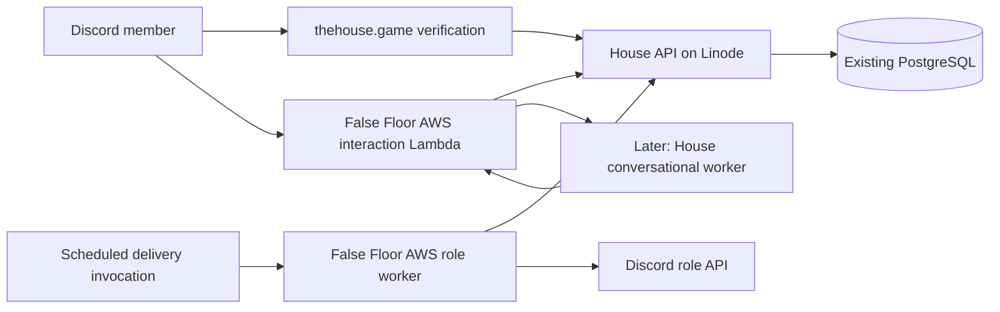

# The House Discord verification v0

## Outcome

A person joins The House Discord, follows a link to `thehouse.game`, signs into
their existing House account (or completes normal signup), proves their Discord
identity, and confirms the association. PostgreSQL saves the association. The bot
assigns the appropriate House community/staff roles. A verified House sysop can
use every implemented House bot capability, subject to the existing approval
requirements for consequential operations.

Verification must work while the conversational agent is asleep. AWS hosts the
new Discord control service; the existing Linode app remains the account and
permission authority. Live role-change subscriptions are deferred, but durable
delivery of requested role changes is required in v0.

The first implementation merged on November 8, 2026 in influence-game PR #317. AWS interactions and delivery functions are deployed from falsefloor/infra PR #39, the OAuth callback and `/verify` command are registered, and production secrets/SSM role IDs are wired. The Linode release passed staging qualification and is deployed in production at `11b049b35d96c927a853a716741d1c36110c584a`; the AWS worker passed its live queue check and its minute schedule is enabled. The implemented schema uses `discord_verification_attempts`, `discord_connections`, and `discord_connection_audit`, with the durable delivery revision/lease/retry cursor on the connection row rather than a separate jobs table. Live human OAuth and role-grant acceptance remain for the operator's sysop test. See the [current setup and deployment runbook](../discord-house-setup.md) for authoritative rollout status and configuration.

## Verified inventory — October 25, 2026

Read-only checks used Doppler secret names, in-memory credential validation against
Discord, and AWS inventory after the operator renewed SSO. No credentials were
printed, no Discord messages were sent, and no infrastructure was changed.

| Item | Evidence |
| --- | --- |
| Discord application | `1521918515752472606`, named The House; current bot token authenticates successfully |
| Discord guild | `1521918107554152468`, named The House; bot has access |
| Valid credential | False Floor Doppler scope `/Users/user/Development/overclaw/workspace-house`, project `overclaw-house`, config `prd`, key `DISCORD_BOT_TOKEN` |
| Other existing keys there | `DISCORD_APP_ID`, `DISCORD_HOUSE_PUBLIC_KEY`, `OPENCLAW_GATEWAY_TOKEN` |
| Original setup credential | `social-strategy-agent/dev/DISCORD_HOUSE_BOT_TOKEN` differs from the current token and returns HTTP 401 |
| Original guild configuration | `social-strategy-agent/dev/DISCORD_HOUSE_GUILD_ID` identifies the guild above |
| Missing from the inspected House config | Discord OAuth client secret; guild ID under a runtime configuration key |
| Bot interaction setup | No interactions endpoint, no global commands, no guild commands |
| Existing staff roles | House Admin `1521921692392357919`; House Moderator `1521921693646458953`; House Support `1521921694686511265` |
| Existing community roles | Member, Player, Spectator, Builder; no dedicated verified House User or House Sysop role |
| Bot permission | Its managed role currently has Administrator; role hierarchy still needs explicit preparation and proof |
| AWS | Profile `falsefloor-agents` resolves to account `978355607658`; inspected region `us-west-1` |
| House runtime | No `OverclawHouse` stack or nonterminated EC2 instance tagged `OverclawDeployment=house`; no House controller Lambda in the regional inventory |
| Existing AWS foundation | `OverclawHouseIdentity` and `CDKToolkit` are `CREATE_COMPLETE`; renderer prerequisite/bootstrap stacks also exist |

The application public key is present, but its stored value has not been compared
with the live application's key in this audit. OAuth redirect registrations were
not inspected. No bot-token reset is needed based on the successful API check.

The current Influence checkout already stores roles by `users.id` through
`user_roles`. Its `requireAuth` middleware reloads current roles/permissions from
PostgreSQL. Existing roles include `sysop`, `admin`, `moderator`, `gamer`,
`producer`, and `player`. The requested community tier **user** means any real
House account; it must not depend on a `player` grant or on having played a game.
The operator's production House sysop grant was not queried during this audit.

## User journey

1. The welcome/verification channel provides `https://thehouse.game/discord/verify`.
   `/verify` returns the same link privately. A generic link carries no
   Discord ID, role claim, credential, or account authority.
2. The page uses the existing House authentication UI and preserves the verification
   destination through login/signup. Existing invite and legal-acceptance rules
   still apply. A server join must not bypass invite-only signup.
3. The signed-in person selects **Connect Discord**. The API starts a short-lived,
   single-use OAuth authorization-code transaction bound to that House account and
   browser. Request Discord's `identify` scope only.
4. Discord returns to a registered, exact callback under `thehouse.game`. The
   callback page exchanges code/state through an authenticated POST to the House
   API. Bind the transaction to the initiating account and browser nonce; reject
   account switches, expired/consumed state, wrong issuer, and mismatched redirects.
   A GET callback or link preview cannot create an association.
5. Show **Connect Discord @name to House @handle** with explicit confirmation and
   a way to restart using a different Discord account. Discord's immutable user ID
   comes from its authenticated user endpoint, never from a typed name, supplied ID,
   email match, or the URL.
6. Confirmation atomically saves the association and a role-delivery job. Show
   **Account connected; applying server roles**, then actual delivery success or a
   useful pending/error state. Discord downtime does not erase the connection.
7. Account settings show the connected account, last successful role refresh,
   **Refresh roles**, and **Disconnect**. A user absent from the guild receives
   the existing join link and can retry after joining. Do not auto-join people.

Use session storage for the initiating browser nonce if retaining the existing
bearer-token frontend model. The callback page must remove OAuth query parameters
from browser history promptly, suppress analytics/query logging and third-party
content, and use a restrictive referrer policy. Never place House session tokens
in redirects. Store only hashes of opaque state/nonce values; consume the OAuth
exchange atomically. An interrupted exchange can restart safely. Keep verified
identity evidence briefly in the attempt row for explicit confirmation; discard
Discord access/refresh tokens after obtaining identity rather than persisting them.

## Durable identity and authority

Add narrowly scoped tables to the existing PostgreSQL schema:

| Table | Responsibility |
| --- | --- |
| `discord_connections` | Internal House user foreign key, unique Discord snowflake string, verified/updated timestamps, revision, active/disconnecting state |
| `discord_verification_attempts` | Hashes, initiating user/browser binding, fixed application/environment, expiry, atomic exchange/confirmation state, short-lived verified Discord identity |
| `discord_role_sync_jobs` | Connection/guild and revision, pending/leased/retry/completed state, attempts, next attempt, lease token/expiry, bounded error and delivery timestamps |
| `discord_connection_audit` | Small structured link/unlink/refresh/conflict/operator-repair records; no bearer credentials or full HTTP bodies |

One active Discord identity per House account and one House account per Discord
identity, enforced by database constraints. IDs remain strings. Repeating the same
link is idempotent; a different existing association returns a conflict without
revealing the other account. No silent transfer, email-based merge, or automatic
staff bypass. Changing accounts requires disconnect/cleanup and a fresh proof of
both identities. Do not reuse `authentication_credentials`: this is a community
association, not a new House login or account-recovery method.

Disconnect immediately disables bot authorization and queues removal of managed
roles. Retain the old binding in `disconnecting` state until removal succeeds or
the member is confirmed absent; do not allow a new link to race cleanup. Account
deletion must enter the same cleanup path before deleting its identity evidence.
Temporary attempt rows expire; durable audit retention must be documented in the
privacy policy. Do not expose the Discord link on public player profiles by default.

These are relational records and small operational state. No new document/blob
storage is needed. Do not retain OAuth response bodies in JSONB or logs.

## Role and capability policy

Proposed Discord display mapping is cumulative by community tier:

| Current House authority | Managed Discord roles | House bot capability |
| --- | --- | --- |
| No association | None | Verification/help only |
| Any authenticated human account | House User | Account/community commands |
| `moderator` | House User, House Moderator | Implemented moderation actions allowed by current House permissions |
| `admin` | House User, House Moderator, House Admin | Implemented administrative actions allowed by current House permissions |
| `sysop` | House User, House Moderator, House Admin, House Sysop | All implemented House bot operator capabilities |

The cumulative labels do not imply new inheritance in the app's RBAC engine.
For example, the existing House moderator only has character-review permission;
Discord moderation powers need an explicit permission mapping. `gamer`/`producer`
alone remain House User for these four community tiers. They retain their existing
application permissions, without becoming admins.

Keep Member/Player/Spectator/Builder interest roles separate. They cannot establish
verification. Use configured role IDs, not names, and mutate only the managed role
set. Adopt the existing Admin/Moderator roles only after reviewing current holders
and permission overwrites. House Admin currently grants Discord Administrator:
replace that broad grant with the specific approved staff permissions before
automatically assigning it. House Sysop identifies full House bot access; it does
not require automatic Discord server ownership or an Administrator grant.

Place the bot above every role it must assign, and prove assignment/removal for
each tier before activation. Remove its setup-time Administrator permission once
the required runtime permissions and hierarchy are proven. Update the old setup
script alongside this work so a later setup run cannot undo verification roles,
channel permissions, or the narrowed staff/bot permissions.

Before every privileged bot action, the trusted controller resolves the signed
Discord actor through the connection and reads current House permissions. Never
authorize from a username, conversation memory, prompt, stale Discord staff role,
or stored JWT role snapshot. No association or an unavailable authority service
means no privileged action. The agent receives capabilities from trusted code and
cannot grant itself roles. An existing Discord owner/old hardcoded owner ID is not
substitute proof of a House sysop account.

V0 refresh triggers: verification, explicit **Refresh roles**, `/house sync`, and
operator repair. Disconnect/deletion also enqueue cleanup. Until automatic role
change events arrive, demotion requires explicit refresh to remove Discord channel
access; document this operational limit and give sysops a targeted removal action.
Fresh permission checks still prevent stale Discord roles from authorizing House
bot actions. Ordinary login need not refresh every member's Discord roles.

## Deployment boundaries

**Influence repository / Linode:** authentication UI, OAuth code exchange,
association schema/migration, current permission resolution, connection management,
job claims/completion, and tests. Keep the Discord OAuth client secret here via
environment-scoped Doppler injection; never ship it to the web bundle.

**False Floor AWS:** one House interactions owner and a small role-delivery Lambda,
runtime secret storage, logs/alarms, and scheduled recovery invocations. Use
`falsefloor/infra` for AWS resources, checking its current ownership conventions
before implementation. This audit could not read that repository through the
connected GitHub account; existing local deployment docs identify it as the owner.
Keep application/controller code versioned with a clear release contract rather
than embedding mutable business logic in infrastructure templates.

The interaction endpoint verifies Discord's Ed25519 signature over the raw body,
timestamp, application and guild; rejects replays; and acknowledges within Discord's
three-second deadline. `/verify` can return its static link without waiting
on Linode. Defer network-dependent commands promptly. Do not introduce a second
interaction endpoint/listener when adding the agent later.

The role worker initially runs on a one-minute schedule and claims bounded pending
jobs over HTTPS from the House API. PostgreSQL remains the queue authority; no
second identity database or DynamoDB copy of user roles is needed. The UI reports
pending honestly rather than promising immediate assignment. Scheduled retries
deliver already-requested changes; they are not a full membership sync.

Use a dedicated high-entropy, environment-scoped service credential for the
worker/controller API, separate from human JWTs, MCP, game workers and deployment
control. Limit it to Discord identity/capability resolution and job claim/complete
routes. Do not give AWS direct database access or generic app-admin credentials.
Split read/delivery permissions by runtime role where separate callers exist.
The coding agent must never receive this service credential or the bot token.

On each attempt, resolve the current association and current roles, serialize work
per Discord member, remove obsolete managed roles before adding desired ones, and
use Discord's individual add/remove role endpoints so unrelated roles survive.
Use lease fencing for acknowledgements, bounded requests, `Retry-After` for 429s,
backoff for transient failures, and operator-visible configuration errors for
missing permissions/roles. Reconcile after uncertain writes. A database lease
cannot fence an already-sent Discord request: check revisions before writes and
recheck/reconcile afterward so a late grant cannot become a permanent stale result.
Do not claim exactly-once external effects.

**Linode IaC:** production/staging secret allowlists and runtime injection, callback
and frontend/API routing if needed, deployment/readiness documentation. Preserve
the existing production approval and blue/green release flow. No database move,
public PostgreSQL endpoint, or dependency on the agent's Tailscale network.

**Secrets:** retain the working bot credential in the House-specific False Floor
Doppler scope. Add the guild configuration and obtain the OAuth client secret for
the existing application. Verify the public key. Supply only selected keys to each
runtime through its existing secret-import/deployment pattern. Update the old
operator script to use this canonical source; do not revive the rejected legacy
token or copy FAMEliza credentials. Staging must use a separate Discord application
and test guild so tests cannot grant production staff roles.

## Building on Society / waking the agent

The current Society Agents source has a signed serverless controller, durable
queue/outbox, disposable GitHub Actions workers, native conversation recovery,
isolated Gateway/coding containers, scoped repository access, and checkpointed
sleep/resume. Those boundaries are useful precedents.

The older Overclaw House plan instead describes a dedicated EC2 runtime with
Tailscale and AWS/OpenAI federation. Its current House Doppler config still lacks
the enrollment and inference identity references described by that plan. The
deployed identity stack alone does not establish a working inference runtime.

Recommendation: deliver verification first, then adapt the current Society
controller/worker lifecycle into an independently configured House deployment.
Do not start by building the older EC2 design merely because its identity stack
exists. Verification introduces no paid inference, coding worker, GitHub signing
authority, or gateway requirement. If House compute must live in False Floor AWS
as well, implement an AWS worker-launch adapter while preserving Society's native
worker/checkpoint contract; GitHub Actions is Society's current implementation,
not an already-approved House compute destination.

The conversational release must consume the new House permission-resolution
contract, replacing the older hardcoded owner-only authorization. A verified sysop
must be recognized on commands and ordinary awake replies, including after sleep
and restore. Preserve action-specific human approvals. Ordinary House users must
not gain repository, deployment, spending or privileged game access through the
public community bot.

## Delivery sequence and acceptance

1. **Prepare existing application:** recover/canonicalize configuration, inspect
   redirect settings, obtain OAuth secret, create a staging bot/guild, and review
   the role/overwrite plan. Do not run the old whole-server setup as a credential
   test. Record application/guild/role IDs without secrets.
2. **Implement identity end to end:** schema, authenticated start/exchange/confirm,
   website page, settings, conflicts, disconnect and audit. Local proof uses the
   real API and PostgreSQL with a deterministic Discord adapter.
3. **Deploy the minimal AWS control service:** signed interactions, role worker,
   scoped app API access, logs/alerts and retries. Add `/verify`; keep status and manual role refresh on the website for v0.
   Prepare the welcome link for a separately executed
   server setup. Validate in staging before the normal production rollout.
4. **Prove the actual user journey:** verify one ordinary user and each staff tier;
   then the operator logs into their existing House sysop account and confirms
   Discord. Prove persisted identity, role readback, capability recognition,
   refresh/demotion, disconnect cleanup and process-restart recovery. No inference
   runtime is claimed awake at this milestone.
5. **Wake the conversational House:** isolated runtime, House persona/workspace,
   current permission checks, bounded repository/capability grants, provider
   authentication, durable wake/queue/sleep/restore. Prove a real authorized
   conversation and rejected unauthorized access. Infrastructure and inference
   prerequisites are resolved here, independently of verification availability.
6. **Later live synchronization:** emit role/account/link changes into the same
   durable delivery path, handle Discord leave/rejoin, and add periodic drift
   reconciliation. No replacement identity store or new role authority.

Required implementation tests include wrong-account/cross-browser completion,
forged/replayed/expired state, missing authorization, duplicate concurrent links,
same-link retries, conflict privacy, signup restrictions, legal acceptance,
non-member/rejoin, service-account rejection, deleted/disconnected accounts,
stale-role authorization, simultaneous demotion/unlink and delivery, 429/403/5xx,
missing/deleted roles, hierarchy failure, crash after Discord succeeds but before
acknowledgement, and preservation of unrelated roles. Browser coverage must prove
login continuation and accurate pending/failure/success states.

Before merging implementation, run `bun run test`, `bun run test:postgres` and
`bun run check`; DB tests use `setupTestDB()` and remain sequential. External-write
tests must be classified and opt-in. The October 25 documentation investigation did not run application tests. The
November 8 implementation adds local API, worker, signature and browser coverage;
the live verification/write rehearsal remains a deployment acceptance step.

## Sources

- `docs/discord-house-setup.md`, `scripts/setup-house-discord.ts`.
- `packages/api/src/db/schema.ts`, `db/rbac.ts`, `db/rbac-seed.ts`,
  `middleware/auth.ts`, `services/account-authentication.ts`.
- `packages/web/src/components/authentication-route.tsx`.
- Sibling `society-agents/docs/architecture.md`, `README.md`,
  `docs/operator-setup.md`; sibling `overclaw/docs/house.md`,
  `docs/house-identity.md`, `deployments.json`.
- Sibling `linode-iac/docs/architecture.md`.
- [Discord OAuth2](https://docs.discord.com/developers/topics/oauth2).
- [Discord interactions](https://docs.discord.com/developers/interactions/receiving-and-responding).
- [Discord permission hierarchy](https://docs.discord.com/developers/topics/permissions).
- [Discord guild member role API](https://docs.discord.com/developers/resources/guild).
