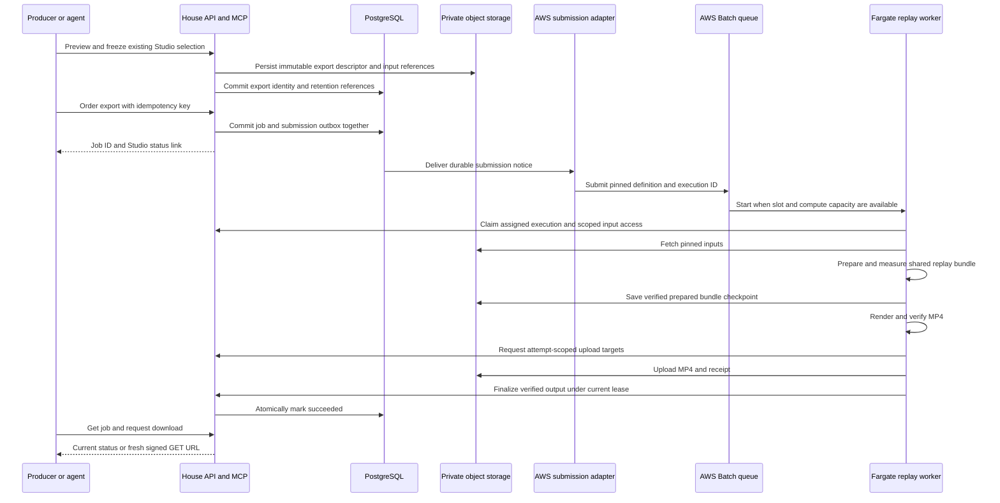

# Shared Batch rendering for trailers and Studio exports

Implementation checkpoint, 2026-11-02: the first staging-test slice adds durable
jobs, private bundle transport, assigned replay/trailer workers, Batch submission
and networking source, producer status/download reads and local Docker proof.
Browser and MCP can now order exact frozen cuts without CLI preparation; the
assigned worker prepares the shared replay bundle. MCP uses separate
`producer:render` consent. Multipart recovery, automatic retry policy and
long-runtime acceptance remain subsequent milestones. Current deployed-target
policy has not been switched.
See [the staging runbook](../deployment/batch-render-staging.md).

Move the existing Studio selected-export flow onto the House Fargate renderer and use AWS Batch as the shared scheduling target for both trailers and Studio exports. A producer or authorized agent should select a cut, order an MP4, leave, and return hours later with the job ID to inspect progress or obtain a fresh private download URL. The output must contain the exact frozen selection and presentation that were ordered. Trailers receive reserved capacity so long exports cannot occupy their entire render allowance.

Originally a planning-only document, this now tracks the user's authorized first implementation for a staging test, including browser and MCP ordering. Local implementation and Docker rendering are in scope; cloud IAM provisioning, credential installation and target activation remain separate operator steps. Long-runtime acceptance remains a later milestone.

## Recommended first delivery

Keep the existing moment selection, Studio preview, frozen descriptor, replay compiler and Remotion composition. Add a durable Studio export job and a replay-render entry point in the existing worker image. **Add AWS Batch on On-Demand Fargate as a new renderer target for both trailers and Studio exports.** Reuse the PostgreSQL outbox pattern, immutable image provenance, storage boundaries and job leases. Share scheduling and execution lifecycle while retaining separate exact trailer/replay payload contracts and public/private output policies.

Use one assigned render per Batch job and two workload lanes per environment: trailers and Studio exports. Each lane has its own queue, compute environment and concurrency budget, managed through the same Batch integration. Proposed initial production capacity is two trailers plus two exports; staging is one of each, subject to resource and spend agreement. Existing local/direct-ECS renderer behavior remains available as-is until its workload is explicitly migrated. Temporary coexistence serves migration, not a permanent split between trailer and Studio systems. There is no automatic fallback between targets.

Use job-scoped renderer admission for both Batch workloads so ordinary deployments can leave accepted jobs running at their pinned image. This requires application and release work in addition to Batch. Existing targets keep their current release fencing until cutover. An incompatible worker protocol/storage change must still drain affected jobs before deployment. The shared Batch destination and staged target migration are the user's requested direction; production capacity, cloud provisioning and migration execution remain separate operator decisions.

Studio's supported result remains an H.264 MP4 with AAC when audio is scheduled, plus a private receipt. Trailer rendering retains its current video/poster/captions/metadata bundle and public publication flow. Keep local descriptor download and local rendering available. No new cut-project model, negative selection semantics, branching, revision workspace, automatic continuity evaluator, new social publishing, or distributed frame rendering is required.

## What exists and what is missing

The application checkout examined is `0cbe1352606fdc6085a530ad859e216b2f2aa5fa`. Infrastructure source was read from `falsefloor/infra` main, whose observed head was `c8167c51e5afda3a676d7008d42a385a0bc4e35a`. These are source findings; live ECS task definitions and deployed releases still need reconciliation before implementation acceptance.

| Area | Current behavior | Cloud export gap |
| --- | --- | --- |
| Studio selection | `POST /api/admin/production/games/:id/selection` checks the displayed IDs against selection resolved in a consistent read; returns a hashed descriptor. Validation reauthorizes frozen source and IDs. | Store that exact descriptor durably and accept an asynchronous order without re-running live tags later. |
| Agent editing | MCP exposes `read_production_moments`, `update_production_moment_tags`, and `preview_production_cut`, including a review link and fingerprint. | No render ordering, durable render status, or result-download tool. Preview fingerprint is not the complete export descriptor hash. |
| Local rendering | `export-house-replay.ts` authenticates, loads the pinned source, binds selected moments, fetches exact audio/media, prepares a bundle, then invokes the shared renderer. | Separate its reusable orchestration from browser CLI login and filesystem arguments; add job-scoped source access. |
| Existing remote worker | Claims public trailer jobs, heartbeats, renders, requests upload targets, uploads, verifies/finalizes; remote launch and generation ownership already exist. | Trailer manifest, game/media identity, visibility gate and public publication cannot represent multiple private Studio exports. |
| Remote policy | `deployment/render-execution.json` selects remote for prod and staging. | Older local-first runbooks are historical and must not determine activation assumptions. |
| Fargate source | 2 vCPU, 4 GiB; one occupied task per environment; staging has a tailnet sidecar. No expanded ephemeral storage is declared. | Measure full-export memory, disk, startup and network behavior; do not assume trailer sizing is sufficient. |
| Staging limits | Stack sets a 720-second container timeout, controller `PROOF_STOP_AFTER_SECONDS=600`, and `PROOF_MAX_TASKS=1`. | New Studio Batch definitions must use their own runtime policy; do not copy these trailer proof controls into the new lane. |
| Publication | Trailer video allowance is 1 GiB and uses immutable public URLs. | Private export storage, large streaming uploads, and renewable authorized download links. |
| Release handoff | Requires zero API leases and no occupied cloud task before replacing the accepted generation. | A long render delays deployment; pipeline timeout/recovery must tolerate that or release ownership must change. |

Current MCP `producer:edit` explicitly says it edits tags and **does not render**. Do not silently turn existing consent into permission to spend on cloud exports.

## Scheduling evaluation and recommendation

Evaluated on 2026-11-02 against the application and host contracts above, the unchanged infrastructure main revision, and current AWS documentation. Neither option has been deployed or benchmarked for Studio. The comparison is for a bounded queue of independent one-to-six-hour exports, not distributed rendering of one movie.

| Concern | Extend the existing controller | AWS Batch on Fargate |
| --- | --- | --- |
| Concurrent jobs | Replace `occupied` singleton with multiple durable slots; update CAS races, launch reconciliation, STOPPED handling, drain and status contracts. Implement scheduling/fairness. | Managed queue and placement; native resource accounting can bound jobs independently of task size. |
| Existing integration | Reuses exact task template, network broker and `RunTask` client-token recovery. Lowest change count if retaining one slot and global drain. | New compute environment, queue, job definitions, submission adapter, IAM and event reconciliation. Existing task definition cannot simply be attached as a Batch queue target. |
| Long runtime | Fargate already supports it; remove proof-specific stops for the intended workload and add watchdog/recovery behavior. | Multi-hour jobs fit the service; define job timeout explicitly and keep application leases/checkpoints. No faster rendering implied. |
| Exact renderer | Current environment admits only one generation/digest. Supporting concurrent releases or queued historical images expands controller and host contracts. | Pin image digest and full job-definition revision per submission; still need House authorization to honor that job after a release. |
| Staging network | Existing sidecar and task-scoped identity protocol fit directly, but broker/controller must become multi-slot aware. | Multi-container Fargate jobs are supported. Sidecar readiness and broker identity binding need adaptation; this is a feasibility gate. |
| Uncertain submission | `RunTask` uses persisted parameters and a client token, with explicit uncertain-launch handling. | `SubmitJob` has no documented client-token field. Keep a durable submission ledger and duplicate-safe job claims; do not assume names deduplicate. |
| Retry/cancel/status | Extend existing custom supervision for multiple slots and job types. | Batch supplies execution state and termination APIs; House still owns retry decisions, durable product state and verified output. |
| Deployment isolation | More slots alone leave the current zero-lease release barrier intact. | Batch does not remove that barrier either. Job-scoped admission for migrated workloads is required under either option. |
| Cost | Fargate/storage/network plus existing control services; engineering owns more scheduling behavior. | Same underlying compute/storage/network costs plus adapter/event services. AWS adds no Batch service fee; no claimed runtime savings. |
| Long-term ownership | We own a growing scheduler as well as the export product. | AWS owns queue placement and capacity scheduling; we retain domain integrity and networking. |

**Recommendation: one Batch rendering system for both workloads.** Multiple long exports and growing trailer demand need controlled capacity; expanding a single occupied-slot controller is more than changing a concurrency integer. Batch removes scheduler responsibilities we otherwise have to grow and test. It does not remove our storage, authorization or recovery responsibilities. If a feasibility gate fails, retain the current target and revisit that gate; do not silently route failed Batch jobs elsewhere.

Trailer migration is included in this plan, not deferred indefinitely. Each execution has exactly one target owner, and the end state has both workloads on Batch. Use a small explicit target dispatch boundary for existing execution and Batch, not a general plugin registry. Remove obsolete direct-ECS controller resources and code only after both environments have migrated, all old attempts/identities are reconciled and the agreed rollback window has ended. The independent local exporter remains useful.

### Capacity configuration

Use a `REPLENISHABLE` Batch consumable resource per environment and workload, such as `trailer-render-slots-prod` and `studio-render-slots-prod`, each with its own total quantity. Every definition requires one unit of its lane's resource, including retries and retained renderer revisions. AWS supports resource-aware scheduling on Fargate and releases replenishable resources after job completion. Each lane also has a separate compute-environment `maxvCpus` budget. [Resource-aware scheduling](https://docs.aws.amazon.com/batch/latest/userguide/resource-aware-scheduling.html), [consumable resources](https://docs.aws.amazon.com/batch/latest/userguide/resource-aware-scheduling-how-to-create.html)

For example, two approved 2-vCPU jobs in each production lane imply separate 4-vCPU compute budgets, 8 vCPU total. The final task allocation must include the sidecar and measured memory requirements. Restrict submissions to approved definitions and lane mappings; callers cannot select the protected trailer queue for a Studio export or override its slot requirement. Keep staging and production resources, IAM and submission records separate.

Reserve trailer capacity structurally: the Studio queue is not associated with the trailer compute environment and cannot borrow its slots. Do not implement borrowing in v1. Queue priority orders evaluation for shared capacity; it does not supply the isolation needed when exports occupy that capacity for hours. [AWS queue priority](https://docs.aws.amazon.com/batch/latest/userguide/job_queues.html)

This is reserved concurrency/compute budget, not prepaid warm capacity or an AWS placement guarantee. Confirm regional/account Fargate quota, subnet addresses and API/storage headroom cover both lane maxima plus other consumers; otherwise shared limits can still block trailers. Track queue age and failed submissions separately by workload and make each lane's capacity independently adjustable through reviewed infrastructure. Keep automatic game progression independent of postgame trailer scheduling; this work must not introduce a wait for a render into the game runner.

Keep direct SQS → ECS Pipes out of this design: it invokes `RunTask`, not a full render lifecycle. The existing signed ingress/SQS delivery pattern can transport typed render submission notices to one AWS-side adapter, while Batch owns scheduling. PostgreSQL still owns accepted trailer/export jobs and their outbox. Never place media or bearer credentials in queue messages. [Pipes ECS target](https://docs.aws.amazon.com/eventbridge/latest/userguide/eb-pipes-event-target.html)

### Renderer targets and migration contract

The current release policy has `mode: local | remote` and independent `network: direct | tailnet`. Add an explicit scheduler target, with proposed values `existing` and `aws-batch`, selected per environment/workload during migration. `existing` delegates to the current mode/network path without changing its polling, batching, claims, uploads or release protocol. Batch uses the same environment's approved network boundary. This target selects execution infrastructure; it is not a feature flag, contestant setting or a permissive input-schema fallback.

Publish the target-aware policy through the current digest-verified API/renderer release family and teach host preflight its contract before selecting Batch. The capability release explicitly selects `existing` for currently served trailers. Do not activate Batch through an unreviewed environment toggle or reinterpret `remote` as Batch. The exact config schema is an implementation detail to settle against the host parser; old binaries must never receive a new policy they cannot validate.

Persist target, workload, routing epoch, execution ID, exact input hash and renderer identity on an execution assignment. Atomic acceptance and claim checks choose one target; worker credentials and endpoints must reject jobs assigned to the other target. Existing trailer rows need a durable assignment that also fences the legacy polling query; adding a Batch queue alone is insufficient. Existing queued rows without assignments are inventoried and assigned under the cutover lock before Batch admission. Large source manifests stay in existing storage, not copied into the routing ledger.

Cut over one environment/workload at a time:

1. Deploy Batch capability while production trailers remain on `existing`; validate target isolation and preserved existing behavior. New Studio exports can enter Batch when their own validation is complete.
2. Stop old trailer dispatch/claims using the existing drain operation. Continue accepting game-owned enqueue events into the durable backlog, but hold dispatch during handoff. Prevent old wake repair/polling from admitting new claims.
3. Let all old active attempts finish; reconcile unknown launches, uploads, STOPPED state and tailnet cleanup. Require zero old leases/occupied tasks before transferring queued work. Do not kill active renders or reset generations to make cutover pass.
4. Under one routing fence, assign remaining eligible queued trailer work to Batch using the same canonical manifest, render/artifact version and completed-game identity. Preserve waiting-music/failed states and their explicit recovery policy. Commit assignments and submission outbox entries atomically; do not create duplicate trailer requests or regenerate source content.
5. Accept the new target epoch and resume dispatch. Replay delayed old wake messages harmlessly: old claims fail the routing fence. Verify the new public trailer bundle, private Studio result access, reserved capacity and clean job/identity exit before repeating in production.

Rollback is an explicit workload handoff, never failure-driven fallback. Pause new Batch trailer submissions, cancel queued executions and reconcile uncertain submissions; drain active ones or explicitly cancel them with completion authority revoked. Transfer only unstarted/retry-eligible work after all prior execution authority is fenced. Completed publications remain valid. Restore `existing` through its normal fresh-generation acceptance; never reuse a retired epoch. Studio remains Batch-backed or paused because the current trailer worker cannot render Studio exports. Interrupted cutover/rollback resumes from a durable journal, not a fresh guess about target ownership.

After both environments have passed the agreed rollback window, remove obsolete direct-ECS dispatch, wake bindings and singleton control resources, retaining audit/history evidence. Track this closure with [W13 in the refactor queue](../refactor-queue.md#w13-postgame-media-scale-out-and-runtime-portability). Keeping current execution working during migration is explicitly required; leaving two permanent render schedulers is not the destination.

### Submission and execution ownership

The AWS-side adapter receives a bounded signed notice carrying workload, target epoch, accepted House job/execution IDs and approved definition identity, and submits one exact Batch definition. The House outbox freezes this small execution specification; large/private render input stays in storage. This avoids requiring the adapter Lambda to reach the private staging API before launching its tailnet-enabled task. It uses its AWS role; the House host does not receive general AWS credentials. Its release-owned registry restricts queue, definition revision, image digest, network and roles independently of notice input. Keep submit authority separate from release admission authority. This is a new shared Batch message contract, not an expansion of the old trailer wake credential's authority to select images.

Persist submission intent before `SubmitJob`, then record the returned Batch ID. A lost response is `submission_unknown`, not a failed job or permission to resubmit immediately. Reconcile by durable execution ID, deterministic name, tags, Batch queries/events and worker registration. These are correlation mechanisms, not exactly-once submission. The documented API offers definition revisions but no idempotency token. [SubmitJob](https://docs.aws.amazon.com/batch/latest/APIReference/API_SubmitJob.html)

Before fetching private inputs or starting expensive work, each task must atomically claim its specific House execution. A second Batch task for the same execution exits without rendering. Delayed tasks from an abandoned execution are rejected. Authenticate registration against the expected definition/digest and actual Batch task identity; a supplied job ID alone is not authority. An uncertain submission can still cause duplicate short-lived startup costs, so use bounded reconciliation and surface unresolved cases instead of repeatedly submitting. If a controlled resubmission is necessary, fence the old execution and terminate every discovered duplicate.

Set Batch retry attempts to one initially. House owns the proposed one-transient-restart policy for Studio and the existing trailer retry/waiting-music policy for trailers. A retry creates a new execution ID only after fencing/reconciling the prior execution. This prevents multiplying Batch retries by application retries. Batch completion is infrastructure evidence, not product success: each workload's verified upload and database finalize transaction establishes success. EventBridge events accelerate reconciliation; periodic `DescribeJobs` checks repair missed events and unresolved submissions. AWS does not emit an initial submission event. [Batch events](https://docs.aws.amazon.com/batch/latest/userguide/batch_job_events.html)

For cancel, revoke House completion authority first, then terminate the associated Batch execution and reconcile its terminal state. `CancelJob` can return success without stopping an already-starting/running job; `TerminateJob` handles those states and cancels earlier states. Do not equate API acknowledgement with confirmed exit. [CancelJob](https://docs.aws.amazon.com/batch/latest/APIReference/API_CancelJob.html), [TerminateJob](https://docs.aws.amazon.com/batch/latest/APIReference/API_TerminateJob.html)

### Image and deployment lifecycle

Register a Batch definition revision with renderer and sidecar images pinned by digest. Store the complete revision ARN, image digests, input contract and House execution identity on each order; never submit the unversioned definition name. Keep referenced definitions active, images retained and secrets available while queued/running jobs or permitted retries depend on them. [Image definition contract](https://docs.aws.amazon.com/batch/latest/APIReference/API_TaskContainerProperties.html)

New Batch jobs use their workload's currently admitted release, while existing jobs retain immutable admission. Workers claim only their assigned job, not arbitrary future work under an old generation. Job-scoped admission applies to both trailers and Studio after migration. The old target retains its current singleton fence until drained and replaced; no retired release epoch is resurrected. Exact-contract authorization, target ownership and attempt fences remain mandatory.

Routine app deployments may proceed only when the new API still implements the exact execution contracts needed by accepted jobs of both workloads. Before a breaking contract/schema change, stop new affected admissions, drain queued and running affected jobs, then remove the old contract. No legacy payload parser or compatibility fallback is proposed. Rollback follows the same contract check. Pinning images alone cannot make an incompatible API safe, and neither Batch nor extra controller slots fixes that.

### Staging and infrastructure feasibility gate

Batch supports `ecsProperties` multi-container jobs on Fargate, but its documented container dependency conditions are `START`, `COMPLETE` and `SUCCESS`, not the existing ECS `HEALTHY` dependency. Preserve the same security outcome with a bounded renderer-side HTTPS readiness probe through the local proxy before claim; test sidecar failure, loss of readiness and clean shutdown. Do not expose staging publicly or weaken certificate verification. [Multi-container jobs](https://docs.aws.amazon.com/batch/latest/userguide/multi-container-jobs.html), [dependency contract](https://docs.aws.amazon.com/batch/latest/APIReference/API_TaskContainerDependency.html)

The current tailnet broker binds capabilities and cleanup to the controller's single persisted launch. Batch needs per-execution/per-task identity records, single-use joins and terminal cleanup reconciliation. Cleanup failure must block new staging submissions and network joins/claims from already queued jobs until reconciled; Batch slot release alone must not imply network identity revocation. Prove this without giving OAuth credentials to workers. Preserve the existing userspace proxy and approved VPC/subnets/security groups; Batch manages its own compute environment rather than adopting the controller's ECS cluster.

Verify the chosen IaC library exposes the required multi-container and consumable-resource contracts, IAM boundaries permit the new Batch/service-linked-role operations, ECR retention protects queued definitions, and the region/account supports the proposed configuration. Reuse existing network resources and public-IP behavior where appropriate; Fargate Batch needs public IP enabled when its subnets lack NAT. [Fargate compute environments](https://docs.aws.amazon.com/batch/latest/userguide/fargate-compute-environments.html)

A small staging render is valid functional evidence under a short test timeout. It cannot establish six-hour readiness. New Batch definitions use workload-specific runtime policies instead of inheriting the old target's 600/720-second proof controls. Proposed Studio timeout is eight hours including preparation and upload after start; select the trailer timeout from measured complete trailer renders. Queue/startup age needs separate monitoring. AWS Batch has no default job timeout and does not automatically retry timeout termination. [Job timeouts](https://docs.aws.amazon.com/batch/latest/userguide/job_timeouts.html)

Batch adds no service charge, but extra concurrent jobs and duplicate starts still consume paid Fargate, logs, network and storage. No price or speed reduction is assumed. [AWS Batch pricing](https://aws.amazon.com/batch/pricing/)

## End to end flow

All operations return promptly; no MCP call, HTTP request, browser tab, or agent process remains open for the one-to-six-hour render. SQS transports submission notices; PostgreSQL owns export orders and Batch schedules execution. SQS visibility timeout is not the movie's runtime limit.

### Freeze the existing export

Use one shared application service for UI and MCP freezing, preserving the current selection validation. Persist exact moment IDs, source/media snapshot, annotation evidence, copy, geometry, fps, timing, music and recording identities. Resolve generated audio to the exact selected versions. A review URL or recipe alone is insufficient: later tag/audio/publication changes must not alter an order.

Proposed MCP `prepare_production_export` takes the existing selection inputs, expected preview identity and explicit presentation settings. It returns a durable export ID, descriptor hash and summary. It performs no movie render. The UI uses the same operation behind its existing export dialog. Keep the original JSON download shape available through the existing path; do not create a permissive alternative descriptor format.

Freeze and ordering may be a single UI action while remaining independently retryable API steps. Do not put expensive asset download or Chromium preparation inside a database transaction or the interactive request. Before committing an accepted export, durable input references must exist and be retained against cleanup. Storage upload followed by database commit needs orphan cleanup if the database write fails.

Queued work must not quietly adopt a different presentation implementation after deployment. Record and retain the required renderer build/digest, Batch definition revision and bundle contract. An admitted queued job remains entitled to its exact renderer, even after a new release becomes the default for new orders. Unexpected missing images or revoked execution contracts produce actionable `renderer_unavailable`; they never silently re-freeze the cut. Breaking protocol changes require the drain described above.

### Imported recordings

Generated game audio already has durable version identities. Imported recordings currently live in browser memory or CLI-local files; their descriptor metadata does not make the bytes available in Fargate.

Preserving the existing export capability requires an attachment step: obtain private constrained upload targets, upload only the selected local recordings, and verify hash, speaker, exact text, duration and alignment before accepting the order. Bind the verified objects to the export. The agent path needs equivalent upload instructions and completion calls, without sending audio/base64 through MCP. Missing attachments remain a clear preparation error, never silently omitted speech. This is input transport, not a new audio editor or speech-generation feature.

### Prepare and render

The worker calls the existing source loader, binder, asset preparer and renderer through reusable functions. It receives only access to the claimed job's frozen inputs, without a user's session token, broad Producer privileges, bucket credentials or release-control authority. Inputs must be authorized at acceptance and claim; no caller-supplied arbitrary URLs, filesystem paths, or worker commands.

Download and hash-check inputs before encoding so signed source URLs cannot expire halfway through the movie. Prepare complete canonical state before selecting movie content, preserving existing replay semantics. Freeze layouts/pages in the layout prepass, then persist the prepared bundle and its manifest hash in private storage. The current renderer writes measured layouts back into the manifest: take the durable checkpoint **after** that write, not before it.

That checkpoint avoids re-fetching or re-measuring inputs after worker loss. It does not resume at a completed frame: v1 rerenders the movie from the beginning if the encoding process is lost. Store a verified completed movie before attempting final publication so an uncertain finalize response can be reconciled without rerendering.

## Durable job model and recovery

Use a Studio-specific job identity, not the existing trailer row keyed by game/media type. Multiple exports from one game are ordinary independent orders. Reuse small concrete worker lifecycle functions where their semantics match; do not introduce a general workflow framework or loosen trailer schemas to accept replay inputs.

The shared execution envelope identifies `trailer` or `studio-export` with an exact discriminated payload contract. Reuse one Batch submitter, execution ledger, target fencing, cancellation transport, progress plumbing and infrastructure reconciler. Workload handlers retain canonical input validation, artifact verification and finalization. A Batch trailer job names one existing game/render version instead of polling for arbitrary work; the legacy target keeps its finite-batch polling behavior unchanged until cutover. This makes scaling trailers independent of rewriting their renderer.

Preserve automatic trailer enqueue after the game/editorial prerequisites settle, both game kinds, per-game enqueue deduplication, visibility restrictions, immutable public artifact versions, waiting-music behavior and explicit rerender recovery. Failed replacements retain the previous ready bundle. Studio always uses private output storage and current producer authorization; sharing Batch must never let a Studio request invoke the trailer's public publication path. Preserve all existing accepted game/history hashes during migration.

PostgreSQL owns job ID, game and requester, descriptor/bundle references and hashes, render build, state, attempt number, lease ownership, timestamps, bounded progress, output references and typed failure category. Large descriptors, bundles, receipts, logs and binaries belong in private object storage. New document columns use the existing `payloadColumn` discipline and explicit inventory entries. Existing binary/document migrations are required if implementation moves any current fields; this plan does not authorize a new-writes-only storage refactor.

Proposed Studio lifecycle; the trailer handler retains its existing domain states:

`queued → preparing → rendering → validating → uploading → succeeded`

Use a separate stage field for layout measurement, encoding and muxing details. Track `retry_wait`, `failed`, `cancel_requested` and `cancelled` explicitly. A missing worker heartbeat is an observation until lease reconciliation establishes ownership; it is not success or cancellation.

Required lifecycle rules:

- Scope idempotency keys to actor, environment and operation. Exact request replay returns the original export/job; a different payload under the same key conflicts. Do not equate equal descriptor hashes with duplicate intent: an explicit fresh order may be intentional.
- Commit queue state and target-aware submission outbox atomically. Batch dispatch/repair covers both workloads; legacy wakes remain owned only by the old target during migration. Duplicate notices cannot create duplicate accepted orders; uncertain Batch submissions follow the execution-claim fencing above.
- Every heartbeat, progress write, upload grant and finalize is fenced by job, attempt, lease token and release/worker identity. Finalize compares the expected input and renderer identities and accepts only one result.
- Renew short leases throughout preparation, rendering, verification and upload; the existing ten-minute default lease is renewable, not a ten-minute runtime cap. Cancel the render process when ownership is lost. The existing worker swallows heartbeat errors, so it needs explicit last-success tracking, bounded transient retries, and cancellation before assuming an expired lease is still valid.
- Retry transport/storage failures with bounded backoff. Preserve attempt evidence and retry from the latest verified stage. Do not keep burning six-hour attempts on malformed bundles, missing pinned assets, unsupported contracts or repeated OOM. Surface those failures with an actionable category.
- Proposed Studio allowance: one automatic restart for a transient lost render attempt, then producer retry. Preserve the current trailer recovery policy. Upload/finalize retries reuse the completed artifact where possible. Retry policy and elapsed work remain visible.
- Cancellation first revokes finalization authority transactionally, then asks the worker to stop. A race has one winner: a completed job stays completed, or cancellation prevents later success. A stale task cannot overwrite the chosen result. Cleanup and ECS STOPPED confirmation remain distinct from accepting a cancel request.
- Task loss destroys scratch space. Retain accepted descriptors, prepared bundle checkpoints, completed output and failed-attempt receipts until an agreed retention policy applies. Collect abandoned upload objects and multipart sessions only after fencing their attempts and a grace period.

Do not serialize errors containing private dialogue, credentials or signed URLs into ordinary job status. Keep detailed diagnostics producer-scoped and separate from contestant or public replay APIs.

## Storage and result access

The phrase “signed uploads back” involves two different operations:

1. **Worker upload:** API issues short-lived PUT or multipart-part targets for server-chosen private keys, bound to the current attempt, content type, expected length and checksum. Obtain them when the bytes are ready, not when the job is first queued.
2. **Producer download:** after verified finalization, API checks current Producer/Sysop access and returns a short-lived signed GET URL, expiry, filename, size and checksum. A producer can request another URL later with the job ID.

Use existing private bucket configuration and clients, extending them with streaming transfer rather than routing multi-gigabyte video through the in-memory payload helpers. Do not inherit the trailer's public prefix, public immutable cache headers or 1 GiB limit. No movie is attached to the public game player by completing a Studio job, even when its audience is Mystery.

Plan resumable multipart transfer for large movies using the existing S3 SDK, after verifying the actual storage provider's supported checksum and multipart behavior. Stream hashing, uploads and verification. The server must verify bytes/length before committing an output reference; worker-supplied metadata or a multipart ETag alone is not SHA-256 proof. If storage cannot enforce a suitable checksum, stream a verification read rather than loading the object into API memory.

Presigned upload credentials may remain usable until expiry even after a lease is revoked. Use unique attempt keys and immutable output promotion/copy or equivalent overwrite protection so a stale upload cannot change bytes referenced by a successful job. Recheck authority after external verification before the final database compare-and-swap. Database rollback does not delete external objects automatically.

Hidden games retain producer access through the existing Studio policy. Non-producers receive no private status details or URL simply because they know a job ID. Role/scope revocation prevents new reads/download grants; a signed GET already issued remains usable until expiry. Proposed link lifetime is 15 minutes, renewable on demand. Never persist signed URLs as durable output identity, put them into public logs, or treat them as permanent sharing links.

## Agent and UI contracts

Tool names below are proposals. All UI operations call the same services, with strict inputs and output schemas, bounded result pages, runtime output validation and regenerated MCP contract artifacts.

| Operation | Proposed tool | Result |
| --- | --- | --- |
| Freeze current selection | `prepare_production_export` | Export ID/hash, exact settings and moment summary, input readiness, review path |
| Order output | `create_production_render` | Job ID, accepted descriptor hash, state, status path |
| Check progress later | `get_production_render` | State/stage, elapsed time, heartbeat freshness, attempt, bounded progress, failure if any |
| Rediscover orders | `list_production_renders` | Paginated jobs filtered by game/status/requester |
| Obtain output | `get_production_render_download` | Fresh authorized signed GET URL and expiry, bytes/hash/duration |
| Stop or retry | `cancel_production_render`, `retry_production_render` | Idempotent cancellation or explicit retry receipt for unchanged frozen inputs |

Add a dedicated opt-in OAuth scope such as `producer:render` for ordering, retries and cancellation, requiring current Producer/Sysop role. Keep `producer` for authorized inspection/download; retain `producer:edit` for existing tag mutations. Do not require tag-write authority to render an already frozen selection. Input-upload tools require the same render authority and export ownership binding. Consent copy must say ordering can incur cloud costs and does not publish.

Agent journey: read the game/moments → use existing tagging/recipe operations → preview → freeze exact settings and recordings → order → retain job ID → later poll status → request download. The agent may iterate with another frozen export; no branch or revision feature is implied. A UI review link is useful, but a mandatory human click before every render would prevent the requested end-to-end agent workflow and is not proposed.

In Studio, add **Render in cloud** to the existing Export dialog, showing exact dimensions/fps, audience, audio readiness and a summary of the frozen cut. Preserve **Download selected export**. After ordering, show a persistent job link and a game-scoped **Exports** list accessible after refresh or reopening the browser. Label rows with requester, creation time, audience, settings and descriptor identity so multiple similar cuts are distinguishable.

Show queued/preparing/rendering/encoding/uploading/complete, elapsed time, last update and cancel/retry/download when applicable. Do not call frame rendering “100% complete” before verification/upload/finalization. Feed durable progress from renderer callbacks instead of parsing terminal prose. Write at bounded intervals, for example every 15 seconds or meaningful stage transition; heartbeat independently. Poll the UI around every 15 seconds while visible, back off when hidden, and stop on terminal status. ETA is approximate and absent until meaningful measurements exist; queued position is not a promised start time.

## Runtime limits and contention

| Constraint | First-release handling |
| --- | --- |
| Staging proof limits | Old-target limits remain until cutover. Batch uses reviewed workload-specific runtime policies, with small functional tests followed by separately authorized long-running proof. Preserve network identity cleanup fencing. |
| Concurrency | Separate Batch slot resources and compute environments reserve a trailer allowance inaccessible to exports. Queue waiting remains visible; priority alone cannot preempt an active export or guarantee trailer capacity. |
| Deployment drain | Ordinary releases preserve both exact workload contracts and accepted job admissions. Breaking changes stop admissions and drain affected jobs before removing their contract. Recover waiting deployments durably; do not force-stop jobs as routine deployment behavior. |
| Process termination | Fargate `stopTimeout` is at most 120 seconds. SIGTERM cleanup can abort work but cannot promise to finish a six-hour render. Persisted checkpoints and retries are required. [AWS task parameters](https://docs.aws.amazon.com/AmazonECS/latest/developerguide/task_definition_parameters.html) |
| Memory | The source task is 4 GiB, also hosting the staging sidecar. Stream the completed movie; measure Chromium/ffmpeg process-tree peak memory before choosing task size or raising render concurrency. |
| Disk | Fargate Linux 1.4+ defaults to 20 GiB and permits up to 200 GiB; image layers consume part of it. Account for downloaded media, bundle copies, frame/encoding scratch, final movie and upload staging. Replace the trailer's 2 GiB free-space check with a measured export preflight and runtime monitoring. [AWS storage documentation](https://docs.aws.amazon.com/AmazonECS/latest/developerguide/fargate-task-storage.html) |
| Upload duration | Existing five-minute upload timeout is not a sufficient universal policy for large movies. Use bounded individual part requests with retry, progress and lease renewal across the full upload. |
| Task batching | One assigned trailer or Studio execution per Batch job, then exit/reconcile. Preserve existing-target trailer batching only until its migration completes. |
| API/network outage | Resume heartbeat within its lease window or stop compute when ownership cannot be confirmed. Test staging proxy and identity lifetime over the full intended duration. No TLS or origin-check bypasses. |
| Cost and overload | Bound queued orders per requester/environment and expose `queue_full` before accepting spend. Choose admission limits explicitly; estimate from measured task runtime plus storage/transfer, not movie duration alone. Never silently reduce requested output quality. |

At two concurrent six-hour exports, the theoretical ceiling is eight exports per day before preparation, upload and gaps, assuming capacity is available. This does not shorten an individual render. A dedicated Studio queue avoids trailer-slot contention, but API, object-storage bandwidth, registry pulls and account quotas still need observation. Increase capacity only after measuring those shared resources; do not conflate more Batch jobs with more Remotion frame workers inside a task.

## Small pipeline improvements within scope

Required cloud portability changes:

- Replace unconditional Git subprocess provenance in preparation and receipt creation with explicit build identity supplied by the packaged worker; retain exact image digest and source revision. Do not report a container without `.git` as an unknown successful build.
- Stream MP4 hashing instead of `readFile(partial)`; reuse streaming storage for upload and verification.
- Expose structured progress/cancellation and a post-layout checkpoint from existing rendering functions. Keep terminal progress as a CLI consumer.
- Verify all opening clips, music, fonts, static art, Chromium and ffmpeg dependencies in the actual worker image. The current Dockerfile primarily packages trailer assets; source inclusion alone does not prove a complete replay runtime.

The renderer already supports `REPLAY_RENDER_CONCURRENCY=1..8` with default 1; its layout prepass remains serial. This is distinct from `POSTGAME_MEDIA_REMOTION_CONCURRENCY` used by the trailer image. Benchmark concurrency 1 and 2 on the actual Fargate size and frozen bundle, retaining 1 unless wall time improves without memory pressure or picture/audio differences. Remotion provides native render concurrency and progress callbacks. Its `timeoutInMilliseconds` concerns render readiness, not a whole-job six-hour budget. [Remotion renderMedia](https://www.remotion.dev/docs/renderer/render-media)

Distributed frame ranges could reduce latency and make partial retries cheaper, but introduce range ownership, consistent measured layout, absolute animation/audio time, ordered stitching, additional storage and partial-failure recovery. Defer it. The existing [readiness and concurrency plan](2026-10-08-001-perf-replay-export-readiness-and-concurrency.md) is useful context, but parts are stale: bounded render concurrency already exists. No broad performance rewrite is a prerequisite for cloud delivery.

## Implementation sequence and acceptance

1. **Agree on Batch scope and prove feasibility.** Resolve the choices below; reconcile live infrastructure against source, review Batch IAM/IaC support, prototype the multi-container readiness and per-task tailnet broker contracts, and verify private-storage multipart support. Initially use source/contracts and local tests; any AWS smoke needs separate authorization. A blocked feasibility gate returns to the architecture decision, not an automatic controller fallback.
2. **Make the current exporter container-ready.** Extract shared orchestration, explicit provenance and progress; stream large files; package complete replay assets. Render an existing frozen bundle inside the exact worker image, without login or providers.
3. **Add private durable export and job services.** Implement frozen input retention, imported-recording transfer, idempotent ordering, submission ledger/outbox, fenced executions, verified bundle checkpoints, private artifact storage and download grants. Preserve public trailer behavior.
4. **Add Batch as a renderer target for both workloads.** In `falsefloor/infra`, add trailer and Studio queues/compute environments, protected lane slot resources, pinned definitions, one authenticated submission adapter, event reconciliation and per-task tailnet cleanup. In the application, add the exact workload envelope, target assignment/fences and assigned-job entry points, reusing existing renderers. In the host release path, add target-aware preflight, migration journal and Batch job admission. Keep currently selected targets working as-is; selecting Batch is a reviewed workload/environment cutover.
5. **Expose MCP and Studio.** Share preparation/order/status/download/cancel/retry services; add explicit render consent, strict schemas and the persistent Exports list. Prove the full agent-only flow and UI reconnection to the same job.
6. **Migrate staging, then production.** Use already completed games and existing media. Exercise small trailer and Studio jobs, concurrent protected lanes, failure injection and a long export. Migrate trailer backlog through the fenced handoff; validate old-target behavior before it and Batch public playback after it. A real Fargate/storage render has cloud cost and requires separate execution authorization; no model, image or TTS generation is needed. Publish/admit coordinated immutable images and exact definition revisions only after evidence passes. Rehearse the explicit rollback without dual claims. Completion includes both workloads on Batch in both environments, not only Studio enablement.
7. **Open the explicit cleanup follow-up PR.** After both workloads pass Batch acceptance and the rollback window closes, remove the old single-concurrency production Fargate path as specified below. Retain local development rendering. This is a separately reviewable follow-up PR, tracked in W13, not an optional cleanup hidden inside the migration.

Required proof before delivery:

| Scenario | Acceptance evidence |
| --- | --- |
| Local versus cloud output | Same frozen export in the same renderer build produces equivalent representative decoded frames, geometry, frame count, duration and audio synchronization. Do not require identical MP4 bytes across hosts. Include both games, opening, thought transitions, ballot/result and score ending. |
| Exact selection | Modify tags, publish new visuals/audio and edit the Studio cut after ordering; job retains original identities and bytes. Reject changed preview identity before ordering. |
| Privacy | Mystery excludes private material; Omniscient and hidden-game exports remain private. Non-producer, expired scope and revoked role cannot get status details, inputs or a fresh URL. Worker cannot read another job's inputs. |
| Real long render | At least one full intended-resolution export runs beyond the former staging limits, with continuous lease renewal, bounded memory/disk, upload, verified finalization, download and task exit. Separately exercise a six-hour lifecycle soak; simulated time does not establish real tailnet/session longevity. |
| Large output | An artifact above the old trailer 1 GiB cap transfers without full-file memory allocation. Interrupted multipart upload resumes or cleans up; checksum mismatch never produces success. |
| Worker loss | Kill during preparation/render/upload; confirm bounded restart, checkpoint reuse, no stale finalize and no leaked task slots. Expire a lease while the old process is still alive. |
| Uncertain responses | Lose create, Batch SubmitJob and finalize responses. Preserve one House job and accepted output; reconcile Batch IDs and demonstrate any duplicate task exits before input reads/rendering. Test delayed starts from fenced executions. Reconcile uploaded bytes before rerendering. |
| Cancellation | Race cancel against finalization; prove one terminal outcome and private orphan cleanup. Verify process-tree cleanup and STOPPED reconciliation. |
| Capacity and contention | Saturate Studio with N+1 jobs and enqueue multiple Batch trailers; prove lane limits include different-sized approved jobs and every image revision. Trailers can use their reserved capacity while excess exports wait, and an export cannot name a trailer lane. Saturate both lanes and check account quotas plus shared API/storage load. |
| Deployment | Deploy a contract-preserving API/renderer change while an older job runs and another is queued; both finish on their original definitions. A breaking change must refuse admission until affected jobs drain. Exercise rollback, retained image cleanup and revoked-contract rejection. |
| Batch reconciliation and staging | Deliver duplicate/out-of-order events, miss terminal events, and restart the adapter; repair state through queries. Fail proxy startup and identity cleanup; prevent private input reads before readiness and new staging admissions while cleanup is unresolved. Do not translate Batch SUCCEEDED into output success without storage verification. |
| Agent and browser | Agent creates, orders and later downloads by job ID; browser refresh/new session finds the same job; expired download link can be renewed. Imported audio has the same validated attachment path. |
| Existing target regression | With the target still set to `existing`, exercise its current enqueue/claim, finite batching, wake repair, upload/finalize and host drain/rollback. Batch deployment alone changes none of those outcomes. Local rendering requires no Batch configuration. |
| Trailer target migration | Exercise enqueue concurrent with drain, an uncertain legacy task, a lost routing-commit response, delayed wakes, interrupted handoff and explicit rollback. No job is accepted by both targets; queued manifests/versions retain their identities and previous ready output remains available. |
| Trailer publication | Both Influence and Werewolf trailers retain video/poster/caption/metadata contracts, visibility restrictions, waiting-music and failed replacement behavior. A private Studio payload cannot be accepted or published by a trailer handler. |

For implementation, run `bun run test`, sequential local `bun run test:postgres`, and `bun run check`, plus classified opt-in renderer/browser/infrastructure tests. Keep provider-free verification separate from authorized cloud render evidence. Update Studio/local-export docs, worker operations, MCP scopes/contracts and the application, `falsefloor/infra` and host deployment instructions in the same delivery. Retain receipts and sanitized attempt diagnostics in private storage.

## Explicit follow-up PR to remove the old production renderer

**Follow-up PR: Remove the single-concurrency Fargate controller after Batch migration.** Open this after the migration work, with coordinated companion PRs in infrastructure/host repositories where required. Track it under [W13](../refactor-queue.md#w13-postgame-media-scale-out-and-runtime-portability). It is required delivery cleanup, while local rendering remains supported.

Entry gates: trailers and Studio exports are proven on Batch in staging and production; protected trailer capacity is validated; no old queued assignments, active/uncertain tasks, leases, unfinished uploads or identity-cleanup obligations remain; the agreed rollback window has ended. Record the evidence and explicit retirement decision before deleting infrastructure. Neither a merged implementation PR nor one successful Studio job satisfies these gates.

Remove only the obsolete production path:

- Direct-ECS single-occupied-slot controller/reconciler, its wake consumption and STOPPED rules, singleton launch/drain state mutations, obsolete control ingress and proof-only timeouts.
- Old production target dispatch/claim/release branches, host handoff/rollback commands and policy options that exist solely for that controller. Retire dedicated credentials, IAM permissions and cloud resources only after checking that Batch, its tailnet broker and local development do not use them.
- Obsolete configuration, CI/deployment wiring, tests and runbook instructions; replace migration guidance with the steady-state Batch operations and failure-recovery contract. Do not retain an undocumented automatic rollback path to the removed scheduler.

Retain the local replay CLI, local development renderer execution, shared trailer/replay render functions, worker packaging, fonts/assets/music, private/public storage clients, payload verification, job history and Batch-required tailnet components. Final supported target concepts are local development rendering and AWS Batch; removal of the direct-ECS controller does not mean removal of Fargate, which remains Batch's compute backend. Do not delete frozen media, published trailers, render receipts, historical routing records or retired-epoch evidence as code cleanup.

Exit proof: local rendering works without AWS credentials or services; both Batch lanes still submit/claim/render/finalize; ordinary deploy and rollback operate through Batch contracts; no runtime references, enabled wake sources, privileged credentials or billable orphan tasks remain for the retired controller. Scope resource deletion by the verified inventory, not by a broad renderer prefix. Run the owning repositories' required checks and keep historical audit records readable. Operational retirement/deletion remains a separately authorized action when this follow-up is executed.

## Decisions to agree before implementation

| Decision | Proposed starting point |
| --- | --- |
| Scheduler and migration | Requested direction: Batch for both trailers and Studio through a new renderer target. Keep existing rendering working until an explicit fenced migration; never dual-submit or auto-fallback. |
| Reserved capacity | Proposed production: two trailer slots plus two Studio slots; staging: one each. Separate compute environments and slot resources protect trailers. Validate combined quota and agree budgets before provisioning. |
| Legacy cleanup | Required separate follow-up PR removes the single-concurrency production Fargate path after Batch proof and rollback-window closure. Keep local development rendering. |
| Deployment behavior | Permit ordinary contract-preserving deployments with accepted jobs still running. Breaking contract changes drain affected jobs; no routine forced cancellation or legacy parsing layer. |
| Queued exports across renderer changes | Retain exact active definition revisions and image digests until accepted work and permitted retries finish. A missing/revoked renderer fails explicitly rather than altering the export. |
| Who can order | Current Producer/Sysop plus dedicated MCP render consent; no mandatory human review click per job. |
| Who can inspect and download | Current Producer/Sysop using existing global Studio authority, including hidden games; no public links or automatic publication. |
| Imported recordings | Include private upload/verification so moving to Fargate preserves current export capability. |
| Retries and timeout | Batch attempts=1; preserve trailer recovery policy and propose one automatic transient restart for Studio. Reuse uploaded output for finalize retry. Studio's proposed eight-hour limit and the measured trailer limit are agreed before activation; expiry is explicit failure, not endless retry. |
| Retention and admission | Preserve successful output and frozen evidence until explicit deletion initially; set queue/storage limits from the first full-export measurements. Define any automatic retention before enabling it. |

## Owning source references

- [Studio](../production-studio.md) and [local replay export](../local-replay-export.md).
- [Selection routes](../../packages/api/src/routes/production-studio.ts), [editorial service](../../packages/api/src/services/production-editorial.ts), [MCP editorial contracts](../../packages/api/src/game-mcp/production-editorial-contracts.ts), [scope policy](../../packages/api/src/services/mcp-scope-policy.ts).
- [Exporter CLI](../../packages/web/src/scripts/export-house-replay.ts), [replay renderer](../../packages/web/src/lib/replay-export/render.ts), [progress](../../packages/web/src/lib/replay-export/progress.ts).
- [Worker image](../../Dockerfile.render-worker), [worker process](../../packages/web/src/scripts/render-house-highlights-media-worker.ts), [claim and lease service](../../packages/api/src/services/postgame-media-worker.ts), [public trailer storage](../../packages/api/src/lib/public-media-storage.ts), [private payload storage](../../packages/api/src/services/payload-storage.ts).
- [Execution policy](../../deployment/render-execution.json), [worker operations](../deployment/house-highlights-render-worker.md), [storage cutover rules](../deployment/private-payload-storage-cutover.md).
- [Fargate stack source](https://github.com/falsefloor/infra/blob/c8167c51e5afda3a676d7008d42a385a0bc4e35a/infra/house-render-stack.ts), [launch controller](https://github.com/falsefloor/infra/blob/c8167c51e5afda3a676d7008d42a385a0bc4e35a/render/controller.mjs), [AWS adapter](https://github.com/falsefloor/infra/blob/c8167c51e5afda3a676d7008d42a385a0bc4e35a/render/aws.mjs).
- Local host handoff reviewed at `/Users/user/Development/linode-iac/scripts/remote-render-host.py` and `/Users/user/Development/linode-iac/scripts/staging-render-handoff.py`; `drained()` requires zero leases and no occupied task.
