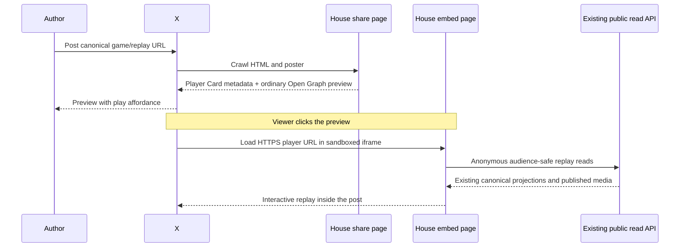

# X Player Cards for interactive House replays

## Recommendation

Build an anonymous, compact House replay player that X can load inside a post. Reuse the existing Influence and Werewolf presentation engines, their canonical coordinates, and their audience-filtered reads. Start with completed games and shared replay moments. Keep the normal game page as the destination when someone follows the link outside X.

This is technically feasible: the supplied Gates post loaded an actual game page inside X during inspection. It uses the established `twitter:card=player` format, not a new game SDK. Platform acceptance, mobile presentation, and our domain's actual unfurl still need a real-post test. Do not describe successful HTML metadata or a local iframe test as proof that X will display our card.

Implementation (completed locally October 22; deployed X rendering remains unverified): [X Player Card replay plan](../plans/2026-10-21-002-feat-x-player-card-replays-plan.md).

Research scope: primary documentation and source, public HTTP reads, direct browser observations from this conversation, and repository inspection. No post was published, game started, provider called, or deployment changed. Dates use America/Denver. The notification work initially present in this worktree was transferred to the main checkout and all 29 changed/untracked files were verified byte-for-byte before starting from `origin/main` on `codex/x-player-card-research`.

## 1. What was actually observed

### Gates example

Source post: [Anthony Eckert, October 21, 2026](https://x.com/EckertAnthony/status/2113123343587025401).

Clicking the card replaced its preview with an X-owned frame. Its DOM attributes were:

```text
src: /i/cards-frame/2113123343587025401
sandbox: allow-popups allow-popups-to-escape-sandbox allow-same-origin allow-scripts
allow: autoplay; fullscreen; web-share
```

The accessibility tree then showed a nested page at:

```text
https://elopros.com/games/gates/play/?embed=1&autoplay=1&auto_play=true
```

The nested page displayed a guest-play button and movement instructions. This establishes that an interactive HTML page loaded inside X on the tested desktop surface. It does not establish successful multiplayer gameplay, all browser permissions, or native iOS/Android behavior. The two autoplay query parameters were observed on the loaded URL; they are not a documented contract to depend on.

Public HTTP inspection with `User-Agent: Twitterbot/1.0` returned:

| Resource | Verified response |
|---|---|
| [Store homepage](https://elopros.com/) | HTTP 200; `summary_large_image`; `X-Frame-Options: DENY`; CSP `frame-ancestors 'none'`. |
| [Gates share page](https://elopros.com/games/gates/) | HTTP 200; `twitter:card=player`; player URL `https://elopros.com/games/gates/play/?embed=1`; width and height both 480; poster `https://elopros.com/art/store/gates-card.png?v=7bbed7c8`; `twitter:site=@ELOPROS1337`. The share page itself denies framing. |
| [Gates player](https://elopros.com/games/gates/play/?embed=1) with observed autoplay parameters | HTTP 200; `Cache-Control: no-cache`; no `X-Frame-Options`; CSP permits `https://x.com https://*.x.com https://twitter.com https://*.twitter.com` as frame ancestors. |

The distinction matters: **the shared webpage does not need to be frameable. The URL in `twitter:player` does.** Gates leaves its ordinary site protected and makes the player a separate surface. No raw-stream metadata was present in the inspected card.

### The House today

A public Twitterbot HTTP read of [thehouse.game](https://thehouse.game/) returned HTTP 200 and a large-image Twitter card, with `Cache-Control: private, no-cache, no-store, max-age=0, must-revalidate`. That particular response contained no CSP, X-Frame-Options, COOP, COEP, or Permissions-Policy header. This is a homepage observation, not a site-wide security audit.

The public [robots.txt](https://thehouse.game/robots.txt) response contained content-signal commentary and no `Disallow` directive. It does not prove that every crawler request will pass the CDN. The deployment documentation identifies staging at `https://influence-staging.tail8a79ed.ts.net`; crawler reachability there was not established. An initial guessed public staging hostname did not resolve and is not an infrastructure finding.

## 2. How Player Cards work



X's [official sample repository](https://github.com/xdevplatform/cards-player-samples) supplies a share page with a poster, a player URL, and dimensions. The player URL is an HTML document, while an optional stream URL is a different concept: a raw media resource. Our interactive player should omit the stream tag rather than point it at an HTML page.

The intended output is one coherent metadata set:

```html
<meta name="twitter:card" content="player">
<meta name="twitter:title" content="An episode at The House">
<meta name="twitter:description" content="Watch the agents make their next move.">
<meta name="twitter:image" content="https://thehouse.game/promo.png">
<meta name="twitter:player" content="https://thehouse.game/embed/games/example">
<meta name="twitter:player:width" content="640">
<meta name="twitter:player:height" content="640">
```

`example` is illustrative, not an existing game. Production metadata must use a validated canonical slug, an eligible game, and an absolute public poster URL. An actual House account can be added as `twitter:site` once verified; do not invent a handle.

There is no need to receive X account identity, integrate OAuth, purchase API read credits, or call an X posting API to serve this HTML mechanism. This does not establish whether X applies domain/account approval or distribution restrictions today. The share URL must work as an ordinary link independently of card rendering.

## 3. Old mechanism, current implementation reports, uncertain platform guarantees

Twitter was already discussing Player Cards in its [November 2012 developer article](https://blog.x.com/developer/en_us/a/2012/twitter-cards-tips-tricks), including slideshows and interactive images. That article also described an application process at that time. It is historical evidence, not an instruction to use that old process in 2026.

[Rosebud's October 10, 2026 engineering account](https://lab.rosebud.ai/engineering/making-rosebud-games-playable-in-x-posts) reports playable games using the same tags, a dedicated embed route, explicit framing headers, compact layout, and client-dependent behavior. Their crawler-specific metadata and runtime architecture are implementation choices, not requirements for The House.

[Taras Shynkarenko's first-hand implementation notes](https://tarasshynkarenko.com/skills/x-player-card) describe issues with cached cards, bot-specific responses, scrolling, login, and Next.js metadata. His documented testing was desktop only. Treat these as useful reproduction leads; verify claims against our versions and infrastructure. We did not install or execute his skill.

The old official [Player Card documentation URL](https://developer.x.com/en/docs/twitter-for-websites/cards/overview/player-card) redirected to the general X API overview. A read of [the current documentation index](https://docs.x.com/llms.txt) found no card/player/Twitterbot entries. This research therefore **does not establish current official approval of arbitrary embedded games, a current allowlisting process, a cache TTL, or a promise of stable native-app support**. Older restrictions discussed elsewhere cannot be assumed either repealed or currently enforced from the evidence available here.

The House use case is viewing a recorded match, with playback controls. That is a better product fit for a media-player surface than account creation or game administration, but it is not proof of platform approval. A real post is an acceptance test, not a guarantee of permanence.

## 4. Browser capabilities and constraints

| Capability | Evidence and implication for The House |
|---|---|
| JavaScript and HTML rendering | Present in the observed X sandbox. Reuse the React player and visual stages. |
| Origin | `allow-same-origin` preserves the framed page's own origin; it does not make it same-origin with X or grant access to X cookies. |
| API requests | Use ordinary HTTPS reads from the player to its own `/api` paths. Framing permission is not CORS permission. No wildcard CORS change is needed for same-origin reads. |
| Forms | The observed sandbox omitted `allow-forms`. Native submission is restricted; keep enrollment and sign-in in a top-level House tab. |
| Popups | Observed tokens allow popups and escaping the sandbox. Use explicit user-clicked anchors with `target="_blank" rel="noopener noreferrer"`; do not hijack the top-level X page. |
| Autoplay | The observed `allow` attribute is permission delegation, not proof that audible autoplay succeeds. Start muted and require a gesture inside the player to enable sound. |
| Fullscreen | Observed delegation does not establish end-to-end browser/native-app support. Test native fullscreen. A CSS full-viewport fallback remains confined to the iframe. |
| Clipboard / Web Share | Feature availability and user activation vary. Keep an ordinary open-on-House anchor available even when programmatic sharing is unavailable. |
| Storage / login | Do not depend on third-party cookies, persistent localStorage, sessionStorage, or an existing House login. An embedded page can have origin storage under some browser policies, so merely hiding sign-in UI is insufficient isolation. |
| Pointer lock, downloads, camera, mic | Not needed for replay. Do not build flows depending on them or request new permissions. |
| Isolation / WebAssembly threads | No House requirement for SharedArrayBuffer was identified. Do not copy COOP/COEP headers from a game engine tutorial. |

Browser semantics are documented by [MDN's iframe reference](https://developer.mozilla.org/en-US/docs/Web/HTML/Reference/Elements/iframe), [Permissions Policy guide](https://developer.mozilla.org/en-US/docs/Web/HTTP/Guides/Permissions_Policy), and [autoplay guide](https://developer.mozilla.org/en-US/docs/Web/Media/Guides/Autoplay). They describe browser rules, not X's guaranteed configuration. In particular, `allow` and `sandbox` solve different problems and restrictions can accumulate across nested frames.

### Framing headers

Proposed player-only ancestor policy:

```http
Content-Security-Policy: frame-ancestors 'self' https://x.com https://*.x.com https://twitter.com https://*.twitter.com
```

Use an HTTP response header, not a meta tag. Every ancestor must satisfy the policy; `frame-src` instead controls what children a document embeds. Multiple CSP headers are enforced together, so appending a permissive policy cannot loosen a restrictive proxy policy. Eliminate conflicting X-Frame-Options on the embed route and check actual responses after redirects. See [MDN frame-ancestors](https://developer.mozilla.org/en-US/docs/Web/HTTP/Reference/Headers/Content-Security-Policy/frame-ancestors).

Retain normal-site protections and Farcaster behavior. Do not apply this allowlist globally. The checked [production Caddyfile](/Users/user/Development/linode-iac/terraform/files/Caddyfile.prod) proxies web/API traffic and redirects legacy/www hosts to `https://thehouse.game`; it does not itself specify framing headers. That does not account for every live CDN/upstream layer. Use the canonical apex directly in metadata.

## 5. Next.js 16.1.7: a verified simpler metadata path

The lockfile pins Next.js 16.1.7. Its [Twitter types](https://github.com/vercel/next.js/blob/v16.1.7/packages/next/src/lib/metadata/types/twitter-types.ts) require `streamUrl`. Its [Twitter renderer](https://github.com/vercel/next.js/blob/v16.1.7/packages/next/src/lib/metadata/generate/opengraph.tsx) calls `.toString()` on that field, and the [Meta helper](https://github.com/vercel/next.js/blob/v16.1.7/packages/next/src/lib/metadata/generate/meta.tsx) omits empty strings.

A direct Bun render using the installed 16.1.7 renderer and ReactDOMServer passed assertions for **one player-card tag and no stream tag** with `streamUrl: ""`. The isolated render produced a React list-key warning from invoking this internal metadata component outside its normal pipeline; it did not fail the markup assertions. This was a renderer probe, not a complete Next build or inherited-metadata test.

Use the public typed metadata interface in application code:

```ts
const twitter = {
  card: "player",
  title,
  description,
  images: [posterUrl],
  players: [{
    playerUrl,
    streamUrl: "", // Next 16.1.7 requires this field; empty values render no tag.
    width: 640,
    height: 640,
  }],
} satisfies NonNullable<Metadata["twitter"]>;
```

Retain real `openGraph` data for other services. Test the complete HTTP response for duplicates, inherited values, and absent stream tags. An undefined stream field could throw; `as any` is not an answer. Pin this behavior with an integration test across Next upgrades. Do not use framework internal renderer imports in production.

Next's [htmlLimitedBots documentation](https://nextjs.org/docs/app/api-reference/config/next-config-js/htmlLimitedBots) includes Twitterbot by default and warns that an override replaces its defaults. Fetch deployed HTML as Twitterbot to verify metadata is available before JavaScript executes. There is no initial need to disable streaming globally, add UA-specific metadata, or discard Open Graph. Metadata inheritance and absolute URL handling still require full-route tests; see [generateMetadata](https://nextjs.org/docs/app/api-reference/functions/generate-metadata).

## 6. Current code and concrete integration work

Paths below describe `0336981e` before the proposed route-group move.

| Owning source | Finding / consequence |
|---|---|
| `packages/web/src/app/layout.tsx`, `app/providers.tsx` | Global metadata, providers, generation contact modal, and footer wrap every page. Providers include Privy, Clerk, wagmi, identity prompts, analytics, and Farcaster bootstrap. A child layout cannot remove its ancestors. |
| `app/games/[slug]/page.tsx` | Resolves House identity, then game-specific metadata. Completed-game posters already exist; currently emits image cards. Preserve spoiler-safe entry semantics. |
| `app/games/[slug]/layout.tsx` | Sets indexing policy from visibility. A new embed path must perform its own checks and set noindex. |
| `app/games/[slug]/house-route.tsx`, `components/games/house-game-entry.tsx` | Explicit game dispatch already exists. Reuse that contract, not endpoint-failure guessing. Existing entry shells also contain controls irrelevant to an embed. |
| `app/games/[slug]/replay/replay-page.tsx` | Influence SSR loads full transcript and replay frames for completed/cancelled games, reached by both replay route forms through `HouseGameRoute`. Optimizing `generateMetadata` alone does not prevent that page-component work. Shared replay routes need a small SSR bootstrap and client-side replay hydration for humans. |
| `app/games/[slug]/game-viewer.tsx` | Couples Influence viewing with auth and live/game controls. Extract or reuse its replay-loading portion; do not fake an auth provider to mount the whole thing. |
| `app/games/[slug]/components/dramatic-replay-viewer.tsx` | Existing Influence presentation and preferences. Reuse it and its canonical cue adapter; do not build a second reducer. |
| `components/games/werewolf/werewolf-viewer.tsx`, `use-werewolf-watch.ts` | Shared director/stage and bounded watch windows exist, but the viewer also reads permissions and owns operator stop controls. Separate these from anonymous replay composition. Completed-game polling already differs from live polling. |
| `components/watch/watch-shell.tsx` | Full-window shell, cast, inspectors, and MCP banner are too large for a card. Share the stage and transport while providing compact composition. |
| `components/watch/use-watch-preferences.ts` | Viewer/production preferences are persistent. Embeds need ephemeral preferences: muted and thinking off regardless of another tab's saved settings. |
| `components/watch/use-player-fullscreen.ts` | Existing native fullscreen and viewport fallback. A viewport fallback cannot escape the X frame. |
| `lib/api.ts` | `apiFetch` reads localStorage and automatically adds an auth token, even for ordinary reads. An embed must use an explicitly anonymous path that never reads that token and sends `credentials: "omit"`. |
| `lib/server-api.ts` | Bounded-time server requests and explicit routing identity are reusable. `resolveServerApiUrl` may resolve relative assets to an internal backend; metadata must instead use a public URL. |
| `packages/engine/src/game-links.ts` | Influence sequences and Werewolf audience-local cursors already have distinct typed helpers. Preserve them in card URLs and open-on-House links. |
| `packages/api/src/routes/game-entries.ts`, `services/game-visibility.ts` | Public and Unlisted allow anonymous direct access; hidden/invalid configurations do not. Entry authorization is not a substitute for independent watch/media authorization. |
| `lib/product-analytics.ts`, `components/watch/use-watch-analytics.ts` | Existing analytics depends on consent/initialization. Do not silently initialize tracking or session recording in the embed to avoid a consent banner. |
| `next.config.ts`, deployment proxy | Same-origin `/api` already exists. Public framing and bot responses must be checked at the final deployment, not inferred from local config. |

Relevant repository learnings: [shared watch clock](../solutions/architecture-patterns/share-watch-clock-with-game-owned-projections.md), [House entry and moments](../solutions/architecture-patterns/house-game-entry-and-replay-moments.md), and [shared replay music](../solutions/architecture-patterns/shared-replay-music-transport.md).

## 7. Product and data contract

### First release

- Completed Influence and Werewolf games, including existing supported replay rules versions. An embed is another presentation surface, not a reason to rewrite historical events.
- Canonical game URL opens the normal site; its card points at an embed replay. Existing moment URLs preserve the requested source coordinate.
- Werewolf default is Mystery. Explicit Omniscient links retain their audience and get a spoiler label. Do not fetch Omniscient data and hide it with CSS for Mystery.
- Public and Unlisted direct links follow existing access policy. Unlisted stays out of discovery and has noindex; a person sharing its link is sharing its accessible content. Hidden/deleted games return a generic unavailable state without identity leakage.
- Existing posters, portraits, projected speech, scenes, and scores; no paid generation, export job, or new media storage system on crawl/open.
- Compact play/pause, step, seek, mute, and open-on-House controls. Thinking is off initially; permitted thinking can reuse existing controls only if readable. Source permissions never depend on a UI toggle.

### Layout and interaction decisions

Use a square 640×640 declared viewport as the initial design target, responsive to actual widths of 320–640 CSS pixels. This is our design choice, not an X maximum. Compare square and 4:3 in the local prototype before finalizing; 16:9 at feed width risks unreadable dialogue. Do not shrink the full desktop dashboard with CSS transforms.

Keep a slim context row, the scene/speech area, and a persistent compact transport. Eliminate cast rails, account prompts, inspector panes, site footer, and promotion banners from the embed composition. The existing typography/pagination logic must measure the actual frame. Keep controls reachable on small frames and native-app overlays; no fixed claim about overlay height is supported by our tests.

Initially prepare the selected moment silently and show a clear play action. X's first click may only load the iframe; a second click is acceptable until the actual client proves one-click muted start reliable. Enable sound only through a gesture within the child document. Preserve background audio behavior in the normal site. If embed-specific visibility suspension is needed, implement it at the embed boundary and verify it does not change ordinary replay semantics. No assumption that a scrolled-away iframe is detectable through `document.hidden` alone.

### Authority and spoilers

An Influence event sequence is not a slider index. A Werewolf cursor is audience-local and can include nonplayable source positions. Preserve the current parsers, pass filtering, ballot subcues, and canonical endings. Reject mixed/invalid audience and coordinate combinations. Never infer a moment from prose or current final roster state.

A whole-game poster must not reveal winners or roles accidentally. Moment cards can inherently reveal the chosen moment, so use neutral episode art initially rather than automatically generating a spoiler-heavy screenshot. Viewer-authorized dialogue/thinking is distinct from private provider requests, reasoning traces, credentials, or producer evidence; the embed must not widen any of those boundaries.

## 8. Delivery, cache, and operating cost

Use existing canonical URLs and one dedicated `/embed/games/...` surface. Route groups can separate the normal site providers from the embed without changing public URLs; [Next route groups](https://nextjs.org/docs/app/api-reference/file-conventions/route-groups) support this. Prefer one neutral root layout plus a `(site)` layout and an embed layout. Multiple independent root layouts and a second Next application add unnecessary coordination here.

Serve the same metadata to bots and humans initially. Ordinary Open Graph tags still support other services; verify those previews rather than assume every client ignores Twitter tags. Keep visibility-sensitive HTML and public read responses no-store initially. Existing immutable, versioned images can retain their established cache policy. Crawler reads must never enqueue provider work or materialize an entire replay just for title/poster eligibility.

X caches card metadata independently of our player page and media. The available evidence does not establish its cache lifetime or a guaranteed refresh tool. Check the actual Twitterbot response first, then use a fresh test URL to distinguish old card state from current HTML. Do not create endless versioned public routes as the production design. Hiding a game can stop fresh player/API reads; it cannot promise to erase a poster already cached by X or downloaded by a viewer.

One viewer still causes House API/media traffic. The embed is not a free video CDN. Start with completed replays, existing request windows and media loading, and no live subscription. Cancel reads on unmount, bound retries, and show actionable errors. Measure the initial Influence payload and memory cost; its full-history path deserves explicit attention before promoting a long match. No speculative database migration, cache tier, CDN rewrite, or payload-size game failure is justified.

## 9. Evidence still required before claiming launch readiness

| Question | Current status | Proof needed |
|---|---|---|
| Can X load an interactive HTML card today? | Yes, observed for Gates on desktop. | Preserve this as reference evidence only. |
| Will X unfurl The House's domain as a Player Card? | Unknown. | Authorized test post with deployed metadata. |
| Do native iOS/Android apps embed it inline or open another surface? | Not tested. | Device tests recording app versions and actual navigation. |
| Will the normal typed Next metadata emit the desired minimal tags? | Direct renderer probe passed for 16.1.7. | Built-route HTML with inherited metadata and Twitterbot user agent. |
| Is arbitrary game interactivity officially supported now? | Not established by current official material located. | Current X guidance or direct platform confirmation; do not invent certainty. |
| Can staging be fetched by Twitterbot? | Not established; documented host is Tailscale-based. | Infrastructure reachability check before choosing a smoke-test destination. |
| Does autoplay/audio/fullscreen work through every nested frame? | Attributes observed, behavior not proven. | Gesture and permission tests on each target client. |
| Can the existing player run without auth/storage? | Source shows coupling that must be removed. | Browser test with denied storage, no credentials, and network assertions. |
| Is compact playback legible and fast for long games? | Not measured. | Realistic completed fixtures, font/image readiness, screenshots and payload timings. |

Research conclusion: proceed with the implementation plan. The main work is an honest anonymous replay boundary, compact presentation, and end-to-end X validation—not the handful of metadata tags.
